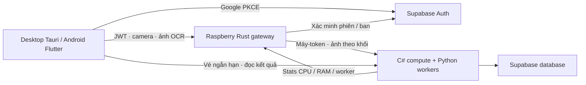

# VietOCR v4 — hướng dẫn setup và triển khai

Cập nhật **09/11/2026, Asia/Saigon**. Nhánh triển khai: **`refactor`**.
Các lệnh Windows chạy từ root repo bằng **PowerShell 7.2+ (`pwsh`)**.

## 1. Máy hiện tại đã có gì?

| Thành phần | Hiện trạng |
|---|---|
| Windows | Tauri 2/Rust 4.0.1, `Desktop/dist/vietocr-desktop.exe` |
| Android | Flutter 4.0.1+19, `Mobile/dist/VietOCR-4.0.1-refactor-arm64.apk` |
| Raspberry | Gateway và webcam đang chạy bằng systemd trên `rasp4gb` |
| Webcam | USB native MJPEG 1920 × 1080 @ 30; client xem/chụp qua Pi |
| Database | Supabase, migrations v2 đã áp dụng; không chạy lại/reset |
| Model | ML_s44 trên compute; client không chứa model |
| TFT/còi | GPIO **tắt** theo yêu cầu vì chưa nối dây |
| Cloudflare | Có binary, bạn còn cần làm DNS/Authorize và triển khai connector |
| Internet | **Chưa kiểm chứng**; chỉ coi sẵn sàng sau checklist mục 10 |

**Bắt đầu từ mục 5 Cloudflare**, rồi mục 6–10. Không cần cài lại Google OAuth,
Python/CUDA, SDK, xoá tài khoản hoặc chạy migration từ đầu.

Đã kiểm EXE tại checkpoint `86525e1` với phiên Google thật và webcam Pi qua SSH: 1920 × 1080,
khoảng 25,3 FPS trong 5 giây, ảnh lật gương lưu đủ kích thước, review 3 giây,
không tự gửi OCR hay tính lượt. Đây không phải số đo qua Cloudflare hoặc
1000 client. Bản EXE/APK mới nhất từ `f21acdc` bổ sung chờ model warmup và quota
phút; CI hai nền tảng đã qua, kiểm retry bằng fixture. Lần chạy lại native debug
cuối bị duyệt tự động chặn, nên số đo camera trên là của checkpoint trước.
APK đã build, kiểm chữ ký v2/alignment 16 KiB và 54 tests;
chưa QA trên điện thoại thật. EXE là portable; APK dùng signing sideload hiện có,
chưa phải signing phân phối Play Store.

Bằng chứng và SHA256: [tiến độ](docs/REFACTOR_PROGRESS.md),
[báo cáo](docs/validation/refactor-checkpoint2.json),
[Android](Mobile/validation-v4.json).

## 2. Luồng mới



- Webcam cắm **Pi**, không mở camera điện thoại/máy tính. Các tài khoản hợp lệ
  dùng chung khung nhìn; file import và bản nháp vẫn riêng từng tài khoản.
- Chụp, review 3 giây/Skip, crop, lật, đen trắng, tối ưu chỉ tạo **bản nháp**.
  Chọn ảnh bằng checkbox rồi nhấn **Gửi**. Không giới hạn danh sách ở 10 ảnh.
- Ảnh luôn qua Pi theo khối tối đa 1 MiB. Compute kiểm hash/ảnh, lưu bền vững
  rồi commit lượt. Pi không giữ hàng nghìn ảnh trong RAM.
- Client chủ động đọc kết quả từ compute bằng vé chỉ cho một job/user/session,
  hết hạn sau 5 phút. Không dùng webhook tới điện thoại sau NAT.
- Trần **500 ảnh được nhận/ngày**, **30 ảnh được nhận/rolling 60 giây/tài khoản**,
  dùng chung các thiết bị; admin có thể hạ. Reset ngày lúc 00:00 Việt Nam.
  Preview/snapshot/upload dở không trừ lượt; retry cùng job không tính thêm.
- Ảnh chưa upload ở client. Job compute đã nhận tiếp tục xử lý khi app đóng.
  Mở lại app để nhận kết quả; retention mặc định 24 giờ, không lưu vĩnh viễn.
- Pi mặc định 8 viewer, 2 viewer/tài khoản, 4 snapshot, 4 upload và 32 lệnh
  compute đang chạy. **1000 OCR client không đồng nghĩa 1000 stream video**.
  Quá tải trả 429/503 và backoff; không tăng thread/buffer không giới hạn.
- Queue công bằng theo tài khoản, sử dụng các worker rảnh luân phiên. Pi có
  thể xin thêm worker; compute được quyền từ chối theo RAM/VRAM thực.

Hợp đồng hiện tại: [OpenAPI v2](Contracts/openapi-v2.json).
API v1 mặc định tắt; không bật fallback gửi OCR đi tắt Pi.

## 3. Công cụ và dữ liệu cần giữ

| Công cụ/dữ liệu | Vị trí trên máy hiện tại |
|---|---|
| Python server | `Server/.venv/Scripts/python.exe` |
| Interpreter riêng | `Server/.python/` |
| PyTorch/CUDA | Trong `Server/.venv`, đã chuyển vị trí, không cài lại |
| Model compute | `Server/models/ML_s44/` |
| Mã/cấu hình nhóm AI | `VietHandOCR_API_Release/` |
| .NET | SDK/runtime 10 có sẵn |
| Flutter | `C:/Services/Flutter/flutter` |
| Android SDK | `C:/Users/QuangNew/AppData/Local/Android/sdk` |
| JDK Android | `.toolchain/java/jdk-21.0.12.1+1` |
| cloudflared Windows | `.toolchain/cloudflared/cloudflared-windows-amd64.exe` |
| cloudflared Pi | `/usr/local/bin/cloudflared` |
| Pi | `admin@rasp4gb`, Raspberry Pi OS 64-bit/aarch64, Wi-Fi |

Máy có PowerShell 7.6.9. Helper mật mã cần `pwsh`, không chạy ép bằng Windows
PowerShell 5.1. cloudflared 2026.10.7 đã tải/kiểm checksum. Không cần tải lại
model/CUDA, C++ SDK hay Android SDK. [Báo cáo cài đặt](docs/INSTALLATION_REPORT.md)
ghi vị trí và dung lượng đã tải.

Dùng `python.exe -m pip`: launcher `pip.exe` cũ có thể còn đường dẫn tuyệt đối
trước khi chuyển môi trường. Không xoá `Server/.venv`, `.python`, model hoặc khoá ký.
Kiểm bản AI mà không nạp GPU hay sửa file:

```powershell
pwsh -File tools/Check-ModelRelease.ps1
```

Helper kiểm SHA256 trọng số, recognizer và preprocessing giữa bản AI/compute.
Không đổi vocab/input size để ép model chạy; đối chiếu bản nhóm AI trước khi
chạy `Server/tools/sync_model.py`.

### Nếu triển khai từ một máy mới

Đây là phần bổ sung, **không chạy lại trên máy hiện tại**. `.venv`, model,
credential và binary build không được commit vào Git.

```powershell
git clone --branch refactor https://github.com/QuangNew/VietOCR_Handwriting.git
Set-Location VietOCR_Handwriting
py -3.11 -m venv Server/.venv
```

Cài .NET10, Node phù hợp `Server/web/package.json`, Supabase CLI và Python3.11
nếu máy chưa có. Đưa bản model ML_s44 của nhóm AI vào
`VietHandOCR_API_Release/model/` đúng `model_config.json`; tên file và SHA256
phải khớp. Không tự đổi tên checkpoint khác thành ML_s44.

Với wheelhouse đã chuẩn bị đúng Windows/Python/CUDA, cài offline:

```powershell
Server/.venv/Scripts/python.exe -m pip install --no-index --find-links C:/offline-wheels -r Server/worker/requirements.txt
Server/.venv/Scripts/python.exe -X utf8 Server/tools/sync_model.py
pwsh -File tools/Check-ModelRelease.ps1
supabase login
supabase link --project-ref rrdxhztiikizgogxtlhu
pwsh -File Server/tools/Setup-Server.ps1
```

`C:/offline-wheels` là ví dụ, thay bằng kho wheel thật. Nếu chưa có, chuẩn bị
dependencies trên mạng không hạn mức; PyTorch/CUDA có thể rất lớn, không tự tải
bằng hotspot 4GB/ngày. Không copy nguyên `.venv` từ máy khác rồi giữ Python home
cũ. Supabase login dùng trình duyệt; mật khẩu/secret nhập tại máy, không qua chat.
Giữ nguyên migrations live đã áp dụng. Tạo pairing theo mục7 trước khi mở public API.

Pi mới cần Raspberry Pi OS **64-bit**, `ustreamer`, `v4l2-ctl` và binary
cloudflared ARM64 đã đối chiếu checksum. Lấy bundle `vietocr-gateway-linux-arm64`
ở workflow `Refactor foundation`, giải nén rồi dùng installer của repo hiện tại
và private pairing. Không cài Rust/.NET/Node/PyTorch lên Pi. Thư mục config
staging phải0700 trước SCP; giữ token live0600. Các service/config mẫu ở
`infra/raspberry/`. Máy Pi hiện tại đã cài các phần này.

## 4. Supabase và Google

Project: `https://rrdxhztiikizgogxtlhu.supabase.co`. Google đã bật.
Giữ hai Redirect URLs trong Authentication → URL Configuration:

- `http://127.0.0.1:47821/auth/callback` cho desktop;
- `vn.pbl4.vietocr://auth/callback` cho Android.

Google OAuth Web Client giữ callback Supabase cung cấp. Hostname Pi/compute
không thay thế callback này. Client Secret chỉ ở Supabase, không trong app.

Migrations đã áp dụng: `202611030001`, `202611090001`–`202611090004`.

```powershell
supabase migration list --linked
```

Không `db reset`, không chạy lại `UPGRADE_V2.sql`, không xoá bảng để sửa lỗi.
Máy/schema mới đọc [runbook database](docs/REFACTOR_DB_ROLLOUT.md).
23 fake-client cũ đã dọn; tài khoản Google thật và admin được giữ.

`Mobile/assets/config/supabase.json` chứa project URL/publishable key công khai;
Tauri nhúng cùng file khi compile. `sb_publishable_…` có thể được trích xuất
từ app theo thiết kế của [Supabase](https://supabase.com/docs/guides/api/api-keys).
Giao diện người dùng không còn trường nhập/xem key. Grants/RLS, JWT/phiên hiện
thời, ban và quota bảo vệ dữ liệu; không dựa vào việc giấu key công khai.

`service_role`/secret key chỉ ở `Server/server.local.json`, quyền riêng trên
Windows, Git-ignore. Pi giữ public key và hai credential máy tách biệt.
Access/refresh token dùng DPAPI/Android Keystore, không vào WebView, URL hay log.

## 5. Cloudflare — bạn làm trên tài khoản tên miền

Làm theo thứ tự: **zone Active → Authorize trên Windows → tạo hai tunnel →
chạy connector Windows/Pi → đổi origin của Pi → kiểm HTTPS**. Các mục 5–7
chuẩn bị đường truyền; mục 10 xác nhận app có thể dùng đường truyền đó.

Hai địa chỉ sau khi hoàn tất:

- **`https://api.quangnew.tech`**: nhập vào app, trỏ tới Raspberry gateway.
- **`https://ocr.quangnew.tech`**: compute nhận ảnh từ Pi và trả kết quả cho app;
  không dùng địa chỉ này trong ô Raspberry.

### 5.1 Thêm zone và đổi nameserver

1. Đăng nhập Cloudflare Dashboard, thêm **`quangnew.tech`**, chọn gói Free.
2. Lưu DNS hiện có tại nhà quản lý: A/AAAA/CNAME, MX, TXT, SPF/DKIM/DMARC và
   bản ghi xác minh dịch vụ. Kiểm từng bản ghi sau import; quét tự động có thể thiếu.
3. Lấy **đúng hai nameserver Cloudflare cấp cho zone này**, không tự đoán tên.
4. Nếu đang bật DNSSEC/DS ở nhà đăng ký cũ, tắt DNSSEC và gỡ DS cũ theo hướng
   dẫn của nhà đăng ký trước khi đổi NS để tránh SERVFAIL.
5. Tại **nhà đăng ký tên miền**, thay nameserver cũ bằng hai NS Cloudflare.
   Chỉ thêm bản ghi NS trong DNSHost không tương đương đổi NS tại registrar.
6. Chờ zone báo **Active**; sau đó bật lại DNSSEC theo thông số Cloudflare nếu cần.

Nguồn: [Cloudflare full setup](https://developers.cloudflare.com/dns/zone-setups/full-setup/setup/).
Không đổi web/MX đang dùng sang IP Pi. Ta chỉ thêm `api`/`ocr`; không cần IP
public cố định hoặc mở port router.

```powershell
Resolve-DnsName quangnew.tech -Type NS
```

Kết quả phải là hai NS Dashboard cấp, không còn `ns*.dns.host` sau khi DNS
cập nhật. Kiểm Dashboard nếu resolver còn cache; không tạo lại zone để thử.

### 5.2 Authorize tunnel từ Windows

Từ root repo:

```powershell
& ./.toolchain/cloudflared/cloudflared-windows-amd64.exe tunnel login
```

Trong browser chọn `quangnew.tech` → **Authorize**. Thành công tạo
`%USERPROFILE%/.cloudflared/cert.pem`. Nếu CLI hết thời gian trước khi bạn
bấm xong, chạy lại. Nếu browser tải certificate, đặt đúng nơi CLI yêu cầu;
không gửi nội dung file vào chat/repo.

```powershell
Test-Path "$env:USERPROFILE/.cloudflared/cert.pem"
```

`cert.pem` có quyền quản lý tunnel tài khoản: **không chép lên Pi**.
Nguồn: [tạo tunnel bằng CLI](https://developers.cloudflare.com/tunnel/features/locally-managed-tunnels/create-local-tunnel/).

### 5.3 Tạo hai named tunnel và DNS

```powershell
pwsh -File tools/Prepare-InternetTunnels.ps1
```

Helper tạo/tái sử dụng:

| Tunnel | Hostname | Connector | Origin |
|---|---|---|---|
| `vietocr-pi` | `api.quangnew.tech` | Pi | `http://127.0.0.1:5082` |
| `vietocr-compute` | `ocr.quangnew.tech` | Windows | `http://127.0.0.1:5080`, có path filter |

Nó tạo CNAME tới `<UUID>.cfargotunnel.com`, không overwrite DNS. Nếu `api`/`ocr`
đã có record xung đột, kiểm và sửa đúng record ở Dashboard; không xoá cả zone.
Tunnel tồn tại nhưng mất UUID credential thì khôi phục credential, không tạo
liên tục tunnel trùng tên.

File private sinh trong `.toolchain/refactor/tunnels/`: `pi.yml`, `compute.yml`
và UUID credential dành Pi. Không commit thư mục này. Compute giữ credential
riêng trong `.cloudflared/`. UUID credential của một tunnel khác `cert.pem`
quản lý tài khoản; chỉ chép credential Pi lên Pi.

```powershell
Resolve-DnsName api.quangnew.tech
Resolve-DnsName ocr.quangnew.tech
```

Record proxied có thể trả IP Cloudflare thay vì CNAME công khai. DNS có record
chưa chứng minh connector/backend đang chạy.

Nếu cần đối chiếu bước đổi NS tại nhà đăng ký, xem riêng
[Cloudflare nameservers](https://developers.cloudflare.com/dns/nameservers/update-nameservers/).

### 5.4 Giữ đúng ingress/cache/auth

Mẫu ở `infra/tunnel/`. Pi hostname chỉ đưa vào gateway 5082. Compute chỉ cho:

- `/api/internal/v2/*`: bắt buộc credential máy Pi;
- `/api/v2/results/*`: bắt buộc vé đọc theo job;
- mọi path khác **404**, kể cả admin/API v1/model/runtime.

Giữ catch-all 404. Không publish cổng 3000, raw µStreamer 8080, database,
SSH/RDP hoặc `server.local.json`. Admin dùng loopback/Tailscale riêng.
Không tạo hostname trỏ toàn bộ compute 5080 và bỏ path filter.

Không bật “Cache Everything” cho `api`/`ocr`; có Cache Rule rộng thì thêm bypass
hai hostname. API đã trả `Cache-Control: no-store`. Không đặt Access login hay
browser challenge HTML trước API của app: client dùng Supabase Google. Nếu WAF
chặn, tra event của đúng rule/API; không tắt bảo vệ cả zone để thử.

Client→Cloudflare và connector→Cloudflare dùng TLS. HTTP trong mẫu chỉ là
loopback trên từng host; không dùng `noTLSVerify` hay public HTTP thay HTTPS.
Tham khảo [ingress configuration](https://developers.cloudflare.com/tunnel/features/locally-managed-tunnels/configuration-file/).

## 6. Connector compute trên Windows

```powershell
pwsh -File tools/Start-ComputeTunnel.ps1
Get-Content .toolchain/refactor/tunnels/compute.err.log -Tail 40
```

Helper chạy nền, lưu PID/log private; không có token trên command line.
Cần thấy kết nối tunnel được đăng ký. Backend cũng phải chạy để API phục vụ.
Dừng đúng connector project:

```powershell
pwsh -File tools/Start-ComputeTunnel.ps1 -Stop
```

Đây chưa là Windows service tự chạy sau boot/logoff. Sau khởi động lại, mở
server và helper. Cloudflared tự thử lại mạng khi process còn chạy; không đánh
thức máy đã ngủ/tắt.

## 7. Connector Pi và đổi compute origin sang HTTPS

### 7.1 Chép credential Pi

Xác định UUID từ `.toolchain/refactor/tunnels/pi.yml`. Thay `PI_UUID` trong lệnh
bằng UUID đó; đây không phải secret hay tên tunnel.

```powershell
ssh admin@rasp4gb "install -d -m 700 /home/admin/vietocr-tunnel-upload"
scp .toolchain/refactor/tunnels/pi.yml admin@rasp4gb:/home/admin/vietocr-tunnel-upload/
scp .toolchain/refactor/tunnels/PI_UUID.json admin@rasp4gb:/home/admin/vietocr-tunnel-upload/
scp infra/raspberry/install-tunnel.sh infra/raspberry/vietocr-tunnel.service admin@rasp4gb:/home/admin/vietocr-tunnel-upload/
ssh admin@rasp4gb
```

Trên **Pi**:

```sh
sh -n /home/admin/vietocr-tunnel-upload/install-tunnel.sh
sudo sh /home/admin/vietocr-tunnel-upload/install-tunnel.sh /home/admin/vietocr-tunnel-upload PI_UUID
systemctl status vietocr-tunnel.service --no-pager
journalctl -u vietocr-tunnel.service -n 30 --no-pager
```

Installer dùng service user `cloudflared`, credential 0600, config 0640; xoá bản
credential staging khi thành công. Service active chưa đủ, phải qua mục 10.
Shell scripts cần LF, không CRLF; repo đã có `.gitattributes` cho định dạng này.

### 7.2 Tái sử dụng pairing hiện có

Máy hiện tại đã có hai credential máy. **Không dùng `-Rotate`** chỉ để đổi
hostname. Giữ hash compute khớp token Pi. Trên **Windows**, sau khi connector
và hostname hoạt động:

```powershell
pwsh -File tools/Prepare-V2Pairing.ps1 -ComputeOrigin https://ocr.quangnew.tech -ResultsOrigin https://ocr.quangnew.tech
pwsh -File tools/Merge-V2Pairing.ps1
```

Lệnh thứ hai chỉ kiểm patch. Đóng đúng server, áp dụng rồi mở lại:

```powershell
pwsh -File tools/Merge-V2Pairing.ps1 -Apply
```

Helper chỉ merge pairing/AllowedHosts, giữ Supabase/Python và settings khác.
Không thay nguyên `server.local.json` bằng `compute.patch.json`.
`LegacyClientApiEnabled=false`, results origin là `https://ocr.quangnew.tech`.
Các runtime settings DB như worker/retention vẫn quản lý bằng dashboard.

Trên **Pi hiện có**, chỉ đổi origin, không chép lại token:

```sh
sudo cp -p /etc/vietocr/gateway.json /etc/vietocr/gateway.before-public.json
sudo python3 - <<'PY'
import json, os
from pathlib import Path
p = Path('/etc/vietocr/gateway.json')
c = json.loads(p.read_text())
c['compute']['origin'] = 'https://ocr.quangnew.tech'
c['compute']['publicResultsOrigin'] = 'https://ocr.quangnew.tech'
c['telemetry']['url'] = 'https://ocr.quangnew.tech/api/internal/v2/status'
temp = p.with_suffix('.json.next')
fd = os.open(temp, os.O_WRONLY | os.O_CREAT | os.O_TRUNC, 0o640)
with os.fdopen(fd, 'w') as f:
    json.dump(c, f, indent=2)
    f.flush()
    os.fsync(f.fileno())
st = p.stat()
os.chown(temp, st.st_uid, st.st_gid)
os.chmod(temp, 0o640)
os.replace(temp, p)
PY
sudo -u vietocr /opt/vietocr/vietocr-gateway /etc/vietocr/gateway.json --check-config
sudo systemctl restart vietocr-gateway.service
```

`panel.enabled` vẫn false. Origin thử `127.0.0.1:15080` phải được thay ở cả
compute và telemetry; SSH forward kiểm thử 15080/15082 đã dừng, không phải
dịch vụ production.

Chỉ khi cài **Pi mới/rotate chủ đích** mới chuyển đầy đủ pairing: tạo staging
0700 trước SCP, chép `gateway.json` và đúng hai `.token`, dùng
`infra/raspberry/install.sh` với bundle ARM64. Installer đặt token 0600 rồi xoá
hai bản staging. Rotate một phía gây 401; dừng, đồng bộ hai phía, mở lại.

## 8. Compute và admin

```powershell
Server/Run-Server.cmd
```

Launcher build backend/web production, admin ở `http://127.0.0.1:3000`, compute
loopback 5080. Đóng phiên server cũ bằng terminal của nó trước khi mở phiên
mới; không chạy hai coordinator trên cùng DB lease.
Admin cũ được giữ; tạo admin khác bằng `Server/tools/New-Admin.ps1`, nhập mật
khẩu tại máy. Không ghi credential admin vào tài liệu/repo.

WorkerSpace chọn **auto: GPU rời → iGPU được hỗ trợ → CPU**, hoặc chọn rõ CPU/
adapter. Giữ tối thiểu 1 GiB RAM/VRAM dự phòng. `(6 GiB−1 GiB)/300 MiB≈17`
chỉ là dự toán: còn CUDA context, activation, RAM và preprocessing. Trước đây
đo khoảng 1,1 GiB RAM/process. Máy chơi game/thiếu RAM có thể không nạp thêm
worker; không bỏ guard để ép nạp.

Backend phục hồi receipt và queued job định kỳ, kể cả commit mất phản hồi/client
đã đóng. Duplicate polling không tự chạy lại job đang bận. Host chết giữa
inference có thể retry; không cam kết exactly-once inference. Quota commit
idempotent. Model không chạy trên Pi.

Next.js giữ Agentation trong dev (`Server/Run-Server.cmd -Dev`), không nhúng
vào production. Không publish admin qua hostname kết quả.

## 9. Webcam và client

### Webcam Pi

```sh
systemctl is-active vietocr-camera@desk.service vietocr-gateway.service
curl -f http://127.0.0.1:5082/health/live
v4l2-ctl --list-devices
v4l2-ctl -d /dev/video0 --list-formats-ext
```

Service dùng `/etc/vietocr/camera-desk.env`, MJPEG/HW encoder, 1920×1080@30,
3 buffers, 1 worker, `--slowdown` khi không có viewer. Không mở µStreamer tay
cùng lúc service đang giữ webcam. Không publish raw 8080.

Lưu ý hạn mức hotspot 4GB/ngày: stream qua Cloudflare dùng Internet ở cả đường
Pi gửi lên và client xem. Ví dụ frame250KiB ×30FPS khoảng7,3MiB/giây, hơn25GiB/
giờ cho một viewer; đây là phép tính ví dụ, không phải bitrate cố định của webcam.
Đóng camera khi không dùng, hoặc giảm FPS trong camera env khi cần tiết kiệm.
Không mở stream lâu để đo tải qua hotspot có hạn mức.

Thêm webcam: dùng `/dev/v4l/by-id/...` ổn định nếu có; tạo `camera-<id>.env`
với device/port loopback riêng, enable `vietocr-camera@<id>.service`, thêm
camera id/upstream vào `gateway.json`, restart gateway. Client đổi camera Pi
công bố bằng dropdown. Chọn mode MJPG/V4L2 được hỗ trợ; mode cao hơn có thể giảm FPS.

### Desktop

```powershell
Desktop/Run-Desktop.cmd
```

Chọn Raspberry URL **`https://api.quangnew.tech`**, đăng nhập Google trong
system browser. Không nhập Supabase URL hay `ocr.quangnew.tech` vào ô Raspberry.
Tài khoản đã xác minh có thể sửa bản nháp offline; gửi/camera cần mạng.
Trên máy này URL test 15082 đã được trả về URL production.

EXE không cần Python/Node/model/BLE. Cần WebView2, máy này đã có.
Build source cần Rust MSVC 1.94+, C++ Build Tools/Windows SDK. Có thể lấy EXE
từ GitHub Actions `Refactor foundation` thay vì tải toolchain lớn.
Frontend desktop là HTML/CSS/JS tĩnh do Rust phục vụ, không chạy Next.js/Node.
Artifact CI hiện giữ 3 ngày. Nếu đã hết hạn, vào Actions → Refactor foundation →
Run workflow trên nhánh `refactor` để tạo bản mới; giữ bản đã tải trong `dist`.

### Android

Cài APK bằng trình quản lý file hoặc ADB đã có:

```powershell
adb devices
adb install -r Mobile/dist/VietOCR-4.0.1-refactor-arm64.apk
```

Bật USB debugging/chấp nhận thiết bị nếu dùng ADB. Chọn Google & Raspberry,
nhập gateway HTTPS, đăng nhập Google. Import dùng Photo Picker, không cần quyền
Bluetooth/camera/microphone local. Đổi tài khoản khoá cache cũ, đóng camera/
editor và chặn cả token refresh đang dở chuyển tác vụ sang tài khoản mới.

### Ảnh

Mặc định giữ nguyên JPEG/PNG và kích thước; file nhỏ không chứng minh bị giảm
độ phân giải. Crop/BW/lật tạo bản mới, bỏ chọn bản nguồn để tránh gửi trùng;
vẫn tải được bản gốc. Tối ưu OCR tuỳ chọn so PNG/JPEG95, chỉ dùng khi nhỏ hơn,
không resize. JPEG95 có thể đổi chi tiết nhỏ, không tự bật lossy cho mọi ảnh.
Profile màu đặc biệt được giữ bằng cách bỏ qua nén lại ảnh đó.

## 10. Kiểm trước khi dùng qua Internet

Sau DNS/connector/compute/origin đúng, từ máy ngoài mạng Pi chạy:

```powershell
pwsh -File tools/Check-PublicDeployment.ps1
```

| Kiểm không có credential | HTTP |
|---|---:|
| Pi `/health/live`, JSON service `raspberry-gateway` |200|
| Pi `/api/v2/cameras` |401|
| Compute `/api/internal/v2/status` |401|
| Compute `/api/v2/results/<uuid>` |401|
| Compute `/api/admin/auth/csrf`, `/api/v1/jobs` |404|

Đây là kiểm TLS/routing/deny, không thay kiểm OAuth/model thật. Dùng 4G hoặc
mạng khác để thử tiếp:

- Google login → Pi xác minh → xem/chụp webcam;
- import ảnh mẫu, chưa Gửi phải chưa có job/lượt;
- Gửi 1 ảnh → đọc kết quả trực tiếp compute, chỉ tính 1 lượt;
- mất mạng sau khi nhận đủ → mở lại nhận job cũ, không tự gửi nháp mới;
- đổi Google → không thấy nháp/text tài khoản trước;
- thử quota/ban có chủ đích qua admin, không reset counter để tạo số đo đẹp.

Không load-test 1000 Google thật/tiêu quota project hiện tại. Fixture Pi đã đo
30 đợt ×1000 danh tính local; chưa đo 1000 upload thật/Supabase/Internet.
Muốn cam kết tải thực phải dùng staging, đo uplink/RSS/FD/slow client, server
offline, spool full và p95 trong một đợt soak có giới hạn.

Kiểm giá trị credential hiện dùng, không in chúng:

```powershell
Server/.venv/Scripts/python.exe -X utf8 tools/check_client_secrets.py Desktop/dist/vietocr-desktop.exe Mobile/dist/VietOCR-4.0.1-refactor-arm64.apk
Server/.venv/Scripts/python.exe -X utf8 tools/check_public_access.py
```

Đây là kiểm phạm vi hẹp, không phải pentest/toàn bộ lịch sử Git. Không chia sẻ
raw config hay ảnh màn hình có session/tunnel credential.

## 11. TFT/còi — sau khi nối dây

**Giữ GPIO tắt hiện tại.** Khi nối/xác minh phần cứng, dùng BCM Pi:

| TFT ILI9341 | BCM | Chân header vật lý |
|---|---:|---:|
| CS/CE0 |8|24|
| MOSI |10|19|
| SCK |11|23|
| MISO, tuỳ chọn |9|21|
| DC |25|22|
| RESET |24|18|

Nguồn VCC/LED theo module 3,3V và GND chung. TMB12A05 active 5V cần transistor/
driver phù hợp từ BCM18/chân12; không nối 5V vào GPIO. Mặc định low, không
beep lúc boot/chụp/login. Chưa enable SPI hoặc `panel.enabled=true` trước khi
bạn xác nhận dây.

TFT chỉ hiển thị stats compute: CPU, RAM, busy/idle worker, queue/online/stale.
CPU **hoặc** RAM **hoặc** busy-worker≥85% liên tục 5 giây mới kêu 180ms;
cooldown 60 giây, rearm khi các chỉ số hợp lệ đều<80%. Offline/stale/không có
worker không tự báo động. Logic/renderer đã test, GPIO thật chưa test.

## 12. Build và kiểm mã

```powershell
cargo test --workspace --locked
cargo clippy --workspace --all-targets --locked -- -D warnings
dotnet test Server/backend/VietOcr.Server.Tests
node --test Desktop/tests/*.test.mjs
```

Desktop: `cd Desktop/src-tauri; cargo build --release --locked` bằng MSVC.
Máy này dùng CI, không tải C++ SDK mới.

Android từ root, dùng JDK21 thay Oracle JDK25 mặc định:

```powershell
$env:JAVA_HOME=(Resolve-Path .toolchain/java/jdk-21.0.12.1+1).Path
$env:PATH=$env:JAVA_HOME+'\bin;'+$env:PATH
$env:GRADLE_OPTS='-Dorg.gradle.jvmargs=-Xmx1024m -Dorg.gradle.workers.max=1'
Set-Location Mobile
flutter pub get --offline
flutter analyze --no-pub
flutter test --no-pub --concurrency=1
flutter build apk --release --target-platform android-arm64 --no-pub
```

`--offline` cần dependency đã cache như máy này. Không tải cả SDK/model khi chỉ
sai JDK path. Build lần lượt lúc máy ít ứng dụng. APK đầu ra ở
`Mobile/build/app/outputs/flutter-apk/app-release.apk`.
SQL tests ở `Contracts/tests`; native race suite chỉ nhận PostgreSQL loopback
database tên `*_test`, không dùng production. Mock UI không thay QA thiết bị thật.

## 13. Tra lỗi và rollback

| Triệu chứng | Kiểm tra |
|---|---|
| NXDOMAIN/NS cũ | Registrar NS, zone Active, cache và hai DNS record |
| Cloudflare1033 | Connector, UUID/config/credential đúng |
| Cloudflare502 | Origin loopback5082/5080 và backend/service |
| HTML thay JSON | Access/challenge/cache rule trước API |
| Máy-token401 | Hash compute và đúng token Pi; không rotate một phía |
| Login không quay lại app | Supabase Redirect URLs, Android deep link, desktop loopback |
| Không có hình | Webcam/service/device/mode MJPG, viewer limit và uplink |
| Không nạp worker | RAM/VRAM guard, model hash, Python path, CUDA/device, log |
|429/503|Giữ ảnh/backoff, kiểm limit/queue/ready; không spam Gửi|
|507 spool capacity|Đĩa compute, upload dở/retention; không xoá ảnh job đang chạy|
|410 result expired|Hết retention; ảnh local vẫn giữ, gửi bản mới nếu cần|

```sh
journalctl -u vietocr-gateway.service -n 50 --no-pager
journalctl -u vietocr-camera@desk.service -n 30 --no-pager
vcgencmd measure_temp
free -m
```

Server logs: `Server/runtime/logs/`; client: tab Log/appdata riêng. Log không
được chứa credential, ảnh hay văn bản nhận diện.

Rollback connector: dừng đúng `vietocr-tunnel.service` hoặc helper compute
`-Stop`. Không xoá DNS zone để rollback nameserver; dùng bản DNS/NS đã lưu,
hướng dẫn registrar, kiểm cả MX/TXT. Nếu chỉ Pi origin sai, khôi phục
`/etc/vietocr/gateway.before-public.json`, check-config rồi restart gateway.
Giữ token/hash đồng bộ, API v1 tắt. Không rollback DB bằng drop/reset.

## 14. Dọn dẹp và phần còn chờ

Đã gỡ firmware/cache ESP32, 80 file client Tk/BLE/OV cũ; chuyển Python/CUDA
ra `Server/`, dọn 14 mapping Android cũ (~170 MiB), fake-client và staging-token.
Mã cũ có thể lấy từ Git history; không force-push/xoá lịch sử.
Giữ model/env, ảnh/cache riêng, credential, signing và EXE/APK mới.
`.toolchain/refactor` chứa bằng chứng riêng, không publish cả thư mục.
Chỉ dọn generated cache khi không còn build/test/IDE compile dùng file.

Fixture kiểm quyền `.toolchain/refactor/pairing-smoke/` còn bốn file thử nhỏ,
chỉ tài khoản Windows hiện tại đọc được và không được dùng bởi Pi/server.
Cơ chế duyệt tự động chặn thao tác xoá, nên chúng được giữ nguyên, không
commit. `Mobile/build/` được tạo lại khi build APK cuối; chưa dọn lần hai.

Còn cần bạn thực hiện:

1. Cloudflare Active/Authorize, hai connector và HTTPS origin theo mục5–7.
2. Checklist mục10 qua hai mạng thật, QA APK trên điện thoại.
3. Nếu cần cam kết tải 1000 ảnh thật, đo staging/slow-client/soak trước khi nâng
   công suất; giữ guard tài nguyên và giới hạn stream hữu hạn.
4. Khi nối TFT/còi, xác minh dây/nguồn rồi mới bật GPIO/test cảnh báo.

Sau setup, kiểm lại hostname production, quyền file, EXE/APK/log không có khoá
máy và UI chỉ hiện cấu hình người dùng cần. Không che secret bằng `***` rồi vẫn
nhúng secret đó vào ứng dụng.
