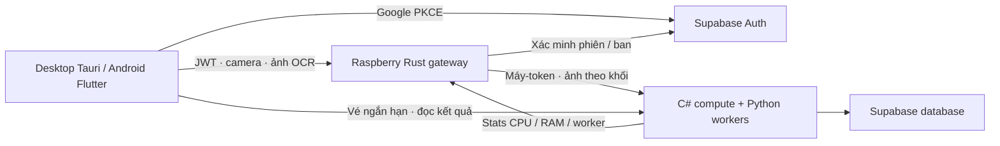

# VietOCR v4 — hướng dẫn cấu hình và vận hành cho người mới

Cập nhật **10/11/2026, Asia/Saigon**. Nhánh triển khai: **`refactor`**.
Tài liệu dùng cấu hình của **máy Windows và Raspberry hiện tại của bạn**.
Mỗi bước ghi rõ: làm ở đâu, làm để làm gì, kết quả cần thấy và cách xử lý lỗi.
Bạn có thể mở bản xem trước Markdown trong VS Code bằng **Ctrl + Shift + V**
để bấm mục lục và đọc bảng dễ hơn.

**Lộ trình lần đầu:** đọc mục 0–2 → kiểm mục 3 → đối chiếu mục 4 → làm lần
lượt mục **5 → 6 → 7 → 8 → 9 → 10**. Như vậy bạn đi từ tên miền, bật dịch vụ,
ghép Pi–server, kiểm model, mở app rồi kiểm toàn bộ qua Internet.
Phần “máy mới” trong mục 3 và phần build ở mục 12 chưa cần làm để dùng bản
app/cấu hình đã có. Sau khi xong lần đầu, mỗi ngày chỉ cần mục **8.4**.

| Bạn cần làm gì? | Mở phần nào? |
|---|---|
| Hiểu các dịch vụ và terminal | [Mục 0](#cach-doc), [mục 2](#so-do) |
| Biết phần nào đã làm, phần nào chưa | [Mục 1](#hien-trang) |
| Cấu hình tên miền, tunnel lần đầu | [Mục 5](#cloudflare), [mục 6](#tunnel-windows), [mục 7](#tunnel-pi) |
| Mở server, mở web admin và đăng nhập quản trị | [Mục 8.1](#admin-server) |
| Kiểm model và thêm worker | [Mục 8.2–8.3](#server) |
| Mở desktop/Android và gửi ảnh thử | [Mục 9](#client) |
| Kiểm hệ thống chạy đúng | [Mục 10](#kiem-thu) |
| Đã tắt laptop/rút nguồn Pi: cần mở lại gì? | [Mục 8.4–8.6](#van-hanh-moi-ngay) |
| Pi tự chạy sau boot / Wi-Fi có lại | [Mục 8.7](#pi-tu-khoi-dong) |
| Dừng gửi, thu gọn và mở lại bảng tiến trình | [Mục 9.6](#bang-tien-trinh) |
| Có lỗi và chưa biết đọc log ở đâu | [Mục 13](#tra-loi) |
| Cài lại từ máy trắng hoặc build source | [Mục 3](#cong-cu), [mục 12](#build) |
| Đánh dấu các bước đã làm | [Checklist mục 14.1](#hoan-tat) |

<a id="cach-doc"></a>

## 0. Đọc trước khi chạy lệnh

### 0.1 Bạn đang điều khiển hai máy khác nhau

**Windows** là laptop/máy tính có RTX 4050: giữ repo, chạy model, web quản trị
và app desktop. **Pi** là `rasp4gb`: cắm webcam, xác minh người dùng và chuyển
ảnh sang Windows. Điện thoại là client cài APK, không cần cài công cụ lập trình.

Chuẩn bị ba tab trong Windows Terminal, có thể đổi tên tab để đỡ nhầm:

| Tab | Dùng để làm gì? | Có thể đóng không? |
|---|---|---|
| **A — Windows / Cấu hình** | Chạy script, kiểm DNS, chép file sang Pi | Có, sau khi lệnh xong |
| **B — Windows / Server** | Chạy `services/compute/Run-Server.cmd` | Giữ mở trong lúc dùng server |
| **C — SSH / Pi** | Điều khiển Pi bằng lệnh Linux | Đóng được; service Pi vẫn chạy |

Các khối **powershell** chạy trên Windows. Các khối **sh** chạy trong SSH của
Pi. Khối **text** chỉ là kết quả minh hoạ, không phải lệnh để chạy.
Không dán tất cả khối trong file này cùng lúc: làm từng bước, xem kết quả rồi
mới sang bước tiếp theo. Lệnh trong phần sửa lỗi chỉ chạy khi gặp đúng lỗi đó.

### 0.2 Mở đúng thư mục trên Windows

**Chạy tại tab A trên Windows:**

```powershell
pwsh
```

Lệnh trên mở PowerShell 7 trong tab hiện tại. Sau đó chạy:

```powershell
$PSVersionTable.PSVersion
Set-Location 'C:\DevLanguage\Works\PBL\PBL4\VietOCR_Handwriting'
Get-Location
```

**Đạt khi:** phiên bản PowerShell là 7.2 trở lên; đường dẫn kết thúc bằng
`VietOCR_Handwriting`. Thư mục này là **root repo**. Mọi lệnh Windows bên dưới
đều bắt đầu ở đây, trừ khi bước đó yêu cầu đổi thư mục.

Nếu `pwsh` báo không tìm thấy, mở terminal tên **PowerShell 7**. Máy hiện tại
đã có PowerShell 7.6.9. Không cần mở toàn bộ terminal bằng quyền Administrator.

### 0.3 Vào và thoát Pi bằng SSH

**Chạy tại tab C, ban đầu vẫn là terminal Windows:**

```powershell
ssh admin@rasp4gb
```

Nhập mật khẩu SSH đã đặt cho Pi. Khi gõ mật khẩu, terminal **không hiện ký tự
hay dấu sao**; đó là bình thường, gõ xong nhấn Enter.
Lần đầu có thể hỏi xác nhận host key: đối chiếu đúng Pi trước khi chấp nhận.
Không tắt kiểm tra host key để vượt lỗi.

**Đạt khi:** đầu dòng giống `admin@rasp4gb:~ $`. Từ đây bạn đang chạy lệnh
trên Pi. Muốn quay lại Windows, chạy trong Pi:

```sh
exit
```

Nếu SSH không tìm thấy `rasp4gb`, kiểm Pi đã bật và có mạng. Dùng IP hiện tại
của Pi trong router/Tailscale thay cho hostname khi cần; không dùng IP minh
hoạ cũ như thể IP đó luôn đúng. Nếu có `Connection refused`, kiểm SSH được bật
trên Pi. Nếu `Permission denied`, kiểm username/mật khẩu, không reset project.

### 0.4 Ba thao tác terminal dễ nhầm

| Thao tác | Tác dụng |
|---|---|
| `q` khi đang xem `systemctl status` hoặc `journalctl` có trang cuộn | Thoát màn hình xem log, service vẫn chạy |
| `Ctrl + C` trong tab Server | Dừng launcher server; backend/worker của launcher cũng dừng |
| `exit` trong SSH | Đóng phiên SSH; gateway/camera/tunnel chạy bằng systemd vẫn hoạt động |

Khi dừng launcher `.cmd`, Windows có thể hỏi `Terminate batch job (Y/N)?`.
Nếu bạn đang chủ động tắt server, chọn `Y`. Đừng đóng tab Server chỉ để mở
tab khác chạy lệnh kiểm tra; dùng tab A.

Ví dụ `127.0.0.1` hoặc `localhost` nghĩa là **chính máy đang thực hiện kết nối**.
`127.0.0.1:5080` trên Windows là compute Windows; cùng địa chỉ đó trên Pi lại
chỉ về Pi. Điện thoại không dùng `localhost` để kết nối laptop hoặc Pi.

### 0.5 Giá trị tự lấy và đường dẫn ví dụ

`$piUuid` ở Windows và `$pi_uuid` ở Pi là các biến giữ **mã định danh tunnel**.
Mục 7.1 có lệnh tự lấy mã từ file cấu hình; bạn chạy lệnh đó thay vì tự nghĩ
UUID hoặc gõ nguyên chữ `PI_UUID`. Các đường dẫn ghi là ví dụ, như
`C:/offline-wheels`, phải thay bằng nơi thật của bạn nếu làm phần máy mới.
File hướng dẫn không chứa mật khẩu/token thật; không tự điền secret vào
các file được Git theo dõi.

<a id="hien-trang"></a>

## 1. Máy hiện tại đã có gì?

| Thành phần | Hiện trạng |
|---|---|
| Windows | Tauri 2/Rust 4.0.2, `apps/desktop/dist/vietocr-desktop.exe` |
| Android | Flutter 4.1.0+21, `apps/android/dist/VietOCR-4.1.0-refactor-arm64.apk` |
| Raspberry | Gateway và webcam đang chạy bằng systemd trên `rasp4gb` |
| Webcam | USB native MJPEG 1920 × 1080 @ 30; client xem/chụp qua Pi |
| Database | Supabase, migrations v2 đã áp dụng; không chạy lại/reset |
| Model | ML_s44 trên compute; client không chứa model |
| TFT/còi | GPIO **tắt** theo yêu cầu vì chưa nối dây |
| Cloudflare | DNS/Authorize đã có; hai connector Pi/Windows đã được kiểm chạy |
| Internet | Kiểm HTTPS/routing và chặn truy cập không có quyền đã qua; Google→OCR qua Internet còn chờ |

Đây là ghi nhận của lần triển khai trước, không phải màn hình trạng thái trực
tiếp. Mục 3 và 8 giúp bạn tự kiểm lại các thành phần đang bật hôm nay.
**Kiểm lại ngày 10/11/2026:** Pi đã dùng compute/results
`https://ocr.quangnew.tech`, GPIO vẫn tắt. Không còn phải mở SSH forward
15080/15082 để vận hành. Nếu dùng máy/Pi mới thì làm mục 7.2; máy hiện tại
không cần làm lại DNS/Authorize/pairing mỗi ngày. Sau khi tắt laptop phải mở
lại cả server và connector Windows theo 8.4, rồi thử Google→OCR theo 10.2.

Không cần cài lại Google OAuth, Python/CUDA hoặc SDK trên máy hiện tại.
Không xoá tài khoản, tạo lại project Supabase hay chạy migration từ đầu.

<a id="so-do"></a>

## 2. Luồng mới

### 2.1 Mỗi dịch vụ làm một việc

| Thành phần | Chạy ở đâu? | Nhiệm vụ, nói đơn giản |
|---|---|---|
| App desktop / Android | Thiết bị người dùng | Đăng nhập Google, xem camera Pi, giữ ảnh nháp và gửi ảnh khi bạn bấm Gửi |
| **Gateway** viết bằng Rust | Raspberry | Người gác cổng: kiểm phiên Google, ban/hạn mức, chuyển ảnh cho compute |
| **µStreamer** | Raspberry | Đọc JPEG từ webcam USB; gateway chia sẻ luồng hình này cho app |
| **Compute/API** viết bằng C# | Windows | Nhận ảnh từ Pi, quản lý hàng đợi, giao cho worker và trả kết quả |
| **Worker Python** | Windows | Tiến trình nạp model AI để đọc chữ; một worker xử lý một ảnh tại một thời điểm |
| **Web admin** viết bằng Next.js | Windows, trình duyệt | Cho bạn xem tải, job, tài khoản, hạn mức và thêm/dừng worker |
| **Supabase** | Dịch vụ cloud | Giữ tài khoản Google, database, quyền và số lượt đã dùng |
| **Cloudflare Tunnel** | Một connector trên Pi, một trên Windows | Đưa hai API ra tên miền HTTPS khi Pi/server ở khác mạng |

Bạn có **hai kiểu đăng nhập khác nhau**: Google trong app là tài khoản OCR;
username/password ở web `127.0.0.1:3000` là tài khoản **admin server**.
Tài khoản đăng nhập Cloudflare chỉ dùng quản lý tên miền/tunnel.

Một vài từ bạn sẽ gặp: **API** là kênh app gửi/nhận dữ liệu; **request** là
một yêu cầu; **queue** là hàng đợi khi worker đang bận; **token/credential**
là thông tin chứng minh quyền truy cập. **Origin** là địa chỉ dịch vụ gốc
mà tunnel gọi tới. **Connector** là process cloudflared đang giữ tunnel.



**Ví dụ một lượt sử dụng:** bạn đăng nhập Google → chụp ảnh từ webcam Pi →
ảnh nằm trong nháp → bấm Gửi → Pi xác minh → compute nhận đủ ảnh và tính
một lượt → worker đọc chữ → app lấy văn bản trực tiếp từ compute.
Pi không phải máy chạy model AI.

### 2.2 Các địa chỉ cần nhớ

| Địa chỉ | Bạn dùng nó ở đâu? |
|---|---|
| `https://api.quangnew.tech` | Nhập trong ô **Địa chỉ Raspberry** của app |
| `https://ocr.quangnew.tech` | Pi dùng gửi ảnh; app tự dùng địa chỉ này để nhận kết quả |
| `http://127.0.0.1:3000` | Mở trình duyệt **trên máy Windows server** để quản trị |
| `http://127.0.0.1:5080/api/health/live` | Kiểm API compute ngay trên Windows |
| `http://127.0.0.1:5082/health/live` | Kiểm gateway ngay trên Pi, bằng SSH |
| `http://127.0.0.1:8080` | Nguồn webcam nội bộ trên Pi; app không nhập địa chỉ này |

`3000`, `5080`, `5082`, `8080` là **cổng**: nhiều chương trình trên cùng máy
có thể nhận kết nối ở những cổng khác nhau. Tunnel tự nối tên miền tới đúng
cổng. Khi dùng Internet, app nhập HTTPS tên miền, không thêm `:5082` ở cuối.
Không tạo thêm tên miền cho web admin trong hướng dẫn này.

### 2.3 Quy tắc sử dụng ảnh và hàng đợi

- Webcam cắm **Pi**, không mở camera điện thoại/máy tính. Các tài khoản hợp lệ
  dùng chung khung nhìn; file import và bản nháp vẫn riêng từng tài khoản.
- Chụp, review 3 giây/Skip, crop, lật, đen trắng, tối ưu chỉ tạo **bản nháp**.
  Chọn ảnh bằng checkbox rồi nhấn **Gửi**. Không giới hạn danh sách ở 10 ảnh.
- Ảnh luôn qua Pi theo khối tối đa 1 MiB. Compute kiểm hash/ảnh, lưu bền vững
  rồi commit lượt. Pi không giữ hàng nghìn ảnh trong RAM.
- Client chủ động đọc kết quả từ compute bằng vé chỉ cho một job/user/session,
  hết hạn sau 5 phút. Không dùng webhook tới điện thoại sau NAT.
- Trần **500 ảnh được nhận/ngày**, **30 ảnh được nhận/rolling 60 giây/tài khoản**,
  dùng chung các thiết bị; admin có thể hạ. Reset ngày lúc 00:00 Việt Nam.
  Preview/snapshot/upload dở không trừ lượt; retry cùng job không tính thêm.
- Ảnh chưa upload ở client. Job compute đã nhận tiếp tục xử lý khi app đóng.
  Mở lại app để nhận kết quả; retention mặc định 24 giờ, không lưu vĩnh viễn.
- Pi mặc định 8 viewer, 2 viewer/tài khoản, 4 snapshot, 4 upload và 32 lệnh
  compute đang chạy. **1000 OCR client không đồng nghĩa 1000 stream video**.
  Quá tải trả 429/503 và backoff; không tăng thread/buffer không giới hạn.
- Queue công bằng theo tài khoản, sử dụng các worker rảnh luân phiên. Pi có
  thể xin thêm worker; compute được quyền từ chối theo RAM/VRAM thực.

Hợp đồng hiện tại: [OpenAPI v2](shared/contracts/openapi-v2.json).
API v1 mặc định tắt; không bật fallback gửi OCR đi tắt Pi.

<a id="cong-cu"></a>

## 3. Công cụ và dữ liệu cần giữ

### 3.1 Kiểm nhanh trên máy hiện tại, không cài lại

**Windows, tab A ở root repo:**

```powershell
Test-Path apps/desktop/dist/vietocr-desktop.exe
Test-Path apps/android/dist/VietOCR-4.1.0-refactor-arm64.apk
Test-Path services/compute/.venv/Scripts/python.exe
Test-Path services/compute/server.local.json
Test-Path .toolchain/cloudflared/cloudflared-windows-amd64.exe
```

**Đạt khi:** cả năm dòng là `True`. Nếu có `False`, ghi lại chính dòng nào;
không chạy cài đặt tất cả. Thiếu EXE/APK xử lý ở mục 9/12; thiếu cấu hình riêng
`server.local.json` xử lý theo phần máy mới bên dưới.

**Pi, tab C sau SSH:**

```sh
systemctl is-active vietocr-gateway.service vietocr-camera@desk.service
curl --fail --max-time 5 http://127.0.0.1:5082/health/live
```

**Đạt khi:** hai dòng `active`, sau đó JSON có `status` là `alive` và `service`
là `raspberry-gateway`. Camera có `active` mới chỉ nói tiến trình đang chạy;
vẫn cần mở hình thật ở mục 9. Chưa cài tunnel thì chưa có `vietocr-tunnel.service`
là bình thường; mục 7 sẽ tạo nó.

Nếu một service không `active`, xem log đúng service ở mục 13 trước khi restart.

### 3.2 Bản đồ thư mục/công cụ

| Công cụ/dữ liệu | Vị trí trên máy hiện tại |
|---|---|
| Python server | `services/compute/.venv/Scripts/python.exe` |
| Interpreter riêng | `services/compute/.python/` |
| PyTorch/CUDA | Trong `services/compute/.venv`, đã chuyển vị trí, không cài lại |
| Model compute | `services/compute/models/ML_s44/` |
| Tiền xử lý Native của nhóm AI | `services/compute/worker/native/` |
| .NET | SDK/runtime 10 có sẵn |
| Flutter | `C:/Services/Flutter/flutter` |
| Android SDK | `C:/Users/QuangNew/AppData/Local/Android/sdk` |
| JDK Android | `.toolchain/java/jdk-21.0.12.1+1` |
| cloudflared Windows | `.toolchain/cloudflared/cloudflared-windows-amd64.exe` |
| cloudflared Pi | `/usr/local/bin/cloudflared` |
| Pi | `admin@rasp4gb`, Raspberry Pi OS 64-bit/aarch64, Wi-Fi |

Máy có PowerShell 7.6.9. Helper mật mã cần `pwsh`, không chạy ép bằng Windows
PowerShell 5.1. cloudflared 2026.10.7 đã tải/kiểm checksum. Không cần tải lại
model/CUDA, C++ SDK hay Android SDK. [Báo cáo cài đặt](docs/INSTALLATION_REPORT.md)
ghi vị trí và dung lượng đã tải.

Dùng `python.exe -m pip`: launcher `pip.exe` cũ có thể còn đường dẫn tuyệt đối
trước khi chuyển môi trường. Không xoá `services/compute/.venv`, `.python`, model hoặc khoá ký.
Kiểm bản AI mà không nạp GPU hay sửa file:

```powershell
pwsh -File tools/Check-ModelRelease.ps1
```

Helper kiểm SHA-256 của checkpoint đang dùng. Worker lấy cấu hình và trọng số
từ `services/compute/models/ML_s44/`. Xem [hướng dẫn kiểm tiền xử lý Native](services/compute/worker/native/README.md)
để chạy thử trang mẫu với worker CPU hoặc CUDA.

### 3.3 Chỉ khi triển khai từ một máy mới

Đây là phần bổ sung, **không chạy lại trên máy hiện tại**. `.venv`, model,
credential và binary build không được commit vào Git.

```powershell
git clone --branch refactor https://github.com/QuangNew/VietOCR_Handwriting.git
Set-Location VietOCR_Handwriting
py -3.11 -m venv services/compute/.venv
```

Cài .NET10, Node phù hợp `services/compute/web/package.json`, Supabase CLI và Python3.11
nếu máy chưa có. Chép `ml_s44_fp16.pth` của nhóm AI vào
`services/compute/models/ML_s44/`. Dùng `model_config.json` trong cùng thư mục
để kiểm tên và SHA-256 của checkpoint.

Với wheelhouse đã chuẩn bị đúng Windows/Python/CUDA, cài offline:

```powershell
services/compute/.venv/Scripts/python.exe -m pip install --no-index --find-links C:/offline-wheels -r services/compute/worker/requirements.txt
pwsh -File tools/Check-ModelRelease.ps1
supabase login
supabase link --project-ref rrdxhztiikizgogxtlhu
pwsh -File services/compute/tools/Setup-Server.ps1
```

`C:/offline-wheels` là ví dụ, thay bằng kho wheel thật. Nếu chưa có, chuẩn bị
dependencies trên mạng không hạn mức; PyTorch/CUDA có thể rất lớn, không tự tải
bằng hotspot 4GB/ngày. Không copy nguyên `.venv` từ máy khác rồi giữ Python home
cũ. Supabase login dùng trình duyệt; mật khẩu/secret nhập tại máy, không qua chat.
Giữ nguyên migrations live đã áp dụng. Tạo pairing theo mục7 trước khi mở public API.

Pi mới cần Raspberry Pi OS **64-bit**, `ustreamer`, `v4l2-ctl` và binary
cloudflared ARM64 đã đối chiếu checksum. Lấy bundle `vietocr-gateway-linux-arm64`
ở workflow `Refactor foundation`, giải nén rồi dùng installer của repo hiện tại
và private pairing. Không cài Rust/.NET/Node/PyTorch lên Pi. Thư mục config
staging phải0700 trước SCP; giữ token live0600. Các service/config mẫu ở
`infra/raspberry/`. Máy Pi hiện tại đã cài các phần này.

## 4. Supabase và Google

**Máy hiện tại: đối chiếu, không cấu hình lại từ đầu.** Supabase là database
và nơi xử lý đăng nhập Google. XAMPP/MySQL không còn là database chính.
Bạn không cần bật XAMPP để chạy luồng này.

Project: `https://rrdxhztiikizgogxtlhu.supabase.co`. Google đã bật.
Mở project trong Supabase Dashboard → **Authentication → URL Configuration**.
Trong **Redirect URLs**, giữ chính xác hai dòng sau rồi Save nếu có thay đổi:

- `http://127.0.0.1:47821/auth/callback` cho desktop;
- `vn.pbl4.vietocr://auth/callback` cho Android.

Google OAuth Web Client giữ callback Supabase cung cấp. Hostname Pi/compute
không thay thế callback này. Client Secret chỉ ở Supabase, không trong app.

Hai dòng trên cho phép Supabase trả người dùng về app sau khi đăng nhập.
Chúng **không** phải địa chỉ gateway. Trong Google Cloud Console, callback
của Web OAuth Client là
`https://rrdxhztiikizgogxtlhu.supabase.co/auth/v1/callback`; trong Supabase mới
là hai callback app. Giữ Google bật trong Authentication → Sign In / Providers.
App chỉ cho đăng nhập bằng Google.

Migrations đã áp dụng: `202611030001`, `202611090001`–`202611090004`.

```powershell
supabase migration list --linked
```

Không `db reset`, không chạy lại `UPGRADE_V2.sql`, không xoá bảng để sửa lỗi.
Máy/schema mới đọc [runbook database](docs/REFACTOR_DB_ROLLOUT.md).
Runbook đó ghi lại checkpoint database ban đầu và quy trình cho môi trường mới;
trạng thái live hiện tại là các migrations đã áp dụng ở trên. Không copy khối
rollback SQL từ runbook để thực hiện cấu hình Cloudflare.
23 fake-client cũ đã dọn; tài khoản Google thật và admin được giữ.

`apps/android/assets/config/supabase.json` chứa project URL/publishable key công khai;
Tauri nhúng cùng file khi compile. `sb_publishable_…` có thể được trích xuất
từ app theo thiết kế của [Supabase](https://supabase.com/docs/guides/api/api-keys).
Giao diện người dùng không còn trường nhập/xem key. Grants/RLS, JWT/phiên hiện
thời, ban và quota bảo vệ dữ liệu; không dựa vào việc giấu key công khai.

`service_role`/secret key chỉ ở `services/compute/server.local.json`, quyền riêng trên
Windows, Git-ignore. Pi giữ public key và hai credential máy tách biệt.
Access/refresh token dùng DPAPI/Android Keystore, không vào WebView, URL hay log.

**Cách nhớ về khoá:** URL project và publishable key dùng cho app; service-role
chỉ dùng trên server. Hai token máy Pi–compute phải khớp nhau, helper mục 7 tạo/
tái sử dụng giúp bạn. Không cần chép bất kỳ secret nào vào hộp cấu hình của app.

<a id="cloudflare"></a>

## 5. Cloudflare — bạn làm trên tài khoản tên miền

**Đọc từ 5.1.A nếu đang bắt đầu ở màn hình đầu tiên.** Phần này ghi rõ nút
cần bấm và giá trị cần nhập. Nhà đăng ký của bạn là **get.tech**, giao diện
quản lý **Namify** tại `namify.get.tech`, nên đường bấm đổi nameserver bên
dưới đã ghi riêng cho đúng nhà cung cấp này.

**Làm một lần. Nơi thao tác:** trình duyệt Windows và tab A.
Bạn đang nối tên miền với hai máy đã có chương trình, không chuyển model hay
database sang Cloudflare. `cloudflared` là chương trình giữ kết nối tunnel;
DNS là phần giúp tên miền tìm đến đúng tunnel.

Làm theo thứ tự: **zone Active → Authorize trên Windows → tạo hai tunnel →
chạy connector Windows/Pi → đổi origin của Pi → kiểm HTTPS**. Các mục 5–7
chuẩn bị đường truyền; mục 10 xác nhận app có thể dùng đường truyền đó.

Hai địa chỉ sau khi hoàn tất:

- **`https://api.quangnew.tech`**: nhập vào app, trỏ tới Raspberry gateway.
- **`https://ocr.quangnew.tech`**: compute nhận ảnh từ Pi và trả kết quả cho app;
  không dùng địa chỉ này trong ô Raspberry.

### 5.1 Thêm zone và đổi nameserver

#### A. Giữ hai tab trình duyệt

| Tab | Mở trang nào? | Dùng để làm gì? |
|---|---|---|
| **Cloudflare** | [dash.cloudflare.com](https://dash.cloudflare.com/) | Thêm domain và lấy hai nameserver Cloudflare cấp |
| **get.tech / Namify** | [namify.get.tech/dashboard/manage-domain](https://namify.get.tech/dashboard/manage-domain) | Đổi domain sang hai nameserver vừa lấy |

Ảnh bạn đã gửi có tiêu đề `quangnew.tech` và các tab **Overview**, **DNS**,
**Domain Forwarding**, **Email**: đó là tab get.tech/Namify. Giữ tab này mở.
Trước tiên sang tab Cloudflare để lấy giá trị cần điền.

#### B. Trong Cloudflare, thêm tên miền gốc

1. Mở **[Cloudflare Dashboard](https://dash.cloudflare.com/)** và đăng nhập.
   Nếu chưa có account, chọn **Sign up**, đăng ký và xác minh email theo
   yêu cầu, rồi quay lại Dashboard.
2. Nếu Cloudflare hỏi chọn account, chọn account bạn dùng quản lý project.
3. Chọn **Domains** trong menu tài khoản. Giao diện cũ có thể gọi là **Websites**.
4. Nếu danh sách đã có **`quangnew.tech`**, bấm vào domain đó: đang Pending
   thì đối chiếu DNS theo phần C rồi lấy nameserver ở D; đã Active thì chuyển
   5.2. Không thêm domain lần hai.
5. Nếu chưa có domain, bấm **Onboard a domain**. Một số giao diện ghi
   **Add a domain / Add site** cho nút thêm tên miền.

Trong màn hình vừa mở, điền/chọn như sau:

| Ô hoặc nút | Giá trị/thao tác |
|---|---|
| Ô nhập domain/website | Gõ đúng **`quangnew.tech`** |
| Cách nhập DNS nếu có lựa chọn | Chọn quét/import các record đang có |
| Các tuỳ chọn khác chưa liên quan | Giữ mặc định trước |
| Nút đi tiếp | **Continue** |

Tên nhập không có `https://`, không có `/`, chưa thêm `api.` hay `ocr.`.
Không nhập IP Raspberry hoặc `127.0.0.1` vào ô tên miền.

**Đạt khi:** màn hình chuyển sang chọn gói cho `quangnew.tech`.
Nếu đang ở **Zero Trust / Networks / Tunnels** hoặc form team name, mở lại
Dashboard chính và chọn Domains; quy trình repo dùng script tạo tunnel ở 5.3.

#### C. Chọn Free rồi đối chiếu DNS hiện có

1. Trong màn hình gói, chọn thẻ **Free**; cuộn xuống nếu chưa thấy.
2. Bấm nút đi tiếp của màn hình, thường là **Continue / Confirm plan**.
3. Khi thấy bảng **Type / Name / Content hoặc Target / Proxy status / TTL**,
   đó là danh sách DNS Cloudflare đã quét.
4. Ở tab get.tech, mở **DNS → DNS Records**, lưu/export hoặc chụp danh sách
   hiện tại để đối chiếu. Giữ các record web/email đang dùng, nhất là
   A/AAAA/CNAME, MX và TXT. Quét tự động có thể bỏ sót record.
5. Nếu có record thiếu, chép đúng giá trị từ cấu hình cũ sang Cloudflare.
   Không tự đặt một IP Pi cho domain gốc chỉ để bỏ cảnh báo thiếu website.
6. Đối chiếu xong, bấm **Continue** hoặc nút tiếp tục kích hoạt trên màn hình.

Ở bước này chưa cần tự thêm CNAME `api`/`ocr`: helper 5.3 sẽ tạo hai record
đó. Nếu chưa có dịch vụ web/email cũ, vẫn giữ các record hiện có đến khi
hiểu chức năng của chúng, không xoá sạch bảng.

**Đạt khi:** Cloudflare hiển thị hướng dẫn đổi nameserver cho domain.

Nguồn đối chiếu thao tác onboarding: [Cloudflare: thêm domain](https://developers.cloudflare.com/fundamentals/manage-domains/add-site/).

#### D. Copy hai nameserver Cloudflare cấp

1. Trong **Cloudflare → quangnew.tech → Overview**, tìm vùng
   **Cloudflare nameservers / Assigned nameservers** hoặc hướng dẫn kích hoạt.
2. Copy nguyên **tên thứ nhất** vào ghi chú.
3. Copy nguyên **tên thứ hai** vào ghi chú.

| Giá trị cần lấy | Nội dung |
|---|---|
| Nameserver số 1 | Tên đầu tiên Cloudflare đang hiển thị cho `quangnew.tech` |
| Nameserver số 2 | Tên thứ hai Cloudflare đang hiển thị cho `quangnew.tech` |

Các tên thường kết thúc bằng `.ns.cloudflare.com`. Mỗi domain có cặp được
cấp riêng; tài liệu không điền tên ví dụ để bạn tránh copy nhầm. Đây là
**tên máy chủ DNS**, không phải IP, URL `api`/`ocr`, hay mật khẩu. Bạn có thể
gửi hai tên này để đối chiếu; không cần gửi token hoặc thông tin đăng nhập.

**Đạt khi:** bạn đã có đúng hai tên Cloudflare. Giữ tab đó mở, sang get.tech.

#### E. Đúng giao diện get.tech của bạn: DNS → Nameservers

Ở tab get.tech đã có `quangnew.tech` như ảnh bạn gửi:

1. Bấm **DNS**, ngay bên phải **Overview**.
2. Trong phần DNS, chọn **Nameservers**.
3. Bấm **Edit nameservers**.
4. Chọn **Custom nameservers**.
5. Nếu domain đang bật DNSSEC, tắt DNSSEC và gỡ DS cũ theo hướng dẫn nhà
   đăng ký trước khi lưu đổi nameserver. Nếu chưa rõ trạng thái, kiểm hoặc
   hỏi hỗ trợ Namify; không tự tạo DS mới.
6. Trong form custom, điền:

| Ô trong form get.tech | Dán gì? |
|---|---|
| Nameserver 1 | **Tên Cloudflare số 1** đã copy ở phần D |
| Nameserver 2 | **Tên Cloudflare số 2** đã copy ở phần D |
| Các dòng NS cũ còn lại, nếu hiện | Xoá dòng thừa/để trống để chỉ còn hai nameserver Cloudflare |

7. Kiểm lại hai tên không bị thừa khoảng trắng, không giữ lẫn `ns1–4.dns.host`.
8. Bấm **Save**, hoàn tất xác nhận nếu hệ thống yêu cầu.
9. Mở lại **Nameservers** để kiểm hai tên Cloudflare đã được lưu.

Đường bấm đầy đủ của giao diện này:

```text
get.tech / Namify → quangnew.tech → DNS → Nameservers
→ Edit nameservers → Custom nameservers → dán hai tên Cloudflare → Save
```

Không tạo một record loại `NS` ở màn hình **DNS Records** để thay cho form
Nameservers. Sau khi dùng nameserver Cloudflare, các DNS record phục vụ domain
sẽ được quản lý bên Cloudflare; phần record ở get.tech có thể báo đang dùng
DNS bên ngoài. Không chuyển lại default Namify chỉ để sửa record ở đó.

Nguồn khớp giao diện: [Namify: đổi nameserver](https://helpdesk.namify.tech/en/articles/10353279-how-to-change-or-switch-your-nameservers).

#### F. Quay về Cloudflare, chờ Active

1. Sang tab **Cloudflare → quangnew.tech → Overview**.
2. Nếu có nút báo đã cập nhật/kiểm tra nameserver, bấm để yêu cầu kiểm lại.
   Nút đó không tự sửa nameserver trong tài khoản get.tech.
3. Chờ domain chuyển từ **Pending Nameserver Update** sang **Active**.
4. Nếu còn Pending, đối chiếu lại hai NS trong Namify với hai NS Cloudflare;
   DNS có thể chưa cập nhật ngay. Chưa sang 5.2 khi domain chưa Active.
5. Khi domain Active, có thể thiết lập lại DNSSEC bằng thông số Cloudflare
   theo hướng dẫn của họ nếu bạn cần dùng DNSSEC.

Nguồn: [Cloudflare: chuyển nameserver](https://developers.cloudflare.com/dns/zone-setups/full-setup/setup/).
Không đổi web/MX đang dùng sang IP Pi. Ta chỉ thêm `api`/`ocr`; không cần IP
public cố định hoặc mở port router.

```powershell
Resolve-DnsName quangnew.tech -Type NS
```

Kết quả phải là hai NS Dashboard cấp, không còn `ns*.dns.host` sau khi DNS
cập nhật. Kiểm Dashboard nếu resolver còn cache; không tạo lại zone để thử.

**Đạt khi:** Cloudflare báo `quangnew.tech` **Active**, và kết quả NS khớp
hai tên trong Dashboard. Có thể phải chờ nhà đăng ký và DNS cập nhật.
Nếu vẫn `Pending Nameserver Update`, kiểm NS đã Save đúng tại nơi đăng ký;
đừng làm tiếp bằng cách tạo thêm zone/tunnel thử. Không có tên NS chung cho
tất cả người dùng, nên tài liệu không điền sẵn hai giá trị này.

### 5.2 Authorize tunnel từ Windows

**Chỉ làm sau khi domain Active.** Mở PowerShell 7 trên Windows/tab A.
Đầu tiên vào đúng thư mục:

```powershell
Set-Location 'C:\DevLanguage\Works\PBL\PBL4\VietOCR_Handwriting'
```

Trong cùng terminal, chạy:

```powershell
& ./.toolchain/cloudflared/cloudflared-windows-amd64.exe tunnel login
```

Lệnh sẽ mở trang cấp quyền trong browser. Trên **trang vừa mở**:

| Màn hình/ô đang thấy | Bấm/chọn gì? |
|---|---|
| Yêu cầu đăng nhập Cloudflare | Dùng cùng tài khoản đã thêm domain ở 5.1 |
| Chọn account, nếu xuất hiện | Chọn account chứa `quangnew.tech` |
| Danh sách domain/zone | Bấm dòng **`quangnew.tech`** |
| Nút xác nhận cấp quyền | Bấm **Authorize** khi trang yêu cầu |

Giữ terminal mở trong lúc bấm browser. Nếu không thấy `quangnew.tech`, kiểm
đúng account và trạng thái Active ở 5.1; không chọn một domain khác.
Không điền tên tunnel, IP Pi, mật khẩu Google/Supabase trong bước này.

Quay về **terminal Windows**. Thành công tạo
`%USERPROFILE%/.cloudflared/cert.pem`. Nếu CLI hết thời gian trước khi bạn
bấm xong, chạy lại lệnh login. Nếu browser tải certificate, đặt đúng nơi
CLI yêu cầu; không gửi nội dung file vào chat/repo. Kiểm bằng lệnh:

```powershell
Test-Path "$env:USERPROFILE/.cloudflared/cert.pem"
```

**Đạt khi:** lệnh trả `True` và CLI thông báo đăng nhập thành công.
Nếu trả `False`, chưa sang bước 5.3: kiểm bạn đang dùng đúng tài khoản
Cloudflare sở hữu zone; chạy lại `tunnel login` nếu lần trước hết thời gian.
Authorize ở đây là cho CLI quản lý tunnel, khác với đăng nhập Google của app.

`cert.pem` có quyền quản lý tunnel tài khoản: **không chép lên Pi**.
Nguồn: [tạo tunnel bằng CLI](https://developers.cloudflare.com/tunnel/features/locally-managed-tunnels/create-local-tunnel/).

### 5.3 Tạo hai named tunnel và DNS

**Chạy trên Windows, tab A:**

```powershell
pwsh -File tools/Prepare-InternetTunnels.ps1
```

Helper tạo/tái sử dụng:

| Tunnel | Hostname | Connector | Origin |
|---|---|---|---|
| `vietocr-pi` | `api.quangnew.tech` | Pi | `http://127.0.0.1:5082` |
| `vietocr-compute` | `ocr.quangnew.tech` | Windows | `http://127.0.0.1:5080`, có path filter |

**Đạt khi:** cuối lệnh có `Prepared project connectors in ...` và không có
lỗi đỏ. Kiểm tiếp các file cấu hình mà không mở nội dung credential:

```powershell
Test-Path .toolchain/refactor/tunnels/pi.yml
Test-Path .toolchain/refactor/tunnels/compute.yml
Select-String -Path .toolchain/refactor/tunnels/pi.yml -Pattern '^tunnel:'
```

Hai dòng `True` và một dòng `tunnel: <mã UUID>` là kết quả mong đợi.
UUID giống mã dài có dấu `-`; UUID là tên định danh, **nội dung file JSON
credential mới là bí mật**. Tạo tunnel chưa làm chương trình chạy; mục 6–7
mới bật connector trên từng máy.

Nó tạo CNAME tới `<UUID>.cfargotunnel.com`, không overwrite DNS. Nếu `api`/`ocr`
đã có record xung đột, kiểm và sửa đúng record ở Dashboard; không xoá cả zone.
Tunnel tồn tại nhưng mất UUID credential thì khôi phục credential, không tạo
liên tục tunnel trùng tên.

File private sinh trong `.toolchain/refactor/tunnels/`: `pi.yml`, `compute.yml`
và UUID credential dành Pi. Không commit thư mục này. Compute giữ credential
riêng trong `.cloudflared/`. UUID credential của một tunnel khác `cert.pem`
quản lý tài khoản; chỉ chép credential Pi lên Pi.

```powershell
Resolve-DnsName api.quangnew.tech
Resolve-DnsName ocr.quangnew.tech
```

Record proxied có thể trả IP Cloudflare thay vì CNAME công khai. DNS có record
chưa chứng minh connector/backend đang chạy.

Mở **Cloudflare → quangnew.tech → DNS → Records** để đối chiếu:

| Type | Name | Target | Proxy |
|---|---|---|---|
| CNAME | `api` | UUID của `vietocr-pi` + `.cfargotunnel.com` | Proxied |
| CNAME | `ocr` | UUID của `vietocr-compute` + `.cfargotunnel.com` | Proxied |

Helper đã thêm hai record này; bạn chỉ kiểm, không cần thêm bản trùng.
`api` và `ocr` có UUID khác nhau. Nếu helper báo DNS conflict, đối chiếu đúng
hai tên đó với tunnel cần dùng trước khi sửa record xung đột; giữ các record
khác của website/email. Nếu `Resolve-DnsName` còn báo NXDOMAIN, xử lý DNS
trước khi thử sửa code app hoặc mật khẩu Google.

Nếu cần đối chiếu bước đổi NS tại nhà đăng ký, xem riêng
[Cloudflare nameservers](https://developers.cloudflare.com/dns/nameservers/update-nameservers/).

### 5.4 Giữ đúng ingress/cache/auth

**Bước này để đối chiếu; helper đã tạo cấu hình cần dùng.** `Ingress` nghĩa
là quy tắc chọn request nào đi vào dịch vụ nào. File `.yml` là cấu hình tunnel;
không thay bằng file credential `.json`.

Mẫu ở `infra/tunnel/`. Pi hostname chỉ đưa vào gateway 5082. Compute chỉ cho:

- `/api/internal/v2/*`: bắt buộc credential máy Pi;
- `/api/v2/results/*`: bắt buộc vé đọc theo job;
- mọi path khác **404**, kể cả admin/API v1/model/runtime.

Giữ catch-all 404. Không publish cổng 3000, raw µStreamer 8080, database,
SSH/RDP hoặc `server.local.json`. Admin dùng loopback/Tailscale riêng.
Không tạo hostname trỏ toàn bộ compute 5080 và bỏ path filter.

Không bật “Cache Everything” cho `api`/`ocr`; có Cache Rule rộng thì thêm bypass
hai hostname. API đã trả `Cache-Control: no-store`. Không đặt Access login hay
browser challenge HTML trước API của app: client dùng Supabase Google. Nếu WAF
chặn, tra event của đúng rule/API; không tắt bảo vệ cả zone để thử.

Client→Cloudflare và connector→Cloudflare dùng TLS. HTTP trong mẫu chỉ là
loopback trên từng host; không dùng `noTLSVerify` hay public HTTP thay HTTPS.
Tham khảo [ingress configuration](https://developers.cloudflare.com/tunnel/features/locally-managed-tunnels/configuration-file/).

<a id="tunnel-windows"></a>

## 6. Connector compute trên Windows

**Điều kiện:** mục 5.3 đã tạo `compute.yml`. Ở bước này bạn bật backend và
connector Windows. Phần 8 sẽ giải thích dashboard/model sâu hơn.

### 6.1 Mở backend nếu hôm nay chưa mở

Nếu tab Server đang chạy rồi thì bỏ qua bước này, không mở thêm instance.
Nếu chưa, **mở tab B / Windows** rồi chạy:

```powershell
Set-Location 'C:\DevLanguage\Works\PBL\PBL4\VietOCR_Handwriting'
services/compute/Run-Server.cmd
```

Giữ tab B mở. **Đạt khi:** launcher có dòng
`Dashboard: http://127.0.0.1:3000 | API: http://127.0.0.1:5080`.
Model có thể đang nạp; kiểm API sống bằng **tab A / Windows**:

```powershell
Invoke-RestMethod -Uri http://127.0.0.1:5080/api/health/live -TimeoutSec 5
```

Kết quả cần có `status` là `alive`. Nếu lỗi, xem mục 8.1/13 trước khi thử
tunnel. Nếu được, chuyển ngay bước 6.2; mục 8.2 sẽ kiểm worker ready sau.

### 6.2 Mở connector Windows

**Chạy trên Windows, tab A:**

```powershell
pwsh -File tools/Start-ComputeTunnel.ps1
Get-Content .toolchain/refactor/tunnels/compute.err.log -Tail 40
```

Helper chạy nền, lưu PID/log private; không có token trên command line.
Cần thấy kết nối tunnel được đăng ký. Backend cũng phải chạy để API phục vụ.

**Đạt khi:** helper in `Started project compute connector, pid=...` hoặc báo
connector project đã chạy; log sau đó có kết nối được đăng ký, thường chứa
`Registered tunnel connection`. Chỉ thấy `Started...` chưa chứng minh đã nối
Cloudflare: process còn có thể lỗi sau khi khởi động. Đợi một chút rồi đọc log
lại nếu chưa có kết nối. Khi không có request, log đứng yên là bình thường.

Các trường hợp chưa đạt:

- `Prepare authorized named tunnels first`: quay lại mục 5.2–5.3.
- Thiếu credential/không đọc được file: kiểm đúng `compute.yml` và UUID credential
  của Windows; không chép credential Pi đè vào đó.
- Lỗi mạng/không kết nối edge: kiểm Internet/firewall cho cloudflared; giữ
  log để phân biệt lỗi mạng với lỗi backend. Không mở port 5080 trên router.
- Tunnel đã kết nối nhưng HTTP 502: kiểm API Windows ở mục 8.2.

**Giữ connector Windows chạy để sang mục 7–10.** Lệnh dừng tunnel chỉ dùng
khi chủ động tắt hệ thống theo mục 8.6, không phải bước cần chạy trong lúc
cài đặt. Nếu connector đã dừng, log kết nối cũ vẫn còn nhưng hostname có
thể báo 530/1033; chạy helper mở lại và kiểm trạng thái hiện tại.

Đây chưa là Windows service tự chạy sau boot/logoff. Sau khởi động lại, mở
server và helper. Cloudflared tự thử lại mạng khi process còn chạy; không đánh
thức máy đã ngủ/tắt.

<a id="tunnel-pi"></a>

## 7. Connector Pi và đổi compute origin sang HTTPS

Mục này có hai việc độc lập: **7.1** cho client truy cập Pi từ Internet;
**7.2** cho Pi gọi được compute Windows qua Internet. Chỉ làm 7.1 thì app
có thể thấy Pi nhưng OCR vẫn lỗi vì Pi còn trỏ vào địa chỉ kiểm thử cũ.

### 7.1 Chép credential Pi

**Windows, tab A, root repo:** lấy UUID tự động từ file cấu hình:

```powershell
$piUuid = ((Select-String -Path .toolchain/refactor/tunnels/pi.yml -Pattern '^tunnel:\s+').Line -replace '^tunnel:\s+', '').Trim()
$piUuid
Test-Path ".toolchain/refactor/tunnels/$piUuid.json"
```

**Đạt khi:** hiện một UUID và `True`. Nếu mã rỗng/file không có, dừng ở đây và
kiểm bước 5.3. Giữ tab A này để biến `$piUuid` vẫn còn giá trị.

Chạy tiếp **trên Windows** để chuẩn bị thư mục riêng và chép đúng file:

```powershell
ssh admin@rasp4gb "install -d -m 700 /home/admin/vietocr-tunnel-upload"
scp .toolchain/refactor/tunnels/pi.yml admin@rasp4gb:/home/admin/vietocr-tunnel-upload/
scp ".toolchain/refactor/tunnels/$piUuid.json" admin@rasp4gb:/home/admin/vietocr-tunnel-upload/
scp infra/raspberry/install-tunnel.sh infra/raspberry/vietocr-tunnel.service admin@rasp4gb:/home/admin/vietocr-tunnel-upload/
```

`scp` là chép file qua SSH; nó có thể hỏi mật khẩu Pi ở từng lệnh. Chép xong
sẽ quay lại dấu nhắc Windows, không tự chuyển tab thành Linux. Không chép
`cert.pem` hoặc credential compute lên Pi.

**Chuyển sang tab C, SSH vào Pi nếu chưa vào**, rồi chạy:

```sh
pi_uuid=$(sed -n 's/^tunnel:[[:space:]]*//p' /home/admin/vietocr-tunnel-upload/pi.yml | tr -d '\r')
printf '%s\n' "$pi_uuid"
sh -n /home/admin/vietocr-tunnel-upload/install-tunnel.sh
sudo sh /home/admin/vietocr-tunnel-upload/install-tunnel.sh /home/admin/vietocr-tunnel-upload "$pi_uuid"
systemctl status vietocr-tunnel.service --no-pager
journalctl -u vietocr-tunnel.service -n 30 --no-pager
```

`sh -n` kiểm cú pháp và thường **không in gì khi đúng**. `sudo` cho phép
installer cài service hệ thống. Nếu hỏi mật khẩu, dùng mật khẩu Pi.

**Đạt khi:** service có `Active: active (running)` và log có kết nối tunnel
được đăng ký. Không chạy lại installer mỗi khi bật Pi; systemd sẽ tự mở
connector sau boot. Cài thành công sẽ xoá credential bản chép tạm, nên muốn
cài lại có chủ đích thì chép lại file từ Windows trước.

Nếu báo `not found`/`Syntax error` dù file có tồn tại, kiểm file `.sh` có bị
đổi thành CRLF khi chép/sửa không. Nếu báo `Unit ... could not be found`,
installer chưa hoàn tất; đọc lỗi ngay trước đó. Đừng tạo tunnel khác để sửa
lỗi cài service Pi.

**Nếu bạn đã làm theo hướng dẫn cũ và gặp `Invalid UUID`, tiếp theo là
`Unit vietocr-tunnel.service could not be found`:** file `pi.yml` cũ có thể
dùng xuống dòng Windows, làm UUID bị dư một ký tự `CR` dù nhìn vẫn đúng.
Đây không phải yêu cầu tạo tunnel mới. Trên Windows, cập nhật repo/script
rồi chép lại `install-tunnel.sh` bằng lệnh SCP ở trên. Trong SSH Pi, chạy
lại khối có `tr -d '\r'` và installer. Installer mới chấp nhận UUID có một
`CR` ở cuối và chuẩn hoá YAML; không cần đổi DNS hay token để sửa lỗi này.

Installer dùng service user `cloudflared`, credential 0600, config 0640; xoá bản
credential staging khi thành công. Service active chưa đủ, phải qua mục 10.
Shell scripts cần LF, không CRLF; repo đã có `.gitattributes` cho định dạng này.

### 7.2 Tái sử dụng pairing hiện có

`Pairing` ở đây là ghép **Pi và compute bằng hai credential máy**, không phải
Bluetooth. Token ingress cho phép chuyển ảnh; token telemetry cho phép đọc
stats server. Compute lưu bản hash để đối chiếu, không dùng mật khẩu Google.

Máy hiện tại đã có hai credential máy. **Không dùng `-Rotate`** chỉ để đổi
hostname. Giữ hash compute khớp token Pi. Trên **Windows**, sau khi connector
và hostname hoạt động:

**Windows, tab A:** kiểm hai file cũ còn trước khi chạy helper:

```powershell
Test-Path .toolchain/refactor/pairing/ingress.token
Test-Path .toolchain/refactor/pairing/telemetry.token
```

Cả hai phải `True` trên máy hiện tại. Nếu bị mất file, khôi phục từ bản lưu
private hoặc lên kế hoạch ghép lại **cả hai phía**; không tạo token mới ở
Windows rồi để Pi giữ token cũ. Không gửi nội dung token lên chat.

Sau đó:

```powershell
pwsh -File tools/Prepare-V2Pairing.ps1 -ComputeOrigin https://ocr.quangnew.tech -ResultsOrigin https://ocr.quangnew.tech
pwsh -File tools/Merge-V2Pairing.ps1
```

**Đạt khi:** helper thứ nhất tạo/tái sử dụng pairing; helper thứ hai in
`Validated pairing patch...`. `Patch` là các trường cấu hình cần thay, và
chưa có thay đổi nào vào server ở lệnh kiểm này.

Chuyển tab B Server, nhấn **Ctrl + C**, chờ launcher dừng; nếu hiện `pause`
thì nhấn một phím để về terminal. Trở lại tab A, áp dụng:

```powershell
pwsh -File tools/Merge-V2Pairing.ps1 -Apply
```

**Đạt khi:** hiện `Merged pairing fields only...`. Sau đó quay tab B, mở lại
`services/compute/Run-Server.cmd` và kiểm worker theo mục 8. Lệnh `-Apply` không tự
khởi động lại backend đang chạy. Connector compute có thể giữ chạy trong
lần restart này; nó sẽ tạm trả 502 khi backend đang dừng.

Helper chỉ merge pairing/AllowedHosts, giữ Supabase/Python và settings khác.
Không thay nguyên `server.local.json` bằng `compute.patch.json`.
`LegacyClientApiEnabled=false`, results origin là `https://ocr.quangnew.tech`.
Các runtime settings DB như worker/retention vẫn quản lý bằng dashboard.

Trên **Pi hiện có**, chỉ đổi origin, không chép lại token:

**Tab C / Pi:** copy **cả khối** dưới đây, từ `sudo cp` tới restart. Khối
Python đọc file cũ và thay đúng ba địa chỉ, giữ token/camera/GPIO.
`PY` kết thúc khối phải đứng đầu dòng, không thêm dấu cách trước nó.

```sh
sudo cp -p /etc/vietocr/gateway.json /etc/vietocr/gateway.before-public.json
sudo python3 - <<'PY'
import json, os
from pathlib import Path
p = Path('/etc/vietocr/gateway.json')
c = json.loads(p.read_text())
c['compute']['origin'] = 'https://ocr.quangnew.tech'
c['compute']['publicResultsOrigin'] = 'https://ocr.quangnew.tech'
c['telemetry']['url'] = 'https://ocr.quangnew.tech/api/internal/v2/status'
temp = p.with_suffix('.json.next')
fd = os.open(temp, os.O_WRONLY | os.O_CREAT | os.O_TRUNC, 0o640)
with os.fdopen(fd, 'w') as f:
    json.dump(c, f, indent=2)
    f.flush()
    os.fsync(f.fileno())
st = p.stat()
os.chown(temp, st.st_uid, st.st_gid)
os.chmod(temp, 0o640)
os.replace(temp, p)
PY
sudo -u vietocr /opt/vietocr/vietocr-gateway /etc/vietocr/gateway.json --check-config
sudo systemctl restart vietocr-gateway.service
```

Kiểm lại **ngay trên Pi**, chỉ in hostname và trạng thái GPIO, không in key:

```sh
sudo python3 - <<'PY'
import json
c = json.load(open('/etc/vietocr/gateway.json'))
print('Compute:', c['compute']['origin'])
print('Results:', c['compute']['publicResultsOrigin'])
print('Telemetry:', c['telemetry']['url'])
print('GPIO enabled:', c['panel']['enabled'])
PY
systemctl is-active vietocr-gateway.service
journalctl -u vietocr-gateway.service -n 25 --no-pager
```

**Đạt khi:** compute/results đều `https://ocr.quangnew.tech`, telemetry kết
thúc `/api/internal/v2/status`, GPIO là `False`, service `active`; không có
lỗi cấu hình hay credential lặp lại trong log. Nếu compute báo 401, đọc
mục 13.5, không xoay token nhiều lần để thử.

`panel.enabled` vẫn false. Origin thử `127.0.0.1:15080` phải được thay ở cả
compute và telemetry; SSH forward kiểm thử 15080/15082 đã dừng, không phải
dịch vụ production.

Chỉ khi cài **Pi mới/rotate chủ đích** mới chuyển đầy đủ pairing: tạo staging
0700 trước SCP, chép `gateway.json` và đúng hai `.token`, dùng
`infra/raspberry/install.sh` với bundle ARM64. Installer đặt token 0600 rồi xoá
hai bản staging. Rotate một phía gây 401; dừng, đồng bộ hai phía, mở lại.

<a id="server"></a>

## 8. Compute và admin

<a id="admin-server"></a>

### 8.1 Mở server và đăng nhập web admin, từng thao tác

**Trang quản trị là `http://127.0.0.1:3000`, mở trên máy Windows chạy server.**
Bạn mở trang này trong browser; app desktop/Android là ứng dụng người dùng.
Tên miền `api.quangnew.tech` dùng cho Pi, `ocr.quangnew.tech` dùng cho API
compute, còn trang admin giữ ở localhost.

#### A. Mở chương trình server

**Nếu đã mở server ở mục 6.1 và tab B còn chạy, bỏ qua việc mở lại; đi thẳng
8.2 để kiểm model, rồi 8.3 để mở dashboard.** Mục 8.1 cũng dùng khi bạn mở
lại hệ thống vào ngày khác.

**Nơi làm:** tab B trên **máy Windows có RTX 4050**. Tab A vẫn dùng để chạy
lệnh kiểm tra; đừng chạy một server thứ hai ở tab A.

Mở PowerShell 7 ở tab B, vào root repo:

```powershell
Set-Location 'C:\DevLanguage\Works\PBL\PBL4\VietOCR_Handwriting'
services/compute/Run-Server.cmd
```

Launcher cần thời gian build backend/web và khởi động model. Giữ tab này mở.
**Đạt khi:** có dòng tương tự:

```text
Dashboard: http://127.0.0.1:3000 | API: http://127.0.0.1:5080
API log: ...\services\compute\runtime\logs\api-....log
```

Bạn cũng có thể mở Explorer → thư mục repo → **services → compute** → double-click
**Run-Server.cmd**. Nó mở terminal để chạy server, không tự đăng nhập browser.
Giữ cửa sổ terminal này mở trong suốt lúc vận hành.

#### B. Mở trang đăng nhập admin

1. Trên **cùng máy Windows server**, mở Chrome/Edge/Opera.
2. Bấm thanh địa chỉ, gõ **`http://127.0.0.1:3000`** rồi Enter.
3. Chờ hiện trang **VietOCR Control**, form có ô **Tên đăng nhập** và **Mật khẩu**.
4. Nếu đã có phiên admin, trang có thể vào thẳng Tổng quan; không cần đăng
   nhập lần nữa.

Nếu muốn mở bằng lệnh, dùng **tab A Windows**, không chạy trong SSH Pi:

```powershell
Start-Process 'http://127.0.0.1:3000'
```

Nếu browser báo không kết nối, quay lại terminal Server ở phần A. Dòng
`Dashboard: ...` xuất hiện trước khi Next.js hoàn tất khởi động; đợi launcher
báo web đã sẵn sàng rồi thử lại. Nếu cổng 3000 đã mở thì dùng trang đang chạy,
không mở thêm launcher để đăng nhập.

#### C. Lấy tài khoản hiện có và điền form

Trên máy hiện tại có file private **`services/compute/runtime/admin-first-login.txt`**.
Mở trong Explorer → **services → compute → runtime → admin-first-login.txt**, hoặc tại
root repo mở riêng bằng Notepad:

```powershell
notepad.exe services/compute/runtime/admin-first-login.txt
```

File có thông tin cấp ban đầu; nếu bạn đã đổi mật khẩu, dùng mật khẩu mới.
Đọc trên máy và điền form như sau, không copy nội dung file vào chat/repo:

| Ô trên web | Nhập giá trị nào? |
|---|---|
| **Tên đăng nhập** | Username admin trong file hoặc username bạn đã tạo; không mặc định dùng email Google |
| **Mật khẩu** | Mật khẩu admin tương ứng, hoặc mật khẩu mới nhất nếu đã đổi |
| Nút **Đăng nhập** | Bấm một lần rồi chờ trang chuyển vào workspace |

**Đạt khi:** trang **Tổng quan** hiện uptime/queue/worker và menu
**WorkerSpace**, **Hàng đợi**, **Tài khoản & API**, **Cấu hình server**.
Nếu báo sai thông tin, kiểm đúng tài khoản/mật khẩu admin. Đăng nhập bị giới
hạn số lần thử; không bấm liên tục khi đang dùng thông tin sai.

#### D. Chỉ khi chưa có tài khoản admin hoặc cần tạo admin khác

Máy hiện tại đã có admin; bạn bỏ qua phần này nếu phần C đăng nhập được.
Nếu cần một tài khoản admin mới, mở **tab A Windows** ở root repo, chạy:

```powershell
pwsh -File services/compute/tools/New-Admin.ps1
```

Terminal sẽ hỏi từng dòng:

| Terminal hỏi | Bạn nhập gì? |
|---|---|
| `Admin username:` | Tên admin bạn tự chọn, dài 3–64 ký tự; dùng tên khác tài khoản đã có nếu tạo thêm |
| `Admin password (12+ characters, hidden):` | Mật khẩu riêng ít nhất 12 ký tự; gõ không thấy ký tự là bình thường, xong Enter |

Thành công hiện `Administrator created...`. Lưu thông tin mới vào nơi riêng
của bạn, quay browser và đăng nhập bằng chính username/password vừa tạo.
Lệnh này quản lý tài khoản, không phải lệnh bật web admin hay nạp model.

Không tự tạo lại Supabase project hoặc xoá admin cũ để sửa lỗi đăng nhập.
Nếu tạo admin báo lỗi kết nối/credential Supabase, xem cấu hình server ở mục
3–4 và log; không điền publishable key thay cho credential máy chủ.

#### E. Sau khi đăng nhập thì làm gì?

1. Mở **WorkerSpace** và làm mục 8.2–8.3 để kiểm model sẵn sàng.
2. Mở **Cấu hình server**, kiểm nhận request đang bật và queue không bị pause
   khi bạn muốn xử lý ảnh. Lưu nếu vừa chủ động thay đổi cài đặt.
3. Quay app desktop/Android để gửi ảnh; theo dõi job ở **Hàng đợi** và stats
   trong **Tổng quan**.
4. Đóng tab browser admin không tắt backend; giữ terminal Server ở phần A chạy.

Trang admin hiện chỉ phục vụ nội bộ Windows. Mở `localhost:3000` trên điện
thoại/Pi sẽ chỉ vào chính thiết bị đó; hai tunnel trong hướng dẫn không
công bố trang quản trị này ra Internet.

Nếu launcher dừng vì build lỗi, API có thể chưa được mở dù thư mục `bin`
đã tồn tại. Giữ nguyên lỗi để tra mục 13; không mở thêm nhiều launcher.
Nếu báo `Port 5080/3000 is already in use`, kiểm tab server cũ trước.

### 8.2 Phân biệt “API đã bật” với “model đã sẵn sàng”

**Windows, tab A:**

```powershell
Invoke-RestMethod -Uri http://127.0.0.1:5080/api/health/live -TimeoutSec 5
```

**Đạt khi:** có `status` là `alive`. Chỉ có nghĩa API còn sống, chưa khẳng
định AI đã nạp xong. Kiểm tiếp:

```powershell
Invoke-WebRequest -Uri http://127.0.0.1:5080/api/health/ready -SkipHttpErrorCheck -TimeoutSec 5 | Select-Object StatusCode, Content
```

| Kết quả | Hiểu thế nào? | Làm tiếp |
|---|---|---|
| `200`, `status: ready` | Coordinator và ít nhất một worker đã sẵn sàng | Có thể kiểm tunnel/gửi ảnh |
| `503`, `status: not_ready` ngay lúc khởi động | API đang lên nhưng chưa có worker sẵn sàng | Xem WorkerSpace/log, chờ nạp model |
| Không kết nối được | Chưa có backend nghe cổng 5080 | Quay tab B, đọc lỗi launcher |

`-SkipHttpErrorCheck` giúp hiện nội dung 503 thay vì chỉ một lỗi đỏ; lệnh này
cần PowerShell 7. Nếu 503 kéo dài và log có lỗi lặp lại, xử lý lỗi đó,
không cứ thêm worker để thử. Mục 10 kiểm đường Internet riêng với kiểm nội bộ này.

### 8.3 Kiểm và thêm worker từ dashboard

Trong web admin mở **WorkerSpace**. Cấu hình mặc định trong repo xin một
worker lúc khởi động; cấu hình đã lưu có thể khác. Nếu worker đang nạp,
đợi nó sang `idle` trước khi quyết định thêm.

| Trạng thái | Ý nghĩa |
|---|---|
| Đang khởi tạo/nạp model | Python đang nạp trọng số và chạy thử để làm nóng model |
| `idle` | Worker rảnh, nhận được ảnh mới |
| `busy` | Worker đang nhận diện một ảnh |
| Đang dừng/draining | Hoàn tất việc đang chạy rồi dừng worker |

Muốn thêm worker: chọn **Thiết bị cho worker** → để **Tự động: GPU rời →
GPU tích hợp → CPU**, hoặc chọn rõ CPU/thiết bị hiện khả dụng → nhấn
**Thêm worker** một lần → xem card mới và RAM/VRAM. Không phải mọi iGPU đều
có backend hỗ trợ; device không khả dụng sẽ không được dùng.

Với máy 16 GB RAM/4050 6 GB, bắt đầu ít worker rồi đo thời gian/queue. Thêm
nhiều worker trên cùng GPU có thể làm mỗi ảnh chậm hơn. Con số lý thuyết 17
không phải hướng dẫn bấm tạo 17 worker. Nếu guard từ chối, xem RAM còn trống,
VRAM và log của worker; đừng tắt guard để ép nạp.

Tab **Tích hợp API** trên admin còn ví dụ v1 cũ; luồng refactor dùng
[shared/contracts/openapi-v2.json](shared/contracts/openapi-v2.json). Dùng app v4 và hướng
dẫn này, không bật API v1 theo ví dụ cũ để đi tắt Pi.

Admin cũ được giữ. Chỉ khi cần tạo **admin mới**, trên Windows root repo chạy
`pwsh -File services/compute/tools/New-Admin.ps1`, nhập username/mật khẩu tại máy;
không ghi credential admin vào repo hoặc dùng mật khẩu SSH thay thế.

Backend có cơ chế tìm lại ảnh/job đã nhận khi bị mất phản hồi, không yêu cầu
app giữ mở mãi. Retry cùng mã job được bảo vệ tránh tính lượt trùng; nếu host
dừng giữa inference thì việc xử lý có thể phải chạy lại khi phục hồi. Giữ
model/env và dữ liệu job trên compute để việc khôi phục còn thực hiện được.

Next.js giữ Agentation trong dev (`services/compute/Run-Server.cmd -Dev`), không nhúng
vào production. Không publish admin qua hostname kết quả.

<a id="van-hanh-moi-ngay"></a>

### 8.4 Đã tắt laptop và ngắt Pi: bật lại những gì?

Phần này dùng **sau khi đã cấu hình Cloudflare một lần, làm xong 7.2 và mục
10 đã qua**. Không chạy lại nameserver, Authorize, pairing, migration hay
installer mỗi ngày. Nếu Pi vẫn trỏ `127.0.0.1:15080`, làm 7.2 trước: đó là
địa chỉ thử qua SSH, sẽ mất khi bạn đóng máy; tự khởi động dịch vụ không
biến một SSH forward đã tắt thành kết nối Internet.

| Thành phần | Sau khi bật máy có tự chạy không? | Bạn cần làm gì? |
|---|---|---|
| Pi kết nối Wi-Fi đã lưu | Có, profile đã bật autoconnect | Cấp nguồn, chờ vào đúng mạng có Internet |
| Webcam Pi, Rust gateway, tunnel Pi | Có, ba systemd service đã enable | Không phải SSH để mở lại; kiểm mục 8.7 khi nghi ngờ lỗi |
| Backend C# + model + web admin trên laptop | Chưa | Mở `services/compute/Run-Server.cmd` và giữ terminal chạy |
| Tunnel compute trên laptop | Chưa | Chạy `pwsh -File tools/Start-ComputeTunnel.ps1` |
| Trình duyệt web admin | Mở khi cần quản trị | Vào `http://127.0.0.1:3000` trên laptop |
| App desktop/Android | Bạn tự mở | Đăng nhập Google lại nếu phiên đã hết hạn |

**Làm lần lượt như sau:**

1. Cắm webcam vào Pi, cấp nguồn Pi. Đợi khoảng một phút, lâu hơn nếu Wi-Fi
   đang khởi động. Pi dùng mạng đã lưu; không nhập lại mật khẩu mỗi lần.
2. Bật laptop, nối Internet. Không bắt buộc cùng Wi-Fi với Pi khi 7.2 đã
   hoàn tất. Mở **VS Code → Terminal → New Terminal** hoặc PowerShell.
3. Trong **terminal Windows thứ nhất**, chạy:

   ```powershell
   cd 'C:\DevLanguage\Works\PBL\PBL4\VietOCR_Handwriting'
   .\services\compute\Run-Server.cmd
   ```

   Giữ terminal này mở. Đợi web có `Ready` và worker sẵn sàng theo 8.2;
   chỉ thấy dòng địa chỉ API chưa chứng minh model đã nạp xong.
4. Bấm nút **+** ở thanh terminal để tạo **terminal Windows thứ hai**.
   Chạy:

   ```powershell
   cd 'C:\DevLanguage\Works\PBL\PBL4\VietOCR_Handwriting'
   pwsh -File tools/Start-ComputeTunnel.ps1
   ```

   Nếu helper báo connector đã chạy thì giữ nguyên, không chạy thêm một
   bản thủ công. Helper mở connector nền; tab thứ hai có thể đóng. Tab
   server ở bước 3 vẫn phải giữ mở. Cách xem log xác nhận kết nối: mục 6.2.
5. Mở Chrome/Edge/Opera, nhập **`http://127.0.0.1:3000`**, Enter. Đăng nhập
   **admin server** theo 8.1; đây không phải tài khoản Google của app.
   Vào **WorkerSpace**, kiểm có worker sẵn sàng. Nếu không dùng admin hôm
   đó, vẫn phải mở chương trình server ở bước 3, chỉ không cần mở browser.
6. Mở app desktop hoặc Android. Địa chỉ Raspberry là
   `https://api.quangnew.tech`. Đăng nhập Google nếu được yêu cầu, chụp/tải
   ảnh rồi **Gửi**. Ảnh nháp cũ không tự gửi lại khi bạn mở app.

**Kiểm Pi khi cần:** từ một terminal Windows khác, chạy `ssh admin@rasp4gb`,
nhập mật khẩu Pi (không hiện ký tự khi gõ), rồi chạy:

```sh
systemctl is-active vietocr-camera@desk.service vietocr-gateway.service vietocr-tunnel.service
```

Đạt khi có ba dòng `active`. Có thể gõ `exit` để đóng SSH; các dịch vụ vẫn
chạy. Nếu không SSH được bằng hostname, dùng IP Pi theo mục 0.3. Nếu app
báo không có công suất, kiểm cả worker laptop lẫn hai tunnel, không chỉ
nhìn camera Pi có hình hay không.

Máy laptop phải bật và không ngủ trong lúc xử lý OCR. Đóng trình duyệt admin
không tắt server; đóng/dừng terminal server thì có. Laptop reboot sẽ cần
làm lại bước 3–6; Pi reboot chỉ cần tự vào lại Wi-Fi và chờ ba service lên.

### 8.5 Đang dùng thì sửa cấu hình hoặc restart thế nào?

| Bạn vừa sửa gì? | Phải khởi động lại gì? |
|---|---|
| `services/compute/server.local.json`, gồm pairing | Dừng/mở lại launcher Windows theo 8.1 |
| `/etc/vietocr/gateway.json` | Check-config, restart `vietocr-gateway.service` |
| `/etc/vietocr/camera-desk.env` | Restart `vietocr-camera@desk.service` |
| `compute.yml` | Helper compute `-Stop`, rồi chạy helper lại |
| `pi.yml` | Dùng installer tunnel với file mới, kiểm log service |
| Worker/giới hạn trên dashboard | Dùng đúng nút Save/Thêm/Dừng; theo dõi phản hồi, không mặc định cần reboot Pi |
| Địa chỉ Raspberry trong app | Lưu & kiểm tra, đăng nhập/xác minh lại nếu được yêu cầu |

Ví dụ **trên Pi**, chỉ khi đã sửa gateway và cần áp dụng:

```sh
sudo -u vietocr /opt/vietocr/vietocr-gateway /etc/vietocr/gateway.json --check-config
sudo systemctl restart vietocr-gateway.service
systemctl is-active vietocr-gateway.service
```

Chỉ chạy dòng restart sau khi check-config thành công. Restart gateway làm
ngắt preview đang mở; app cần mở lại. Không restart để chữa một lỗi DNS
chưa được sửa ở Cloudflare.

### 8.6 Tắt khi dùng xong

1. Đóng cửa sổ preview trong các app để ngừng truyền video.
2. Nếu đang có ảnh gửi/xử lý, chờ xong và queue về 0 trước khi tắt có chủ đích.
3. Windows tab A: `pwsh -File tools/Start-ComputeTunnel.ps1 -Stop`.
4. Windows tab B: `Ctrl + C`, chờ launcher dừng. Nếu hiện yêu cầu nhấn phím,
   nhấn một phím để trở về terminal.
5. Pi có thể để chạy nền. Nếu muốn tắt hẳn, chạy `sudo poweroff` trong SSH,
   chờ Pi tắt rồi mới rút nguồn, không rút nguồn ngay lúc đang ghi thẻ nhớ.

Nếu tắt đột ngột, ảnh đã được compute nhận có cơ chế phục hồi khi server mở
lại; vẫn cần retention còn hiệu lực. Đừng tạo hàng loạt lượt gửi mới chỉ vì
vừa mở app lại mà kết quả chưa xuất hiện.

<a id="pi-tu-khoi-dong"></a>

### 8.7 Pi tự khởi động dịch vụ và nối lại sau khi Wi-Fi mất

**Đã áp dụng trên `rasp4gb` ngày 10/11/2026:** Wi-Fi đang dùng có
`connection.autoconnect=yes`; NetworkManager và wait-online được enable;
webcam, gateway và tunnel có `enabled` và `active`. Ba service dùng restart
mỗi 5 giây khi lỗi, không hết số lần thử trong một cửa sổ ngắn. Gateway và
tunnel đợi `network-online.target` lúc boot. Nếu Wi-Fi/Internet lên muộn,
connector tiếp tục thử lại. Đây là kiểm cấu hình và dịch vụ thật; chưa chủ
động reboot/rút nguồn Pi của bạn trong lần kiểm này.

**Bình thường không chạy lại các lệnh cài đặt.** Để kiểm trên Pi:

```sh
systemctl is-enabled vietocr-camera@desk.service vietocr-gateway.service vietocr-tunnel.service
systemctl is-active vietocr-camera@desk.service vietocr-gateway.service vietocr-tunnel.service
nmcli -t -f NAME,TYPE,AUTOCONNECT connection show
```

Hai lệnh đầu lần lượt cần ba `enabled` và ba `active`. Lệnh cuối chỉ in tên
mạng/profile, không in mật khẩu; profile Wi-Fi cần có `yes`.

Nếu cài lại Pi hoặc lỡ disable service, chép script từ Windows, **sau khi đã
cài gateway/webcam/tunnel một lần**:

```powershell
scp infra/raspberry/enable-autostart.sh admin@rasp4gb:/home/admin/enable-autostart.sh
ssh admin@rasp4gb
```

Sau khi thấy prompt `admin@rasp4gb:~ $`, chạy **trên Pi**:

```sh
sudo sh /home/admin/enable-autostart.sh
```

Nếu `sudo` hỏi, nhập mật khẩu Pi. Script không nạp lại token, không tải gói,
không reboot; nó enable/start các service đã cài và bật autoconnect cho
profile Wi-Fi đang hoạt động. Muốn đổi Wi-Fi: trên desktop Raspberry Pi OS,
bấm biểu tượng mạng góc phải → chọn tên Wi-Fi → nhập mật khẩu → Connect;
kiểm Internet rồi kiểm lại ba service. Không đưa mật khẩu Wi-Fi vào Git.

Nếu một service không `active`, xem đúng log của nó:

```sh
journalctl -u vietocr-gateway.service -n 30 --no-pager
journalctl -u vietocr-tunnel.service -n 30 --no-pager
journalctl -u vietocr-camera@desk.service -n 30 --no-pager
```

Không xoá file cấu hình/token để chữa lỗi Wi-Fi. GPIO TFT/còi vẫn **tắt**;
không cần bật GPIO để các dịch vụ tự khởi động.

<a id="client"></a>

## 9. Webcam và client

### 9.1 Kiểm webcam trên Pi

**Tab C / Pi:**

```sh
systemctl is-active vietocr-camera@desk.service vietocr-gateway.service
curl -f http://127.0.0.1:5082/health/live
v4l2-ctl --list-devices
v4l2-ctl -d /dev/video0 --list-formats-ext
```

Hai lệnh đầu phải cho service `active` và health `alive`. Hai lệnh `v4l2-ctl`
chỉ đọc thông tin webcam: danh sách thiết bị và các độ phân giải/FPS hỗ trợ.
Trong danh sách mode, cần có MJPG ở độ phân giải đã chọn. Chỉ cắm thêm webcam
không tự bảo đảm camera mới có cùng số `/dev/video0` sau reboot.

Service dùng `/etc/vietocr/camera-desk.env`, MJPEG/HW encoder, 1920×1080@30,
3 buffers, 1 worker, `--slowdown` khi không có viewer. Không mở µStreamer tay
cùng lúc service đang giữ webcam. Không publish raw 8080.

Lưu ý hạn mức hotspot 4GB/ngày: stream qua Cloudflare dùng Internet ở cả đường
Pi gửi lên và client xem. Ví dụ frame250KiB ×30FPS khoảng7,3MiB/giây, hơn25GiB/
giờ cho một viewer; đây là phép tính ví dụ, không phải bitrate cố định của webcam.
Đóng camera khi không dùng, hoặc giảm FPS trong camera env khi cần tiết kiệm.
Không mở stream lâu để đo tải qua hotspot có hạn mức.

**Thêm webcam khác, khi cần:** dùng `/dev/v4l/by-id/...` ổn định nếu có; tạo `camera-<id>.env`
với device/port loopback riêng, enable `vietocr-camera@<id>.service`, thêm
camera id/upstream vào `gateway.json`, restart gateway. Client đổi camera Pi
công bố bằng dropdown. Chọn mode MJPG/V4L2 được hỗ trợ; mode cao hơn có thể giảm FPS.

### 9.2 Mở và đăng nhập desktop

**Windows**, từ root repo; có thể dùng tab riêng cho app:

```powershell
apps/desktop/Run-Desktop.cmd
```

Bạn cũng có thể double-click `apps/desktop/dist/vietocr-desktop.exe` trong Explorer.

1. Nhấn **Cấu hình Raspberry** ở màn hình đăng nhập, hoặc biểu tượng bánh răng
   nếu app đã mở workspace.
2. Ô **Địa chỉ Raspberry** nhập **`https://api.quangnew.tech`**, nhấn
   **Lưu & kiểm tra**. Không thêm `/stream`, `:5082` hay địa chỉ Supabase.
3. Nhấn **Đăng nhập bằng Google**. Trình duyệt mặc định mở trang đăng nhập;
   chọn tài khoản Google rồi hoàn tất. Giữ app mở trong lúc trình duyệt trả về.
4. Sau khi Pi xác minh thành công, workspace hiện email của bạn và khu vực
   tài liệu. Nếu đăng nhập Google xong mà vẫn chưa vào được, kiểm gateway
   URL/Internet và callback ở mục 4, chưa phải lỗi model.

**Đạt khi:** app nhận đúng tài khoản và có thể mở camera hoặc thêm ảnh nháp.
Không nhập `ocr.quangnew.tech` vào ô Raspberry.
Tài khoản đã xác minh có thể sửa bản nháp offline; gửi/camera cần mạng.
Trên máy này URL test 15082 đã được trả về URL production.

EXE không cần Python/Node/model/BLE. Cần WebView2, máy này đã có.
Build source cần Rust MSVC 1.94+, C++ Build Tools/Windows SDK. Có thể lấy EXE
từ GitHub Actions `Refactor foundation` thay vì tải toolchain lớn.
Frontend desktop là HTML/CSS/JS tĩnh do Rust phục vụ, không chạy Next.js/Node.
Artifact CI hiện giữ 3 ngày. Nếu đã hết hạn, vào Actions → Refactor foundation →
Run workflow trên nhánh `refactor` để tạo bản mới; giữ bản đã tải trong `dist`.

### 9.3 Cài và đăng nhập Android

File APK ARM64 ở **`apps/android/dist/VietOCR-4.1.0-refactor-arm64.apk`**.
Đây là bản ARM64, Android tối thiểu 8.0/API26. APK hiện dùng ký sideload,
chưa phải bản phát hành Play Store.

**Cách A — qua file:** chép APK sang điện thoại, mở bằng trình quản lý file,
cho phép cài từ nguồn bạn đang dùng nếu Android hỏi, rồi cài. Chỉ cần cho
phép nguồn đó khi cài APK của bạn; không gửi credential cùng file APK.

**Cách B — dùng ADB trên Windows:** cắm cáp, bật USB debugging, chấp nhận
hộp thoại cấp quyền của chính máy tính bạn. Chạy ở root repo:

```powershell
adb devices
adb install -r apps/android/dist/VietOCR-4.1.0-refactor-arm64.apk
```

**Đạt khi:** `adb devices` có máy ở trạng thái `device`, lệnh cài trả `Success`.
`unauthorized` nghĩa là điện thoại chưa chấp nhận hộp thoại; danh sách trống
thì kiểm cáp/chế độ USB. Nếu báo khác chữ ký bản cũ, giữ bản nháp cần thiết
trước khi quyết định gỡ app; gỡ app có thể xoá dữ liệu local của nó.

Mở VietOCR rồi bấm **Đăng nhập Google**. Quay lại app để xác minh với
Raspberry. Cấu hình mặc định dùng `https://api.quangnew.tech`. Nếu cần đổi,
vào biểu tượng bánh răng **Cài đặt → Kết nối Raspberry**. Dùng cùng tài khoản
trên desktop và Android để xem cùng lịch sử OCR. Ảnh nháp nằm trên thiết bị
đã chụp hoặc chọn ảnh.

Import dùng Photo Picker, không cần quyền
Bluetooth/camera/microphone local. Đổi tài khoản khoá cache cũ, đóng camera/
editor và chặn cả token refresh đang dở chuyển tác vụ sang tài khoản mới.

### 9.4 Một lượt chụp và gửi ảnh đúng cách

Thực hiện lần đầu với **một ảnh** để biết toàn bộ đường truyền hoạt động:

1. Trong desktop nhấn **Camera Raspberry** và chọn webcam. Trên Android nhấn
   **Chụp tài liệu**. Nếu Pi có nhiều webcam, chọn trong màn chụp.
2. Đặt giấy đủ sáng, giữ cố định, chờ hình hiện. Có thể bật **Lật gương**
   nếu muốn đổi trái–phải; hướng này được áp dụng vào ảnh lưu.
3. Nhấn **Chụp ảnh**. App xem ảnh vừa chụp khoảng 3 giây rồi trở lại preview;
   **Bỏ qua · Chụp tiếp** kết thúc review sớm, ảnh đã chụp vẫn vào nháp.
4. Cửa sổ camera giữ mở cho lần chụp tiếp. Đóng cửa sổ này khi đã chụp đủ.
   Đến đây **chưa có request OCR, chưa tính lượt**.
5. Mở ảnh nháp trong danh sách. Dùng **Chọn ảnh** trên Android hoặc **Tải ảnh lên**
   trên desktop để thêm file từ máy.
6. Nếu cần, mở **Zoom & crop** hoặc bấm vào ảnh đã có để chỉnh. Vùng cắt có
   chữ nhật/elip/vẽ tự do, xoay, zoom, đen trắng. Lưu thành ảnh mới giữ bản gốc;
   bản nguồn tự bỏ chọn để không gửi cả hai bản ngoài ý muốn.
7. Kiểm checkbox những ảnh thực sự muốn nhận diện. Chọn **Tự tách dòng** cho
   trang văn bản; **Một dòng chữ** cho ảnh đã crop chỉ còn một dòng.
8. Nhấn **Gửi**. App tự tối ưu bản truyền trước, rồi upload → xếp hàng → xử lý → kết quả.
   Đừng nhấn lại liên tục khi đang chờ. Pi/compute có thể phải chờ lượt hoặc
   đợi worker nạp xong; app giữ cùng mã yêu cầu để tránh tính trùng.
9. Xem, sửa, sao chép hoặc xuất văn bản trong từng tài liệu. Trên Android, vào
   **Cài đặt → Lịch sử trên máy chủ** để xem các lượt đã gửi từ cùng tài khoản.

Giới hạn là **500 ảnh được nhận/ngày/tài khoản, 30 ảnh trong 60 giây**,
dùng chung điện thoại và desktop. Khi hạn mức phút hết, chờ cửa sổ phút qua;
khi hạn mức ngày hết, chờ ngày mới hoặc liên hệ admin. Admin chỉ hạ giới hạn
từng tài khoản trong trần chính sách hiện tại.

Nếu đã gửi xong rồi mất mạng, mở app lại để xem job đã nhận; đừng import lại
và tạo lượt gửi mới chỉ để tìm kết quả. Khi đóng app trước upload hoàn tất,
giữ nguyên file/cache local để app còn dữ liệu phục hồi.

### 9.5 Chất lượng ảnh và dung lượng truyền

**Không cần bấm nút “Tối ưu OCR” nữa.** Khi bạn nhấn Gửi, desktop và
Android tự so PNG với JPEG chất lượng 95, giữ nguyên độ phân giải, chỉ dùng
bản truyền nhỏ hơn ít nhất 1 KiB. Nếu không tiết kiệm dung lượng hoặc có
profile màu cần giữ, gửi nguyên bản. Không tự giảm chiều rộng/cao, không tự
crop hay làm trắng đen. JPEG95 có thể thay đổi chi tiết rất nhỏ; kích thước
file giảm không đồng nghĩa giảm số pixel.

Ảnh gốc dùng để xem/tải xuống vẫn giữ nguyên. Bản truyền được cache riêng,
không tạo thêm một ảnh trùng trong danh sách. Gửi tiếp sau lỗi dùng lại cùng
bytes/hash/mã yêu cầu; không nén lại nhiều lần. Một lần encode nặng chạy tại
một thời điểm trên worker/isolate nền để tránh tăng RAM đột biến. Những lượt
đã bắt đầu bằng bản cũ tiếp tục dùng bản cũ, không thay dữ liệu giữa chừng.
Crop/BW/lật vẫn là chức năng chỉnh ảnh theo chủ ý, tạo bản nháp mới.

Ví dụ ảnh 1920×1080 được nén JPEG có thể vài trăm KB; số KB không thể dùng
riêng để kết luận ảnh có bị hạ độ phân giải. Zoom vào chữ thật để kiểm nét.
Chụp từng trang, đặt camera gần vuông góc giấy, giữ ổn định và tránh bóng
đổ giúp OCR hơn việc chỉ tăng kích thước file. Đen trắng không khôi phục
chi tiết đã mất do rung hoặc lấy nét sai.

<a id="bang-tien-trinh"></a>

### 9.6 Dừng, thu gọn và mở lại bảng tiến trình desktop

- Bảng **Tiến trình gửi & đọc** nằm cao hơn mép dưới cửa sổ; danh sách cuộn
  bên trong khi có nhiều ảnh.
- **Dừng** ở từng ảnh dừng lần gửi/đợi kết quả của ảnh đó, rồi yêu cầu Pi và
  server huỷ lượt đang chờ/đang chạy. **Dừng tất cả** làm tương tự cho cả
  lượt gửi, kể cả ảnh còn đang chờ đến lượt trên client.
- Ảnh gốc/bản nháp vẫn còn. Khi đã xác nhận **Đã dừng**, bạn có thể chọn và
  nhấn **Gửi** để bắt đầu lượt mới. Ảnh server đã nhận đầy đủ vẫn tính hạn
  mức, kể cả khi bạn huỷ xử lý sau đó.
- Nếu mất mạng: app báo **Đã dừng trên máy · chưa xác nhận server**. Nó không
  tự gửi tiếp và không tự tạo lượt mới. Khi mạng có lại, bấm **Thử dừng lại**
  để xác nhận trạng thái server. Kết quả đã hoàn tất trước yêu cầu Dừng được
  giữ nguyên, không đổi thành “Đã dừng”.
- Bấm **⌄** ở góc bảng để thu gọn thành nút **↑** bên dưới. Bấm **↑** để mở
  lại. Cập nhật mới không tự bung bảng sau khi bạn thu gọn. Khi cả lượt đã
  kết thúc, bảng tự thu gọn sau 5 giây; nút mũi tên vẫn còn để xem lại.

Bản desktop mới có nút Dừng cần backend C# đã cập nhật. Nếu server vẫn đang
chạy bản trước, dừng/mở lại `services/compute/Run-Server.cmd` theo 8.5 sau khi queue
đã xong; không cần đổi token hay chạy migration database cho chức năng này.

<a id="kiem-thu"></a>

## 10. Kiểm trước khi dùng qua Internet

### 10.1 Kiểm đường đi công khai

**Chỉ làm sau khi:** NS/zone Active, hai connector chạy, Windows API live,
Pi đã đổi compute origin và pairing hai phía khớp. **Windows, tab A**;
tốt nhất máy kiểm ở khác mạng Pi:

```powershell
pwsh -File tools/Check-PublicDeployment.ps1
```

**Đạt khi:** tất cả dòng có `Passed=True`, cuối lệnh có
`Public routing/TLS and anonymous denial checks PASS...`.
Một số dòng **401/404 là kết quả đúng**, vì script cố ý không đưa credential.
Nếu script báo đỏ, đọc dòng nào `Passed=False`, dùng mục 13 theo HTTP đó.

| Kiểm không có credential | HTTP |
|---|---:|
| Pi `/health/live`, JSON service `raspberry-gateway` |200|
| Pi `/api/v2/cameras` |401|
| Compute `/api/internal/v2/status` |401|
| Compute `/api/v2/results/<uuid>` |401|
| Compute `/api/admin/auth/csrf`, `/api/v1/jobs` |404|

Mở `https://ocr.quangnew.tech/` trong browser được 404 có thể hoàn toàn đúng:
hostname compute chỉ công bố các đường dẫn API đã cho phép, không có trang
web ở `/`. Web quản trị mở ở `http://127.0.0.1:3000` trên Windows server.

Health 200 chỉ nói gateway sống, còn 401 nghĩa là đã tới đúng API nhưng chưa
đăng nhập. Script không đăng nhập Google hay chạy OCR. Làm thêm bước tiếp theo.

### 10.2 Thử thật bằng một tài khoản Google

Dùng điện thoại 4G hoặc mạng khác với Pi/server, mở app rồi kiểm:

- Google login → Pi xác minh → xem/chụp webcam;
- import ảnh mẫu, chưa Gửi phải chưa có job/lượt;
- Gửi 1 ảnh → đọc kết quả trực tiếp compute, chỉ tính 1 lượt;
- mất mạng sau khi nhận đủ → mở lại nhận job cũ, không tự gửi nháp mới;
- đổi Google → không thấy nháp/text tài khoản trước;
- thử quota/ban có chủ đích qua admin, không reset counter để tạo số đo đẹp.

**Đạt khi:** ảnh một trang hiện được trong app, bấm Gửi xong nhận văn bản;
dashboard có job tương ứng và số lượt chỉ tăng một. Đây mới là kiểm cả
Google → Pi → worker → kết quả về client. Sau đó đóng preview để tiết kiệm data.

Nếu mạng hiện tại đang dùng hotspot giới hạn, chỉ thử ngắn với một ảnh.
Để đo tải lớn hãy dùng mạng và môi trường staging riêng.

### 10.3 Giới hạn của các kết quả kiểm thử đã có

Không load-test 1000 Google thật/tiêu quota project hiện tại. Fixture Pi đã đo
30 đợt ×1000 danh tính local; chưa đo 1000 upload thật/Supabase/Internet.
Muốn cam kết tải thực phải dùng staging, đo uplink/RSS/FD/slow client, server
offline, spool full và p95 trong một đợt soak có giới hạn.

Kiểm giá trị credential hiện dùng, không in chúng:

```powershell
services/compute/.venv/Scripts/python.exe -X utf8 tools/check_client_secrets.py apps/desktop/dist/vietocr-desktop.exe apps/android/dist/VietOCR-4.1.0-refactor-arm64.apk
services/compute/.venv/Scripts/python.exe -X utf8 tools/check_public_access.py
```

Đây là kiểm phạm vi hẹp, không phải pentest/toàn bộ lịch sử Git. Không chia sẻ
raw config hay ảnh màn hình có session/tunnel credential.

<a id="phan-cung"></a>

## 11. TFT/còi — sau khi nối dây

**Bạn có thể bỏ qua mục này khi triển khai phần mềm. GPIO đang tắt vì chưa
nối dây và phải tiếp tục giữ tắt.** Camera/OCR chạy được mà không cần TFT/còi.
Khi nối/xác minh phần cứng, dùng BCM Pi:

| TFT ILI9341 | BCM | Chân header vật lý |
|---|---:|---:|
| CS/CE0 |8|24|
| MOSI |10|19|
| SCK |11|23|
| MISO, tuỳ chọn |9|21|
| DC |25|22|
| RESET |24|18|

Nguồn VCC/LED theo module 3,3V và GND chung. TMB12A05 active 5V cần transistor/
driver phù hợp từ BCM18/chân12; không nối 5V vào GPIO. Mặc định low, không
beep lúc boot/chụp/login. Chưa enable SPI hoặc `panel.enabled=true` trước khi
bạn xác nhận dây.

TFT chỉ hiển thị stats compute: CPU, RAM, busy/idle worker, queue/online/stale.
CPU **hoặc** RAM **hoặc** busy-worker≥85% liên tục 5 giây mới kêu 180ms;
cooldown 60 giây, rearm khi các chỉ số hợp lệ đều<80%. Offline/stale/không có
worker không tự báo động. Logic/renderer đã test, GPIO thật chưa test.

<a id="build"></a>

## 12. Build và kiểm mã

**Không cần build lại chỉ để cấu hình Cloudflare.** Các EXE/APK ở `dist` đã
có để dùng. Phần này dành cho lúc bạn sửa mã nguồn hoặc dựng máy mới.
`Build` nghĩa là biên dịch mã thành app; `run` là mở app đã build.

### 12.1 Kiểm source, cho người phát triển

```powershell
cargo test --workspace --locked
cargo clippy --workspace --all-targets --locked -- -D warnings
dotnet test services/compute/backend/VietOcr.Server.Tests
node --test apps/desktop/tests/*.test.mjs
```

Desktop: `cd apps/desktop/src-tauri; cargo build --release --locked` bằng MSVC.
Máy này dùng CI, không tải C++ SDK mới. CI là máy build tự động của GitHub;
không phải worker chạy OCR trên laptop.

### 12.2 Lấy EXE từ GitHub Actions

1. Mở repo GitHub → **Actions → Refactor foundation**.
2. Chọn run thành công trên nhánh `refactor`. Nếu artifact hết hạn 3 ngày,
   **Run workflow**, chọn branch `refactor`, chờ build mới thành công.
3. Trong phần **Artifacts**, tải `vietocr-desktop-windows`, giải nén.
4. Đóng app desktop đang mở, giữ bản EXE trước nếu cần quay lại, chép EXE mới
   vào `apps/desktop/dist/vietocr-desktop.exe`.
5. Mở lại bằng `apps/desktop/Run-Desktop.cmd`. App không cần môi trường Python AI;
   Python/weights chỉ nằm ở compute Windows.

Workflow còn tạo bundle gateway ARM64 dành Pi. Đừng chép EXE Windows lên Pi;
hai hệ điều hành/kiến trúc chạy binary khác nhau.

### 12.3 Build APK khi có sửa Flutter

Android từ root, dùng JDK21 thay Oracle JDK25 mặc định:

```powershell
$env:JAVA_HOME=(Resolve-Path .toolchain/java/jdk-21.0.12.1+1).Path
$env:PATH=$env:JAVA_HOME+'\bin;'+$env:PATH
$env:GRADLE_OPTS='-Dorg.gradle.jvmargs=-Xmx1024m -Dorg.gradle.workers.max=1'
Set-Location apps/android
flutter pub get --offline
flutter analyze --no-pub
flutter test --no-pub --concurrency=1
flutter build apk --release --target-platform android-arm64 --no-pub
```

`--offline` cần dependency đã cache như máy này. Không tải cả SDK/model khi chỉ
sai JDK path. Build lần lượt lúc máy ít ứng dụng. APK đầu ra ở
`apps/android/build/app/outputs/flutter-apk/app-release.apk`.
SQL tests ở `shared/contracts/tests`; native race suite chỉ nhận PostgreSQL loopback
database tên `*_test`, không dùng production. Mock UI không thay QA thiết bị thật.

Sau khi build APK xong, mở tab Windows mới ở root repo nếu tiếp tục chạy lệnh
khác: tab build hiện đang đứng trong `apps/android/`. Dùng `Set-Location ../..` để quay
lại root repo từ thư mục này. Khi thay APK ở `dist`, ghi lại version/hash và
kiểm trên điện thoại; build thành công chưa chứng minh luồng Google/camera đã đúng.

<a id="tra-loi"></a>

## 13. Tra lỗi và rollback

### 13.1 Tìm chỗ lỗi trước khi sửa

Kiểm theo thứ tự sau, mỗi lần chỉ đổi một thứ:

1. **Nội bộ Windows:** API 5080 live và ready chưa? Xem mục 8.2.
2. **Nội bộ Pi:** gateway/camera active chưa? Xem mục 3.1 và 9.1.
3. **Internet:** domain/tunnel kiểm mục 10.1 có qua không?
4. **Danh tính:** Google trở về app và Pi xác minh được không?
5. **OCR:** ảnh đã được nhận chưa, job nằm ở queue hay worker báo lỗi?

Ví dụ Windows `/api/health/live` còn không kết nối được thì sửa launcher
trước; thay DNS không giúp backend đang tắt. Nếu hai máy nội bộ đều ổn nhưng
Cloudflare 1033, tập trung connector. Tránh thay token, callback, model và
DNS cùng lúc, vì sẽ không biết thay đổi nào gây lỗi.

### 13.2 Bảng tra nhanh

| Triệu chứng | Kiểm tra |
|---|---|
| NXDOMAIN/NS cũ | Registrar NS, zone Active, cache và hai DNS record |
| Cloudflare1033 | Connector, UUID/config/credential đúng |
| Cloudflare502 | Origin loopback5082/5080 và backend/service |
| HTML thay JSON | Access/challenge/cache rule trước API |
| Máy-token401 | Hash compute và đúng token Pi; không rotate một phía |
| Login không quay lại app | Supabase Redirect URLs, Android deep link, desktop loopback |
| Không có hình | Webcam/service/device/mode MJPG, viewer limit và uplink |
| Không nạp worker | RAM/VRAM guard, model hash, Python path, CUDA/device, log |
|429/503|Giữ ảnh/backoff, kiểm limit/queue/ready; không spam Gửi|
|507 spool capacity|Đĩa compute, upload dở/retention; không xoá ảnh job đang chạy|
|410 result expired|Hết retention; ảnh local vẫn giữ, gửi bản mới nếu cần|

### 13.3 Lấy log đúng nơi

**Tab C / Pi**, chọn đúng service đang lỗi:

```sh
journalctl -u vietocr-gateway.service -n 50 --no-pager
journalctl -u vietocr-camera@desk.service -n 30 --no-pager
journalctl -u vietocr-tunnel.service -n 30 --no-pager
vcgencmd measure_temp
free -m
```

Ba lệnh `journalctl` lần lượt là gateway, webcam và tunnel. `vcgencmd` xem
nhiệt độ Pi, `free -m` xem RAM. Muốn xem log trực tiếp có thể thêm `-f`;
khi đó `Ctrl + C` chỉ dừng **việc theo dõi log**, không dừng service.

**Windows / tab A**, xem lỗi backend mới nhất:

```powershell
$recentError = Get-ChildItem services/compute/runtime/logs -Filter 'api-*.error.log' -File -ErrorAction SilentlyContinue | Sort-Object LastWriteTime -Descending | Select-Object -First 1
if ($recentError) { Get-Content -LiteralPath $recentError.FullName -Tail 60 } else { Write-Output 'Chưa có log backend. Kiểm tab launcher Server.' }
```

File lỗi rỗng có thể bình thường; xem log hoạt động gần nhất:

```powershell
$recentApi = Get-ChildItem services/compute/runtime/logs -Filter 'api-*.log' -File -ErrorAction SilentlyContinue | Where-Object { $_.Name -notlike '*.error.log' } | Sort-Object LastWriteTime -Descending | Select-Object -First 1
if ($recentApi) { Get-Content -LiteralPath $recentApi.FullName -Tail 60 } else { Write-Output 'Chưa có log hoạt động backend.' }
```

**Tunnel Windows** có log khác backend:

```powershell
Get-Content .toolchain/refactor/tunnels/compute.err.log -Tail 40
```

Lỗi trước khi backend mở, như build Next.js/.NET thất bại, nằm ngay ở tab B
Server. Trên desktop mở **Nhật ký lỗi**. Trên Android mở **Cài đặt → Nhật ký chẩn đoán**.
Ghi lại giờ, đang bấm chức năng nào, HTTP/error code và phần log gần đó.
Không gửi nguyên `server.local.json`, `session.dpapi`, credential tunnel,
token, ảnh riêng hay văn bản OCR chỉ để báo lỗi.

### 13.4 Domain không mở: NS, 1033 hay 502?

- **NXDOMAIN/Pending NS:** làm lại phần kiểm ở 5.1/5.3. Chưa có đường từ tên
  miền tới tunnel, nên sửa app/worker chưa giải quyết được.
- **1033:** Cloudflare không thấy connector hoạt động cho tunnel đó.
  `api` thì kiểm service tunnel **Pi**, `ocr` thì kiểm helper **Windows**.
- **502:** kiểm origin ngay tại máy đang giữ connector: gateway 5082 trên
  Pi hoặc compute 5080 trên Windows; xem log connector để xác định nó không
  kết nối được origin nào. Kiểm hostname đang trỏ đúng UUID.
- **404 ở trang gốc `ocr.../`:** bình thường theo ingress, kiểm đúng các
  API trong mục 10.1 thay vì trang `/`.
- **HTML trang đăng nhập/challenge thay JSON:** kiểm Cloudflare Access/WAF
  cho đúng hostname/API; app không giải một màn hình đăng nhập Cloudflare
  thay cho Supabase Google.

Nguồn đối chiếu: [Cloudflare 1033](https://developers.cloudflare.com/support/troubleshooting/http-status-codes/cloudflare-1xxx-errors/error-1033/),
[troubleshooting tunnel](https://developers.cloudflare.com/tunnel/troubleshooting/).

### 13.5 401: sai đăng nhập Google hay sai ghép máy?

Trước hết xem **401 ở đường dẫn nào**:

| Trường hợp | Kiểm gì? |
|---|---|
| Script mục 10 gọi camera/results mà không có credential | 401 là đúng, không sửa token |
| App sau Google login bị Pi từ chối | Gateway URL, Google provider, callback, phiên còn hiệu lực; thử đăng xuất/đăng nhập lại đúng tài khoản |
| Pi gọi compute `/api/internal/v2/...` bị 401 | Token máy Pi phải khớp hash trong cấu hình compute; kiểm đã Apply và restart backend chưa |
| Web admin báo sai đăng nhập | Dùng username/password admin, không dùng access token Google hoặc mật khẩu SSH |

Nếu token pairing gốc còn ở Windows, chạy lại **đúng** mục 7.2 không có
`-Rotate`, Apply và restart. Nếu đã chủ động thay token, phải cập nhật cả
Pi lẫn compute trong đợt bảo trì. Mật khẩu Google không phải token máy và
không được điền thay vào `.token`.

### 13.6 Có hình nhưng không nhận diện, hoặc chờ quá lâu

1. Chụp/import xong chỉ ở nháp là đúng: chọn checkbox rồi bấm **Gửi**.
2. Nếu báo đang chờ server, kiểm `/api/health/ready` ở 8.2 và WorkerSpace.
3. `server_not_ready`: worker/điều phối chưa sẵn sàng hoặc admission đang tạm
   dừng. Kiểm worker và cài đặt nhận request trên admin.
4. `minute_quota`/429: đợi lượt trong 60 giây. Hạn ngày đã hết thì không tự
   retry mãi. Tài khoản bị ban/403 kiểm ở admin.
5. Worker lỗi model/GPU: đọc log Python/backend, kiểm `Check-ModelRelease.ps1`,
   Python path, RAM/VRAM. Chỉ thêm worker CPU khi máy còn tài nguyên, không
   cài lại PyTorch/CUDA ngay trên hotspot để thử.
6. 507/spool đầy: kiểm đĩa Windows và retention/partial upload. Không xoá file
   job đang chạy hoặc database để dọn dung lượng.

Nếu ảnh đã được compute nhận, giữ job cũ để nhận kết quả. Nút gửi lại với
ảnh/job mới có thể là một lượt OCR mới, không phải cách tra lịch sử.

### 13.7 Quay lại cấu hình trước khi sửa sai

`Rollback` nghĩa là quay về cấu hình trước thay đổi. Chỉ rollback đúng phần
vừa sửa, không xoá cả project. Ví dụ sau khi đổi Pi origin ở 7.2 mà cần
khôi phục, **trên Pi**, kiểm bản backup tồn tại trước:

```sh
sudo test -f /etc/vietocr/gateway.before-public.json
```

Nếu lệnh thành công và đó đúng là bản bạn muốn phục hồi, chạy:

```sh
sudo cp -p /etc/vietocr/gateway.before-public.json /etc/vietocr/gateway.json
sudo -u vietocr /opt/vietocr/vietocr-gateway /etc/vietocr/gateway.json --check-config
sudo systemctl restart vietocr-gateway.service
```

Chỉ restart nếu check-config qua. Bản backup trên máy hiện tại có thể còn
origin kiểm thử `127.0.0.1:15080`: khôi phục nó **không** làm OCR Internet
hoạt động. Mục đích là quay lại trạng thái trước đổi cấu hình để kiểm tra.

Rollback connector: dừng đúng `vietocr-tunnel.service` hoặc helper compute
`-Stop`. Không xoá DNS zone để rollback nameserver; dùng bản DNS/NS đã lưu,
hướng dẫn registrar, kiểm cả MX/TXT. Nếu chỉ Pi origin sai, khôi phục
`/etc/vietocr/gateway.before-public.json`, check-config rồi restart gateway.
Giữ token/hash đồng bộ, API v1 tắt. Không rollback DB bằng drop/reset.

<a id="hoan-tat"></a>

## 14. Dọn dẹp và phần còn chờ

### 14.1 Đánh dấu tiến độ của chính bạn

Bạn có thể tích các ô này trong bản Markdown local khi làm xong từng bước:

- [ ] Biết tab nào là Windows, tab nào đang SSH trên Pi.
- [ ] Máy hiện tại có EXE/APK, Python server, cấu hình riêng và cloudflared.
- [ ] Cloudflare zone `quangnew.tech` Active, hai NS đúng.
- [ ] Windows Authorize thành công, có `cert.pem` riêng trên máy.
- [ ] Có hai tunnel, DNS `api`/`ocr` trỏ đúng UUID.
- [ ] Windows API live và model ready, admin đăng nhập được.
- [ ] Connector compute và service tunnel Pi đều kết nối được.
- [ ] Pairing giữ đúng hai token, Pi dùng compute HTTPS thay địa chỉ thử.
- [ ] Script mục 10.1 tất cả `Passed=True`.
- [ ] Desktop đăng nhập Google, chụp thành nháp, Gửi một ảnh nhận kết quả.
- [ ] Android đăng nhập/chụp/gửi thành công trên điện thoại thật.
- [ ] Đã thử khi Pi, server, client không ở cùng mạng.
- [ ] Biết bật lại theo 8.4, đóng preview và tắt theo 8.6.
- [ ] GPIO vẫn tắt trong lúc TFT/còi chưa nối.

Hoàn tất phần mềm không đồng nghĩa phải bật TFT/còi hay đo 1000 client thật
ngay. Hai phần đó có checklist kiểm riêng và không chặn một lượt OCR thông thường.

### 14.2 Những dữ liệu cần giữ khi dọn/cài lại

| Dữ liệu | Giữ ở đâu / vì sao? |
|---|---|
| `services/compute/server.local.json` | Cấu hình private Supabase/pairing; sao lưu riêng, không commit |
| `.toolchain/refactor/pairing/` | Token máy gốc để ghép đúng Pi–compute |
| `%USERPROFILE%/.cloudflared/`, `.toolchain/refactor/tunnels/` | Chứng chỉ quản lý và credential/config tunnel; giữ private |
| `/etc/vietocr/`, `/etc/cloudflared/` trên Pi | Config/token đang dùng của Pi, không dán nguyên thư mục vào chat |
| `services/compute/.venv/`, `services/compute/.python/`, model AI | Công cụ/trọng số lớn đã có; xoá sẽ phải dựng/tải lại |
| Nháp app và khoá ký Android | Giữ ảnh chưa gửi, phiên local và khả năng nâng cấp đúng app đã ký |
| `apps/desktop/dist/`, `apps/android/dist/` | Bản app đã build để mở/cài lại nhanh |

Phiên desktop được mã hoá bằng Windows DPAPI: chép file session sang một
tài khoản/máy Windows khác không thay cho đăng nhập Google trên máy mới.
Lưu ảnh/văn bản quan trọng ra nơi bạn quản lý; kết quả trên server có retention.

### 14.3 Trạng thái kiểm thử đã ghi nhận

Đã kiểm EXE tại checkpoint `86525e1` với phiên Google thật và webcam Pi qua
SSH: 1920×1080, khoảng 25,3 FPS trong 5 giây, lưu lật gương đúng kích thước,
review 3 giây và không tự gửi OCR. Đây không phải số đo qua Cloudflare hay
1000 client. EXE/APK mới nhất từ `f21acdc` bổ sung chờ warmup/quota phút;
CI qua, retry được kiểm bằng fixture. Lần chạy native debug cuối bị duyệt
tự động chặn, nên không gán số đo camera checkpoint trước cho binary cuối.

APK đã build, kiểm chữ ký v2/alignment 16 KiB, 54 tests và analyzer qua;
chưa QA trên điện thoại thật. EXE portable; APK dùng signing sideload hiện có.
Chi tiết: [tiến độ](docs/REFACTOR_PROGRESS.md),
[báo cáo kiểm](docs/validation/refactor-checkpoint2.json),
[Android](apps/android/validation-v4.json), [cài gì/ở đâu](docs/INSTALLATION_REPORT.md).

### 14.4 Phần đã dọn và các kiểm còn chờ

Đã gỡ firmware/cache ESP32, 80 file client Tk/BLE/OV cũ; chuyển Python/CUDA
ra `services/compute/`, dọn 14 mapping Android cũ (~170 MiB), fake-client và staging-token.
Mã cũ có thể lấy từ Git history; không force-push/xoá lịch sử.
Giữ model/env, ảnh/cache riêng, credential, signing và EXE/APK mới.
`.toolchain/refactor` chứa bằng chứng riêng, không publish cả thư mục.
Chỉ dọn generated cache khi không còn build/test/IDE compile dùng file.

Fixture kiểm quyền `.toolchain/refactor/pairing-smoke/` còn bốn file thử nhỏ,
chỉ tài khoản Windows hiện tại đọc được và không được dùng bởi Pi/server.
Cơ chế duyệt tự động chặn thao tác xoá, nên chúng được giữ nguyên, không
commit. `apps/android/build/` được tạo lại khi build APK cuối; chưa dọn lần hai.

Còn cần bạn thực hiện:

1. Cloudflare Active/Authorize, hai connector và HTTPS origin theo mục5–7.
2. Checklist mục10 qua hai mạng thật, QA APK trên điện thoại.
3. Nếu cần cam kết tải 1000 ảnh thật, đo staging/slow-client/soak trước khi nâng
   công suất; giữ guard tài nguyên và giới hạn stream hữu hạn.
4. Khi nối TFT/còi, xác minh dây/nguồn rồi mới bật GPIO/test cảnh báo.

Sau setup, kiểm lại hostname production, quyền file, EXE/APK/log không có khoá
máy và UI chỉ hiện cấu hình người dùng cần. Không che secret bằng `***` rồi vẫn
nhúng secret đó vào ứng dụng.
