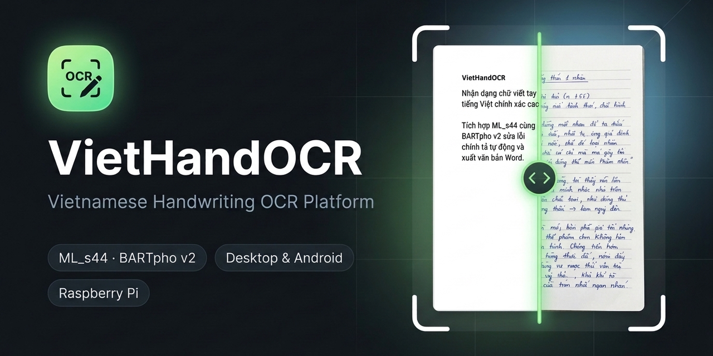
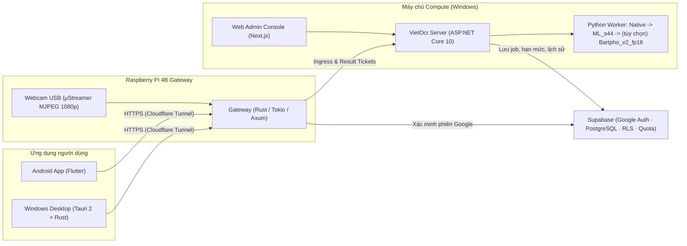

<p align="center">
  
</p>

<h1 align="center">VietHandOCR</h1>

<p align="center">
  <strong>Hệ thống nhận dạng chữ viết tay tiếng Việt đầu cuối (PBL4)</strong><br>
  Native Preprocessing · <code>ML_s44</code> · <code>Bartpho_v2_fp16 + Edit Guard v3</code> · Raspberry Pi Gateway · Windows Desktop &amp; Android
</p>

---

**VietHandOCR** là hệ thống nhận dạng chữ viết tay tiếng Việt đầu cuối (PBL4), kết hợp **tiền xử lý & phân đoạn dòng Native**, mô hình nhận dạng **`ML_s44`** và tầng **hậu xử lý nội suy sửa lỗi tùy chọn (`Bartpho_v2_fp16 + Edit Guard v3 + Smart Continuation Context`)**.

Ứng dụng **Android** và **Windows Desktop** thu nhận ảnh (chụp từ webcam cắm trên Raspberry Pi hoặc tải từ thiết bị), gửi an toàn qua **Raspberry Pi Gateway** tới **Compute Server** chạy GPU/CPU. **Supabase** quản lý xác thực Google OAuth, hạn mức sử dụng và lịch sử tài liệu.

---

## Kiến trúc hệ thống



### Luồng xử lý AI trong Python Worker

1. **Tiền xử lý & phân đoạn dòng (`Native — auto_without_rectification`):** Phân biệt trang nền sạch/phức tạp, tìm mực, tách dòng chữ viết tay và chuẩn hóa lề `V2c` (cao 64 px). Hỗ trợ hai chế độ: **`auto`** (cả trang) và **`line`** (ảnh một dòng).
2. **Nhận dạng chữ viết tay (`ML_s44`):** Trọng số `ml_s44_fp16.pth` (~72.9 MiB, phát triển dựa trên kiến trúc gốc *VietOCR — Apache-2.0*), chạy trên CUDA, DirectML hoặc CPU.
3. **Hậu xử lý nội suy sửa lỗi tùy chọn (`Bartpho_v2_fp16 + Edit Guard v3 + Smart Continuation Context`):**
   - **Mặc định TẮT (`correct=false`):** Worker chỉ chạy `ML_s44`, không nạp model BARTpho (`0 MiB` VRAM cộng thêm).
   - **Khi người dùng tích chọn *"Nội suy sửa lỗi (BARTpho)"* trước lúc gửi (`correct=true`):** Worker lazy-load `Bartpho_v2_fp16` (`760.3 MB`, nén FP16 giảm 49.8% dung lượng từ FP32), gộp thông minh các dòng nối tiếp (tối đa 3 dòng / 45 từ, không gộp câu độc lập kết thúc bằng `. ! ?`), rồi lọc qua **Edit Guard v3** (bảo vệ tuyệt đối chữ số/ngày giờ/giá tiền, dấu câu, từ phiên âm có gạch nối như `Xan - chô`, `Ha - men`, `các - bơn`, khử lỗi chữ hoa giữa từ và chống bịa chữ ở dòng mờ nặng).

---

## Kết quả đánh giá đã kiểm chứng

Toàn bộ thí nghiệm hậu xử lý đều được lọc **0.00% rò rỉ 4-gram** với `val`/`test` (loại 9,082 chuỗi 4-gram khỏi dữ liệu huấn luyện) và đo trên **RTX 4050 Laptop GPU (6 GB VRAM)**:

| Tập dữ liệu & Quy mô | `ML_s44` gốc (Không nội suy) | `+ Bartpho_v2_fp16 + Edit Guard v3 + Smart Context` | Cải thiện / Ghi nhận |
| --- | --- | --- | --- |
| **`UIT-HWDB val`** (678 dòng, 25 người viết, có nhãn) | CER `2.13%` · WER `6.15%` · EM `45.28%` | **CER `1.73%` · WER `4.40%` · EM `59.14%`** | **-18.7% lỗi ký tự** · **-28.5% WER** · **+13.86 pp EM** ($p = 1.41 \times 10^{-18}$) |
| **`UIT-HWDB test`** (201 dòng, 6 người viết, giữ kín) | CER `4.94%` · WER `13.31%` · EM `36.32%` | **CER `4.38%` · WER `10.61%` · EM `50.25%`** | **-11.3% lỗi ký tự** · **-20.3% WER** · **+13.93 pp EM** ($p = 1.46 \times 10^{-7}$); riêng 5/6 người viết thường giảm **-32.9%** lỗi |
| **`testdata` đời thực** (33 ảnh / 29 ảnh độc nhất, 436 dòng, `layout=auto`) | `19.13 s/ảnh` · VRAM `146 MiB` | **`19.82 s/ảnh` (`+695 ms/ảnh` = `+3.63%`) · Đỉnh VRAM `1,098 MiB`** | Can thiệp `34.0%` dòng (`1.45` ký tự/dòng); kiểm toán thủ công: **78.0%** cải thiện rõ (`99/127`), **0** lỗi phá số liệu & từ gạch nối |

---

## Cấu trúc dự án & Điều hướng nhanh

| Thành phần | Thư mục / Tài liệu | Mô tả |
| --- | --- | --- |
| **Ứng dụng Android** | [apps/android](apps/android/README.md) | App Flutter: chụp webcam Pi, cắt/chỉnh ảnh, bật/tắt *Nội suy BARTpho*, gửi hàng loạt, lưu nháp cục bộ |
| **Ứng dụng Windows Desktop** | [apps/desktop](apps/desktop/README.md) | App Tauri 2 (Rust + HTML/CSS/JS): không cần Python cục bộ, bật/tắt *Nội suy sửa lỗi (BARTpho)*, token lưu DPAPI |
| **Compute Server & Web Admin** | [services/compute](services/compute/README.md) | Backend ASP.NET Core 10, Web Admin Next.js, Worker Python (`Native + ML_s44 + Bartpho_v2_fp16`) |
| **Worker Native Preprocessing** | [services/compute/worker/native](services/compute/worker/native/README.md) | Bộ tiền xử lý & tách dòng Native của nhóm bàn giao |
| **Raspberry Pi Gateway** | [services/gateway](services/gateway/README.md) | Dịch vụ Rust (Tokio/Axum): xác minh Google, broker MJPEG webcam, điều phối upload, telemetry/TFT |
| **Hợp đồng & Core dùng chung** | [shared/contracts](shared/contracts/openapi-v2.json), `shared/client-core` | Đặc tả OpenAPI v2, kiểu dữ liệu Rust và client truyền tải dùng chung |
| **Hạ tầng Pi & Tunnel** | [infra/raspberry](infra/raspberry/README.md), `infra/tunnel` | Script cài đặt systemd trên Pi 4B, autostart và Cloudflare Named Tunnel |
| **Cơ sở dữ liệu Supabase** | `supabase/migrations` | Migration PostgreSQL, chính sách RLS, giới hạn quota (500 ảnh/ngày, 30 req/60s) |
| **Hướng dẫn vận hành chi tiết** | [DevTodo.md](DevTodo.md) | Từng bước cấu hình laptop, Raspberry Pi, Supabase OAuth và Cloudflare Tunnel |

---

## Khởi chạy nhanh trên máy chủ Windows

1. **Chuẩn bị trọng số AI cục bộ** *(các file trọng số lớn không lưu trong Git)*:
   - Model nhận dạng chữ viết tay: đặt tại `services/compute/models/ML_s44/ml_s44_fp16.pth`.
   - Model hậu xử lý nội suy (tùy chọn): đặt tại `services/compute/models/Bartpho_v2_fp16/model.safetensors` *(các file cấu hình/tokenizer và `edit_guard_config.json` đã có sẵn trong repo; nếu thiếu `model.safetensors`, worker tự động fallback an toàn về chạy `ML_s44` thuần)*.
2. **Chạy Compute Server & Web Admin:**
   ```powershell
   services/compute/Run-Server.cmd
   ```
   - Giao diện quản trị mở tại `http://127.0.0.1:3000`; compute nội bộ lắng nghe tại `http://127.0.0.1:5080`.
   - Khi sửa mã backend/web, build lại bằng `services/compute/tools/Build-Server.ps1`.
3. **Mở ứng dụng Client:**
   - **Desktop:** Chạy `apps/desktop/Run-Desktop.cmd` (hoặc build `apps/desktop/dist/vietocr-desktop.exe`).
   - **Android:** Cài gói APK phát hành trong `apps/android/dist/` và kết nối tới địa chỉ HTTPS của Raspberry Pi Gateway.

---

## Kiểm thử & Xác minh từ thư mục gốc

```powershell
# 1. Rust workspace (contracts, client-core, gateway, desktop)
cargo test --workspace --locked
cargo clippy --workspace --all-targets --locked -- -D warnings

# 2. Backend Compute Server (C# / .NET 10)
dotnet test services/compute/backend/VietOcr.Server.Tests -c Release

# 3. Desktop UI tests (Node.js)
node --test apps/desktop/tests/*.test.mjs

# 4. Python Native Worker integration check (CPU / GPU)
services/compute/.venv/Scripts/python.exe -X utf8 services/compute/tools/check_native_worker.py --device cpu

# 5. Kiểm tra không lộ secret trong client
services/compute/.venv/Scripts/python.exe tools/check_client_secrets.py
```

- **Android (trong `apps/android` sau khi chạy `flutter pub get`):**
  ```powershell
  flutter analyze --no-pub
  flutter test --no-pub --concurrency=1
  ```
- **Cơ sở dữ liệu & hợp đồng:** chạy test tại `shared/contracts/tests` (WASM mặc định hoặc PostgreSQL test riêng biệt).

---

## Quy ước tên gọi & Bản quyền

- Tên chính thức của dự án là **VietHandOCR**.
- Một số định danh kỹ thuật nội bộ như tên project C# (`VietOcr.Server`), tên crate/service Linux (`vietocr-gateway`, `/opt/vietocr/`), Android OAuth callback (`vn.pbl4.vietocr://auth/callback`) và đường dẫn repository (`VietOCR_Handwriting`) được giữ ổn định để đảm bảo tương thích ngược với cấu hình Supabase, Cloudflare và Raspberry Pi đang vận hành.
- Phần kiến trúc nhận dạng dòng tham khảo và tuân thủ giấy phép Apache-2.0 của thư viện gốc **VietOCR** (xem [THIRD_PARTY.md](services/compute/docs/THIRD_PARTY.md) và `services/compute/worker/core/LICENSE_VietOCR.txt`).
