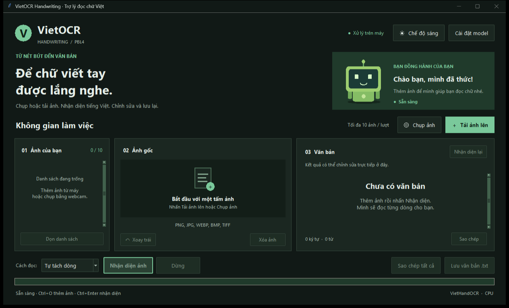

# VietOCR Handwriting — Desktop & API

Đây là gói API nhận diện chữ viết tay độc lập (Standalone API), có thể dễ dàng tích hợp vào bất kỳ ứng dụng Python nào.

## 1. Thành phần
- `AI.py`: Code chính chứa toàn bộ tiền xử lý ảnh (DIP) và bọc gọi mô hình OCR.
- `vgg_transformer_final.pth`: Trọng số (weights) của mô hình.
- `requirements.txt`: Danh sách các thư viện cần cài đặt.
- `test.jpg`, `test2.jpg`: Ảnh để chạy thử nghiệm.

## 2. Hướng dẫn cài đặt
Khuyến nghị sử dụng Python 3.11 trong môi trường ảo. VietOCR 0.3.13 cố định `Pillow==10.2.0`, phiên bản không hỗ trợ Python 3.14.

Trên Windows (PowerShell), chạy trong thư mục `VietHandOCR_API_Release`. Nếu có `uv`, lệnh sau sẽ tự tải Python 3.11 khi cần và tạo môi trường ảo:
```powershell
uv venv --python 3.11 --seed .venv
.\.venv\Scripts\python.exe --version
.\.venv\Scripts\python.exe -m pip install -r requirements.txt
```

Nếu đã cài Python 3.11 bằng bộ cài Windows, có thể thay lệnh `uv venv` bằng `py -3.11 -m venv .venv`.

Nếu `.venv` đã tồn tại, dùng trực tiếp `.\.venv\Scripts\python.exe` để cài thư viện và chạy ứng dụng. Kiểm tra `--version` phải hiển thị Python 3.11; lệnh `python` hoặc `pip` bên ngoài môi trường ảo có thể vẫn dùng Python 3.14.

`gdown==4.4.0` được cố định trong `requirements.txt` theo yêu cầu của VietOCR 0.3.12/0.3.13. Đổi thành `gdown>=5.0.0` sẽ gây lỗi xung đột phụ thuộc khi cài đặt.

`setuptools` được giới hạn dưới 82 vì `gdown` 4.4.0 vẫn cần `pkg_resources`, đã bị loại bỏ từ `setuptools` 82.

`numpy` được giới hạn dưới 2.0 để tương thích với `imgaug` của VietOCR. `torch` và `torchvision` cũng được cài vì `AI.py` sử dụng trực tiếp hai thư viện này.

## 3. Cách test nhanh (Command Line)
Chạy trực tiếp file `AI.py` bằng Terminal/Command Prompt:
```powershell
.\.venv\Scripts\python.exe -X utf8 AI.py --image test.jpg
.\.venv\Scripts\python.exe -X utf8 AI.py --image test2.jpg
```
Tùy chọn `-X utf8` giúp in kết quả tiếng Việt trên Windows, kể cả khi chuyển hướng đầu ra vào file hoặc công cụ khác.

## 4. Cách tích hợp vào Code ứng dụng
Bạn có thể gọi Class `VietHandOCR` từ `AI.py` rất đơn giản như sau:

```python
import cv2
from AI import VietHandOCR

# Khởi tạo mô hình một lần duy nhất lúc khởi động app
ocr = VietHandOCR(weight_path="vgg_transformer_final.pth", device="cpu")

# 1. Truyền đường dẫn file
text1 = ocr.predict("test.jpg")
print("Kết quả 1:", text1)

# 2. Hoặc truyền trực tiếp ảnh OpenCV (numpy array) từ camera/server trả về
img = cv2.imread("test2.jpg")
text2 = ocr.predict(img)
print("Kết quả 2:", text2)
```

## 5. Chạy ứng dụng desktop

Ứng dụng Python/Tkinter dùng `VietHandOCR` trong `AI.py` và trọng số cục bộ, không cần server. Tkinter đi kèm bộ cài Python trên Windows; không cần cài thêm thư viện giao diện.

Model chạy trong **tiến trình AI riêng**, được giữ lại để dùng cho các lượt tiếp theo. `OCRProcessService` điều phối tiến trình; `OCRService` xử lý ảnh, tách dòng và gọi `AI.py`. Giao diện không nạp PyTorch vào tiến trình Tkinter. Nếu nạp model thất bại, tiến trình AI dừng bất thường hoặc hết thời gian chờ, app báo lỗi và cho phép nhận diện lại bằng tiến trình mới.



Ứng dụng mặc định dùng **giao diện tối**. Nút **Chế độ sáng / Chế độ tối** ở góc trên cho phép chuyển ngay trong lúc sử dụng, giữ nguyên ảnh và nội dung đang chỉnh sửa. Lựa chọn được lưu trong `.desktop-preferences.json` cạnh `app.py` và áp dụng ở lần mở tiếp theo; file này được bỏ qua bởi Git.

Chạy từ thư mục `VietHandOCR_API_Release`:

```powershell
.\.venv\Scripts\python.exe -X utf8 app.py
```

Hoặc mở `Run-VietOCR.cmd` bằng cách nhấp đúp. Launcher mở **terminal debug riêng**
và chạy giao diện bằng tiến trình con. Đóng app hoặc app crash đều giữ terminal;
nhấn **Enter** để mở lại, **Q rồi Enter** để đóng terminal. Log trực tiếp được
lưu ở `.logs/console-*.log` (giữ 20 phiên gần nhất), kèm mã thoát dạng số/hex.
Muốn có terminal bền vững, dùng launcher; lệnh chạy thẳng `app.py` chỉ chạy GUI.

Nếu đứng ở thư mục gốc repository:

```powershell
.\VietHandOCR_API_Release\.venv\Scripts\python.exe -X utf8 .\VietHandOCR_API_Release\app.py
```

Đường dẫn model mặc định luôn được tính theo vị trí `app.py`, nên có thể mở app từ bất kỳ thư mục nào. App ưu tiên `vgg_transformer_compact.pth` nếu file này tồn tại, sau đó dùng `vgg_transformer_final.pth` nằm cạnh `AI.py`. `--weights` cho phép chọn bản gốc hoặc model khác. Trọng số bị bỏ qua bởi Git và phải được cung cấp riêng trên máy mới.

Có thể mở sẵn ảnh hoặc chọn thiết bị/camera từ dòng lệnh:

```powershell
.\.venv\Scripts\python.exe -X utf8 app.py test.jpg test2.jpg
.\.venv\Scripts\python.exe -X utf8 app.py --weights "D:\Models\vgg_transformer_final.pth" --device cpu --camera 0
```

### Quy trình sử dụng

1. **Tải ảnh lên** từ máy hoặc **Chụp ảnh** bằng webcam. Cả hai cùng dùng một danh sách tối đa **10 ảnh**. Có thể nhập nhiều đợt, hoặc chụp liên tiếp bằng phím Space; ảnh hỏng được bỏ qua và có thông báo. Lựa chọn vượt số chỗ còn lại sẽ bị từ chối trước khi nhập.
2. Chọn ảnh trong danh sách để xem trước. **Xoay trái** nếu cần; **Xóa ảnh** để giải phóng một chỗ. Ảnh điện thoại được áp dụng hướng EXIF tự động. Ảnh được giới hạn cạnh dài 2.800 px khi nạp để giảm bộ nhớ; ảnh trên 40 megapixel bị từ chối.
3. Chọn **Tự tách dòng** cho ảnh tài liệu một cột, hoặc **Một dòng** cho ảnh đã cắt sát một dòng chữ. Nhấn **Nhận diện**. Mô hình chỉ nạp khi cần và được dùng lại cho các ảnh tiếp theo. Tải model, đọc ảnh, camera và OCR chạy nền; giao diện vẫn có thể xem các ảnh khác.
4. Đọc và sửa kết quả trực tiếp trong ô **Văn bản**. **Sao chép** lấy văn bản ảnh đang chọn; **Sao chép tất cả** và **Lưu văn bản .txt** gộp các kết quả có nội dung theo thứ tự ảnh, kèm tên ảnh. File `.txt` dùng UTF-8 để giữ dấu tiếng Việt.
5. **Dừng** hủy tiến trình AI đang nạp model hoặc nhận diện, giải phóng model và giữ kết quả của các ảnh đã hoàn tất. Nhấn **Nhận diện** để tiếp tục các ảnh chưa xong; model sẽ được nạp lại. **Nhận diện lại** xử lý riêng ảnh đang chọn và thay kết quả cũ.
6. **Dọn danh sách** bắt đầu lượt mới. Ảnh camera và kết quả chỉ được giữ trong RAM trong phiên làm việc; hãy lưu văn bản trước khi dọn danh sách hoặc đóng app.

**Cài đặt model** cho phép chọn file `.pth`, CPU/GPU CUDA và camera 0–9. Thiết lập áp dụng cho phiên hiện tại. GPU cần bản PyTorch hỗ trợ CUDA và card tương thích; CPU là mặc định. Nếu webcam không mở được, kiểm tra quyền camera của Windows, đóng app khác đang dùng camera hoặc chọn chỉ số khác.

Phím tắt: **Ctrl+O** thêm ảnh, **Ctrl+Enter** nhận diện, **Ctrl+S** lưu tất cả văn bản, **Escape** dừng OCR. Trong cửa sổ camera: **Space** chụp, **Escape** đóng.

### Trợ lý và phạm vi nhận diện

Trợ lý hoạt hình trên giao diện đi qua các trạng thái **thức → đã nhận → đang xử lý → hoàn tất/chờ → ngủ khi đóng app**. Thông báo hiện bằng văn bản, không có giọng đọc.

Nút **Kết nối ESP32** điều khiển trợ lý thật qua **Bluetooth BLE**: nạp firmware
mới, bấm **Bật Bluetooth** → chọn **VietOCR-Assistant** sau khi quét → **Kết nối**.
Nếu Bluetooth đã bật, có thể bấm **Quét Bluetooth** trực tiếp.
Xem [hướng dẫn BLE, nạp firmware và đấu dây](../pbl4/README.md#kết-nối-bluetooth-ble).
Trên Windows, nút **Bật Bluetooth** dùng WinRT, yêu cầu quyền từ giao diện khi cần
và chỉ báo thành công sau khi xác nhận bộ thu đã bật. Windows có thể từ chối
điều khiển bằng chương trình; khi thiếu bộ thu, thiếu thư viện hoặc không được
cấp quyền, app mở **Cài đặt Bluetooth** để bạn kiểm tra/bật thủ công rồi quét lại.
Tính năng này không bảo đảm bật được Bluetooth trên mọi máy.

Quét và kết nối GATT chạy trong **tiến trình Bluetooth riêng**, kể cả lần mở
hộp thoại đầu tiên. Lỗi driver/WinRT hoặc tiến trình này chết được báo về GUI;
không nạp backend BLE native vào tiến trình Tk để quét/kết nối. Thao tác bật
radio vẫn dùng hộp thoại quyền của Windows. Log BLE TX/RX nằm trong terminal,
`.logs/vietocr.log` và `.logs/bluetooth.log`; lỗi native có thêm
`.logs/bluetooth-crash.log`. Chỉ kết nối một app với ESP32 tại một thời điểm.

Quét, bật radio và kết nối dùng chung khóa điều phối: quét thủ công chờ GATT cũ
dọn xong; mở hộp thoại khi đang tự kết nối không tạo thêm lượt quét. Nhấn Kết nối
lặp không tạo client mới. Worker nhận lệnh đóng ngay cả khi đang chờ WinRT và
có thời gian dọn GATT trước khi bị buộc dừng. Lỗi kết nối thử lại sau 3, 6, 12,
24 rồi tối đa 30 giây; bấm Kết nối khi offline yêu cầu thử lại ngay.

Windows quét quảng bá rộng rồi lọc theo service **hoặc** tên VietOCR, tránh bỏ
sót thiết bị khi gói quảng bá chưa có UUID. Kết nối không dùng cache service
Windows cũ. Log ghi riêng bước tìm địa chỉ, mở GATT, đăng ký Notify và PING/WAKE;
chỉ báo đã nối khi ESP32 đã ACK. Dòng `Không tìm thấy ESP32` là lỗi tìm thiết
bị, chưa phải một kết nối GATT thành công rồi bị ngắt.

Để kiểm tra quảng bá từ terminal riêng, đóng kết nối desktop rồi chạy trong
`VietHandOCR_API_Release`:

```powershell
.\.venv\Scripts\python.exe -X utf8 tools/diagnose_bluetooth.py --seconds 6
# Khi muốn kiểm tra thêm GATT + Notify + PING, không phát còi:
.\.venv\Scripts\python.exe -X utf8 tools/diagnose_bluetooth.py --seconds 6 --connect
```

Lệnh mặc định dùng địa chỉ đã lưu; thêm `--address <MAC>` để chỉ định thiết bị.
Lần quét thực tế ngày 21/10 thấy 53 thiết bị, chưa thấy ESP32 đã lưu
`F0:9E:9E:3D:06:E9`, nên chưa xác nhận được kết nối board từ máy tính này.
Trạng thái TFT **Chờ kết nối** chưa đủ để xác nhận Windows nhận được quảng bá.

Firmware cũ trả `ERR INVALID_COMMAND: send HELP` khi nhận THEME được nhận biết
đúng: giữ kết nối và nhắc nạp firmware mới. Nạp firmware hiện tại để đổi theme
trên TFT. Đổi theme desktop cập nhật màu tại chỗ trong một lượt vẽ Windows,
giữ widget, font/padding, con trỏ, vị trí cuộn và ảnh xem trước.

`requirements.txt` gồm **Bleak**; gói `winrt-Windows.Devices.Radios` chỉ được cài
trên Windows. Cập nhật thư viện bằng Python trong `.venv` nếu dùng môi trường cũ.
Máy tính cần Bluetooth hỗ trợ BLE; không phải nhập Wi-Fi hay IP.
App gửi trạng thái/phần trăm OCR, giữ kết nối bằng `PING`, tự kết nối lại và gửi
`SLEEP` khi đóng app. Thiết bị đã chọn được lưu trong `.desktop-preferences.json`
cùng theme; **Ngắt kết nối** xóa lựa chọn đã lưu. App vẫn nhận diện khi chưa có
ESP32 hoặc khi mất Bluetooth; trạng thái kết nối hiển thị dưới trợ lý.
Trong hộp kết nối có nút **Thử còi**; TMB12A05 phát beep theo nhịp trạng thái.

Đổi sáng/tối gửi `THEME LIGHT` / `THEME DARK` tới ESP32 và khôi phục lựa chọn
sau khi nối lại. Cần nạp firmware mới trong `pbl4` để TFT đổi màu theo app.
Firmware cũ vẫn nhận các trạng thái OCR và app nhắc cập nhật. Đổi theme trên
desktop chỉ cập nhật màu tại chỗ, giữ các hàng ảnh, vị trí con trỏ và độ rộng nút.

### Giảm dung lượng bản desktop

Tạo checkpoint gọn từ thư mục gốc repository:

```powershell
.\VietHandOCR_API_Release\.venv\Scripts\python.exe -X utf8 VietHandOCR_API_Release/tools/compact_model.py
```

Script giữ nguyên bản gốc, tạo `vgg_transformer_compact.pth` và chỉ lưu sau khi
bốn ảnh mẫu trả cùng văn bản. Dung lượng trọng số giảm **144,8 → 73,2 MiB**;
Conv/Linear lưu FP16, nạp vào model tính FP32. Xem
[báo cáo kiểm chứng](docs/compact-model-verification.json). Đây là nén có mất mát,
cần đánh giá thêm trên tập chữ thực tế; RAM và tổng dung lượng ứng dụng không
giảm cùng tỷ lệ vì còn Python, PyTorch và thư viện khác.

Để phân phối bản chỉ dùng CPU, tạo môi trường riêng, cài Torch/Torchvision từ
[nguồn wheel CPU chính thức](https://pytorch.org/get-started/locally/) trước khi
cài `requirements.txt`; không đổi môi trường GPU đang dùng:

```powershell
py -3.11 -m venv .venv-cpu
.\.venv-cpu\Scripts\python.exe -m pip install torch torchvision --index-url https://download.pytorch.org/whl/cpu
.\.venv-cpu\Scripts\python.exe -m pip install -r requirements.txt
```

Gói phát hành chỉ cần một checkpoint đã chọn, mã chạy và thư viện runtime.
Không kèm SDK Android, model ONNX mobile, dữ liệu huấn luyện, cache, log và công
cụ export/kiểm thử. ZIP giúp tải gọn nhưng dung lượng sau giải nén vẫn lớn.
Chuyển desktop sang dùng chung ONNX Runtime với Android có thể giảm phụ thuộc
PyTorch; hướng này cần một lượt tích hợp và kiểm chứng riêng.

Muốn thử từ điện thoại ngay: dùng **nRF Connect for Mobile**, kết nối
`VietOCR-Assistant`, bật TX Notify và ghi `44454D4F0A` (HEX của `DEMO` + LF) vào RX.
Xem [các bước trên điện thoại và giao thức cho bản mobile](../pbl4/docs/BLE_PROTOCOL.md).
Chỉ một app kết nối tại một thời điểm; ngắt desktop trước khi dùng điện thoại.
App OCR mobile Flutter/Dart nằm trong [Mobile](../Mobile/README.md), chạy ONNX offline
trên điện thoại và dùng cùng giao thức BLE với desktop.

Model hiện tại là bộ nhận diện **từng dòng**, không phải bộ phát hiện chữ tự do trong ảnh. Chế độ tự tách dòng bổ sung căn nghiêng và tách theo các hàng có chữ; phù hợp trang giấy sáng, một cột, hướng đọc từ trên xuống. Chưa hỗ trợ phân tích bảng, nhiều cột, chữ trên cảnh vật hoặc tự sửa phối cảnh khi chụp xiên. Chất lượng văn bản phụ thuộc trọng số và ảnh đầu vào; nên kiểm tra lại kết quả trước khi sử dụng.

### Khi nạp model lỗi hoặc app đóng bất thường

1. Đóng app và cập nhật đúng môi trường: chạy `.\.venv\Scripts\python.exe -m pip install -r requirements.txt` trong thư mục `VietHandOCR_API_Release`, sau đó mở `Run-VietOCR.cmd`. Không chạy bằng Python ngoài `.venv`.
2. Nếu app báo lỗi AI, mở **Cài đặt model**, kiểm tra file `.pth` và thử **CPU**, rồi bấm **Nhận diện** lại. Sau lỗi nạp model hoặc tiến trình AI dừng bất thường, app sẽ tạo tiến trình mới; kết quả các ảnh đã hoàn tất vẫn còn. Nếu nạp model hoặc nhận diện không phản hồi trong thời hạn chờ, app cũng dừng tiến trình và báo để thử lại.
3. Nếu cửa sổ vẫn tự đóng, mở lại app và gửi các log có nội dung trong thư mục `.logs` cạnh `app.py`, kèm thao tác ngay trước lỗi:

   - `vietocr.log`: khởi động app, lỗi giao diện và điều phối AI/Bluetooth.
   - `ocr-worker.log`: nạp model và nhận diện trong tiến trình AI.
   - `app-crash.log`, `ocr-crash.log`: dấu vết lỗi native nếu Python ghi được; có thể rỗng khi không có lỗi loại này.

Chỉ riêng traceback kết thúc bằng `KeyboardInterrupt` cho biết chương trình nhận ngắt từ bàn phím, chưa xác định được nguyên nhân cửa sổ tự đóng. Log giúp phân biệt lỗi model, lỗi giao diện và tiến trình bị dừng. Đóng bằng nút cửa sổ hoặc **Ctrl+C** sẽ yêu cầu app dọn tiến trình AI và kết nối trước khi thoát. Nếu cửa sổ tự đóng, kết quả chưa lưu trong RAM sẽ mất.

### Cấu trúc để mở rộng sang mobile

```text
app.py                    # Điểm khởi động desktop
desktop/application.py    # Giao diện và điều phối công việc nền
desktop/domain.py         # Danh sách ảnh, giới hạn 10 ảnh, trạng thái trợ lý
desktop/ocr_process.py     # Điều phối tiến trình AI, tái sử dụng/hủy/khởi động lại
desktop/ocr_service.py     # Xử lý OCR cốt lõi: gọi AI.py và tách dòng
desktop/tasks.py           # Tác vụ nền chỉ nhận dữ liệu và hàng đợi, không gọi Tk
desktop/diagnostics.py     # Log xoay vòng và dấu vết lỗi native
desktop/camera.py         # Webcam, chụp liên tiếp, giải phóng camera
desktop/widgets.py        # Giao diện chung và trợ lý vector hoạt hình
desktop/theme.py          # Theme sáng/tối và lưu lựa chọn giao diện
desktop/preferences.py    # Lưu theme và thiết bị BLE đã chọn
desktop/bluetooth_transport.py # Quét BLE, GATT/NUS, ghép notification thành dòng
desktop/bluetooth_radio.py # Bật Bluetooth Windows và mở Cài đặt khi cần
desktop/robot_connection.py # BLE chạy nền, heartbeat, kết nối lại và đồng bộ trạng thái
```

Desktop gọi `OCRService` qua `OCRProcessService` để quản lý vòng đời tiến trình AI.
`RobotClient` gửi trạng thái từ `AssistantState` qua BLE. Bản [Flutter mobile](../Mobile/README.md)
dùng cùng UUID/giao thức ASCII, chuyển trọng số của `AI.py` thành encoder/decoder ONNX
và nhận diện trực tiếp trên Android; không cần dịch vụ OCR trên máy tính.

## 6. Kiểm tra

Kiểm tra giới hạn ảnh, EXIF, tách dòng, tái sử dụng model, hủy tác vụ, nhập ảnh, sửa/sao chép/xuất văn bản và camera giả lập. Test tiến trình AI dùng engine giả trong tiến trình con thật để kiểm tra lỗi nạp model, thoát bất thường, timeout, hủy và nhận diện lại:

```powershell
.\.venv\Scripts\python.exe -X utf8 -m unittest discover -s tests -v
```

Các kiểm tra Tkinter cần phiên desktop có màn hình. Bộ test camera giả lập không truy cập webcam thật.

Các test BLE dùng scanner và GATT peripheral bất đồng bộ giả lập: kiểm tra quét,
ghép notification bị chia nhỏ, timeout, hủy kết nối, heartbeat, khôi phục trạng thái,
lưu thiết bị cùng theme và luồng giao diện quét/chọn → nhận ảnh → OCR → đóng app
gửi `SLEEP`. Không dùng Bluetooth thật hay ESP32 trong bộ test này.
Test nút bật Bluetooth giả lập WinRT và kiểm tra quyền, trạng thái bộ thu cùng
phương án mở Cài đặt; không thay đổi Bluetooth thật của máy.

Chạy kiểm tra toàn bộ luồng bằng trọng số thật, bốn ảnh mẫu và một tài liệu hai dòng ghép từ ảnh mẫu:

```powershell
.\.venv\Scripts\python.exe -X utf8 tests/smoke_real_model.py
```

Kiểm tra này xác nhận model nạp được, trả văn bản cho từng ảnh, tách tài liệu hai dòng và giao diện tiếp tục xử lý sự kiện trong lúc OCR. Nó không đo độ chính xác nhận diện; webcam thật cần được thử riêng trên máy có camera.

Kiểm tra độ ổn định với trọng số thật qua ba lần mở app/nạp model, mỗi lần một
lượt đủ 10 ảnh và một lần nhận diện lại dùng cùng model; có hủy lúc nạp và thử lại:

```powershell
.\.venv\Scripts\python.exe -X utf8 tests/smoke_stability.py
```

Script chỉ in số lượt và thời gian, không in nội dung OCR; không truy cập camera
hay Bluetooth thật. Chạy trên CPU và cần hai ảnh mẫu `test.jpg`, `test2.jpg`.
