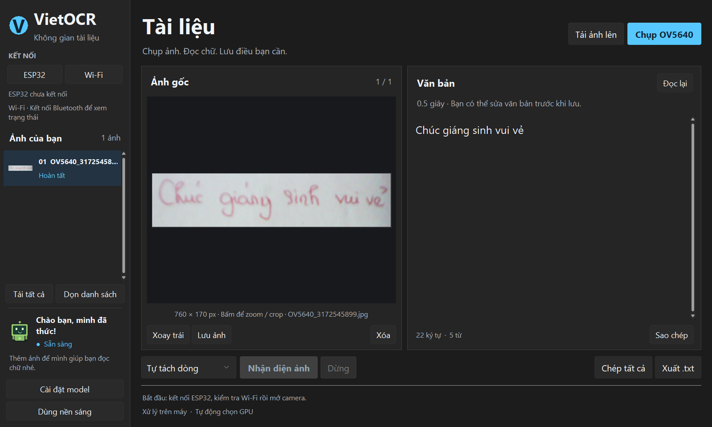
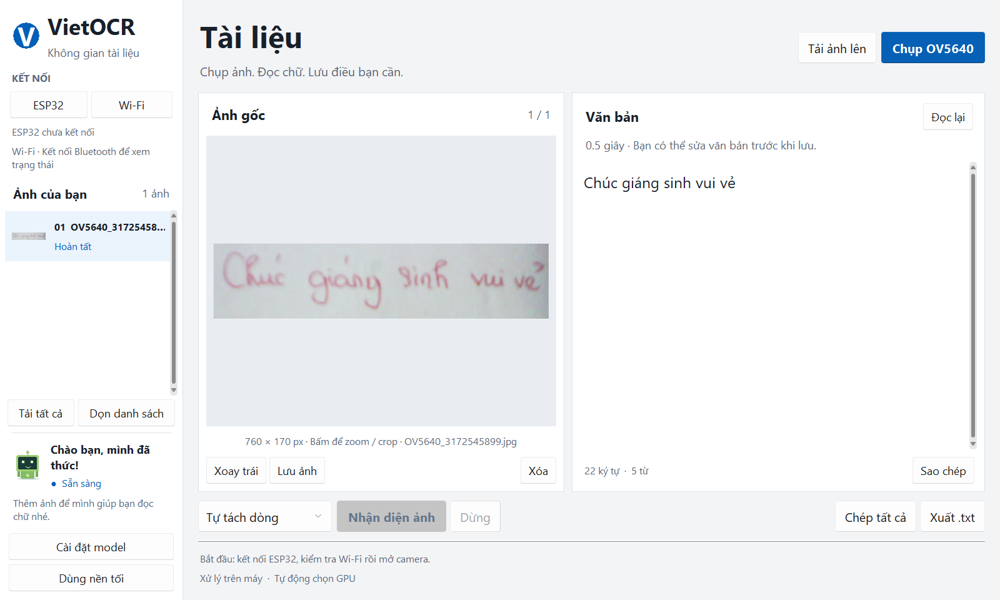

# Desktop UI — 02/11/2026

Đã sửa tiếp theo phản hồi trải nghiệm: tải ảnh từ máy tính, một nút vào camera,
thanh bên rộng hơn, tải toàn bộ ảnh, hộp Bluetooth kéo giãn, Wi-Fi 3 giây và
tab mạng đã lưu, thông báo tự ẩn. Xem [báo cáo cập nhật](REVIEW_2026-11-02.md).

## Các lựa chọn MIT đã đối chiếu

| Bộ giao diện | Giấy phép gốc | Mức phù hợp |
| --- | --- | --- |
| [Sun Valley ttk](https://github.com/rdbende/Sun-Valley-ttk-theme) | [MIT](https://github.com/rdbende/Sun-Valley-ttk-theme/blob/main/LICENSE) | Được chọn: điều khiển kiểu Windows hiện đại, có sáng/tối, dùng được với Tk/ttk hiện tại. |
| [Azure ttk](https://github.com/rdbende/Azure-ttk-theme) | [MIT](https://github.com/rdbende/Azure-ttk-theme/blob/main/LICENSE) | Một hướng Fluent khác; cũng có thể tích hợp với ttk. |
| [CustomTkinter](https://github.com/TomSchimansky/CustomTkinter) | [MIT](https://github.com/TomSchimansky/CustomTkinter/blob/master/LICENSE) | Điều khiển bo góc, có sáng/tối; muốn đồng nhất toàn app sẽ phải thay nhiều widget hiện có. |

Sun Valley cung cấp hình thức cho các điều khiển. Bố cục tài liệu, thanh bên,
khung ảnh và vùng soạn thảo được viết riêng cho VietOCR trong
`desktop/workspace_view.py`.

## Thay đổi sử dụng

- Thanh bên gom kết nối ESP32/Wi-Fi, danh sách ảnh, trợ lý và cài đặt.
- Vùng chính dành cho ảnh gốc và văn bản. Kéo vạch giữa hai vùng để đổi tỷ lệ.
- Nút chụp/xem camera ở đầu trang; nhận diện và xuất văn bản ở cuối trang.
- Bỏ khối giới thiệu lớn. Trợ lý thu nhỏ để nhường chỗ cho tài liệu.
- Nền xám trung tính, điểm nhấn xanh dương; có cả sáng và tối.
- Cửa sổ thấp tự rút gọn lời chào để danh sách ảnh còn chỗ hiển thị.
- Đổi theme giữ nguyên widget, nội dung đang sửa, vị trí con trỏ và tỷ lệ hai vùng.
- Các cửa sổ camera/cài đặt dùng cùng bộ điều khiển; nội dung trong tab cũng đổi màu.
- Bật system DPI awareness trước khi tạo cửa sổ để chữ không bị Windows phóng bitmap.
  Tk 8.6 vẫn dùng DPI của màn hình lúc khởi động; chưa hỗ trợ tự đổi DPI khi kéo
  cửa sổ giữa hai màn hình có tỷ lệ khác nhau.

## Ảnh giao diện

Các ảnh dưới đây dùng ảnh mẫu và nội dung dựng cho việc kiểm tra bố cục;
không phải kết quả đo camera/OCR mới.

[Trạng thái chưa có ảnh](ui/dark-empty.png) · [Cửa sổ 1120 × 680](ui/compact.png)

[Cài đặt model](ui/model-settings.png) · [Cấu hình camera](ui/camera-settings.png)

## Cài đặt và phân phối

Chỉ tải wheel `sv_ttk-2.6.1-py3-none-any.whl` **50.076 byte**, đối chiếu SHA-256
với metadata PyPI rồi đưa Tcl/sprite/license vào `desktop/vendor/sunvalley/`.
Không cài package mới vào Python, không tải font hay SDK.
[Thông báo bản quyền](../THIRD_PARTY_NOTICES.md) và bản MIT đầy đủ nằm trong repo.

Mở `dist/VietOCR.exe` hoặc `Run-VietOCR.cmd`. Launcher sử dụng source, `.venv`,
model và theme nằm trong dự án; đây chưa phải bản portable độc lập.
Build lại bằng `powershell -File tools/build_desktop.ps1`.

## Kiểm tra

Chạy `python -m unittest discover -s tests -v` bằng Python trong `.venv`.
Kiểm tra UI bao gồm cửa sổ nhỏ ở Tk scaling 2.0, nút không bị cắt, danh sách ảnh
còn chỗ, kéo vạch chia, đổi theme nhiều lần giữ nội dung/con trỏ/vị trí và đổi
màu widget Tk nằm trong Notebook. Có kiểm tra ảnh chụp màn hình sáng/tối thực tế.

Sau tích hợp model mới và sửa theo phản hồi: **208 test desktop đạt**.
Build launcher và kiểm tra môi trường bằng `VietOCR.exe --check` đều thành công.

Các test UI dùng đối tượng mô phỏng. Kiểm tra firmware thật trên COM8 và số đo
ảnh chụp/standby/BLE nằm trong báo cáo cập nhật; bo đã ngủ sâu cuối lượt.
