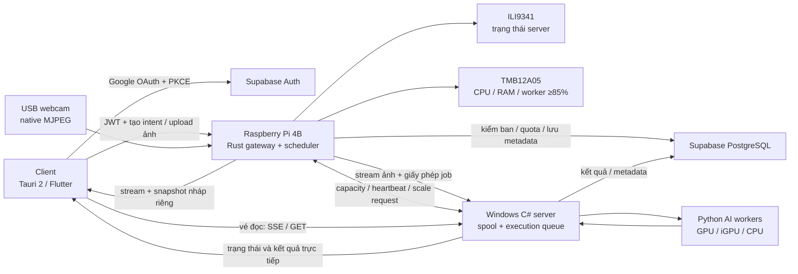

# Kế hoạch refactor VietOCR: Client → Raspberry → Inference Server

Ngày lập: 08/11/2026. Cập nhật: 09/11/2026, Asia/Saigon. Trạng thái: **ĐÃ ĐƯỢC CHẤP THUẬN — TRIỂN KHAI THEO GIAI ĐOẠN TRÊN NHÁNH `refactor`**.

Chủ dự án đã chốt kế hoạch ngày 09/11/2026, cho phép tạo/push nhánh `refactor` trên GitHub và triển khai từng giai đoạn. Bản cập nhật này chuyển webcam sang Pi, bổ sung TFT giám sát server và còi cảnh báo; thay thế các quyết định camera phía client và bỏ mọi TFT/còi trong bản nháp trước. Tiến độ và bằng chứng kiểm thử ghi riêng trong `docs/REFACTOR_PROGRESS.md`; kế hoạch được chấp thuận không đồng nghĩa mọi giai đoạn đã hoàn tất.

## 1. Các quyết định đã xác nhận

| Nội dung | Quyết định của chủ dự án |
| --- | --- |
| IoT cũ | Loại bỏ ESP32/BLE/OV3660/OV5640 và luồng trợ lý IoT cũ; không mang giao thức firmware cũ sang Pi |
| Webcam | Webcam USB nối **Raspberry**; nhiều tài khoản được xem/chụp chung; client xem stream từ Pi, không mở camera máy tính/điện thoại |
| TFT trên Pi | Tái sử dụng **ILI9341 SPI**; chỉ hiển thị trạng thái server, mạng, queue, CPU/RAM/worker; chân GPIO cấu hình riêng cho Pi |
| Còi trên Pi | Tái sử dụng **TMB12A05**; cảnh báo khi **CPU, RAM hoặc tỷ lệ worker bận đạt 85%**, lấy stats máy server; không phát âm thanh theo các trạng thái khác |
| Client desktop | Chuyển từ Python/Tk sang **Tauri 2**; Rust xử lý chính, giao diện web cục bộ |
| Client Android | Giữ **Flutter/Dart**; không làm iOS |
| Chức năng ảnh | Giữ tải file, chụp, đổi camera, zoom/crop, đen trắng OCR, tải ảnh, sửa/xuất văn bản và lịch sử |
| Khi gửi | Chụp/thêm/chỉnh ảnh chỉ tạo bản nháp; chỉ upload khi người dùng bấm **Gửi** |
| Raspberry | Pi 4B, RAM 4 GB, Raspberry Pi OS, thẻ 128 GB, Wi‑Fi; chạy gateway API bằng Rust |
| Inference host | Máy Windows hiện tại, RTX 4050 Laptop 6 GB VRAM, RAM 16 GB |
| Phạm vi mạng | Dùng Internet ngay; client, Pi và server có thể ở ba mạng khác nhau |
| Tên miền | Đã có tên miền; có thể dùng tunnel |
| Nhận kết quả | Client được mở kết nối riêng đến server bằng vé ngắn hạn; ảnh/request tạo OCR phải qua Pi |
| Tải đông | Queue động theo tình trạng server và worker; Pi được yêu cầu server tăng worker |
| Hạn mức mới | **500 ảnh/ngày, 30 request OCR/phút/tài khoản** |
| Mất kết nối | Ảnh chưa upload ở client; ảnh server đã nhận tiếp tục xử lý; mở app lại lấy kết quả |

Các mặc định đã chốt: Windows desktop trước; C# + Python AI + Next.js admin được giữ; tài khoản admin riêng hiện có được giữ; Google-only áp dụng cho người dùng hai app; hạn mức 500/30 là trần hệ thống giai đoạn đầu, admin có thể hạ riêng từng tài khoản. Muốn cho admin nâng quá trần sẽ sửa quyết định này trước khi triển khai.

Đã được cấp SSH tới `admin@rasp4gb` và kiểm tra OS **aarch64/64-bit, Debian 13.7 trên Raspberry Pi**, µStreamer 5.4. Không lưu thông tin xác thực vào tài liệu/Git. Tên miền HTTPS triển khai và tốc độ uplink thực chưa xác nhận; vẫn dùng tên ví dụ cho ingress. Tiến độ kiểm thử thiết bị ghi ở `REFACTOR_PROGRESS.md`.

## 2. Mục tiêu và ranh giới trách nhiệm

### Client

- Chỉ cung cấp đăng nhập Google qua Supabase OAuth/PKCE và system browser; khôi phục phiên hợp lệ, không bắt mở browser mỗi lần chạy app.
- Lần đăng nhập mới phải được gateway xác nhận trước khi vào workspace. Khi mất mạng sau một phiên đã xác nhận, cho mở bản nháp/cache riêng của tài khoản đó và import/chỉnh ảnh cục bộ; camera Pi cần kết nối mạng. Không cấp quyền gửi mới từ cache cũ. Đăng xuất hoặc đổi tài khoản phải khoá dữ liệu của tài khoản trước.
- Liệt kê camera do **Pi** công bố; client chọn camera Pi được cấp quyền, xử lý webcam tháo/bận/không có hình. Không còn camera local trong app.
- Client xem native MJPEG được Pi relay; không phát video tới inference server. Chỉ chụp mới tạo ảnh nháp; preview không tự tạo OCR. Độ phân giải thực tế do webcam/V4L2 công bố, không suy chất lượng ảnh từ kích thước widget.
- Quản lý bản nháp, nén bản truyền, upload có tiếp tục, nhận kết quả và lưu bản sửa. Có thể chụp nhiều ảnh; một ảnh là một job/quota unit.
- Giữ nguyên file gốc; không tự gửi ảnh mới chụp sau3 giây và không tự nhận diện ảnh vừa crop.

### Raspberry gateway

- Là cửa vào duy nhất để tạo một yêu cầu OCR cho người dùng.
- Xác minh phiên, nguồn đăng nhập Google, tài khoản không bị ban và quyền/hạn mức hiện hành.
- Giữ queue điều phối, cấp lượt upload theo công suất server, chuyển tiếp ảnh theo luồng; yêu cầu tăng/giảm worker.
- Cấp vé nhận kết quả gắn với người dùng/job/server; không chạy OCR, không giải mã/nén lại luồng MJPEG.
- Host webcam: một producer native MJPEG cho mỗi camera, buffer hữu hạn, nhiều viewer dùng chung. Không mở một webcam/process/encoder cho mỗi client.
- Ảnh chụp trả JPEG gốc về client làm bản nháp riêng. Pi không tự đưa snapshot vào queue OCR; chỉ chuyển ảnh tới server sau lệnh **Gửi** của chủ ảnh. Client có thể gửi lại bản đã crop/chỉnh; chính sách giữ ảnh offline ở client không thay đổi.
- Queue bền vững bằng metadata trên Supabase; RAM chỉ giữ working set có giới hạn. Không dùng thẻ nhớ Pi làm kho ảnh chờ; buffer video không phải queue ảnh.
- TFT nhận telemetry server với thời gian cập nhật rõ ràng; dữ liệu cũ/mất liên lạc hiển thị offline, không báo số cũ như hiện thời. Còi không kêu khi boot, mất mạng hoặc chụp ảnh.

### Server

- Chỉ nhận **tạo job/upload/chạy OCR/điều khiển worker** từ gateway đã được xác thực.
- Có endpoint client riêng, chỉ đọc trạng thái/kết quả bằng vé hợp lệ. Không nhận Google JWT hoặc API key client để đi tắt tạo OCR.
- Nhận ảnh vào spool trên ổ đĩa, kiểm tra file đầy đủ, thực thi model qua worker persistent và trả kết quả trực tiếp cho kết nối do client mở.
- Có quyền từ chối yêu cầu tăng worker khi thiếu tài nguyên; lỗi worker không làm sập API hoặc app.
- Tiếp tục xử lý ảnh đã nhận khi client/Pi tạm offline. Chỉ metadata tải/job hoàn tất quay về Pi; không đưa văn bản OCR đi vòng qua Pi.

### Supabase

Giữ Auth Google, identity cố định, ban, quota/reservation, job/lease, kết quả, cấu hình và audit. Không đưa file ảnh vào bảng PostgreSQL. Giai đoạn này không dùng Storage làm kho upload khi server offline.

## 3. Sơ đồ kiến trúc



HTTP không cho server trả vào kết nối TCP/TLS mà client đã mở tới Pi. Vì vậy Pi trả `jobId`, địa chỉ result endpoint đã được cho phép và vé đọc; client mở kết nối **mới** tới server. Không yêu cầu điện thoại có IP public, không dùng callback URL do người dùng gửi lên, không mở cổng trên client.

## 4. Internet, tunnel và endpoint

Đề xuất dùng named Cloudflare Tunnel với tên miền hiện có; kiểm tra nhà cung cấp DNS/nameserver và đường mạng trước triển khai. Nếu tên miền không phù hợp, giữ nguyên hợp đồng API và thay lớp ingress bằng tunnel/reverse proxy có HTTPS tương đương.

| Địa chỉ minh hoạ | Nơi phục vụ | Quyền |
| --- | --- | --- |
| `gateway.example.com` | Pi Rust | Client Google: session, camera/stream/snapshot, intents, upload, quota, cancel, ticket renewal |
| `result.example.com` | Server result API | Client có vé: chỉ trạng thái/kết quả/event của job được cấp |
| `compute.example.com` | Server internal API | Chỉ gateway: upload, capacity, scale; xác thực máy và giấy phép ký |
| Admin | Next.js trên server | Giữ private/local trước; không tự publish admin lên Internet |

Hai connector tunnel chạy trên Pi và Windows. Ingress chỉ route đúng host/path, có catch-all404. Chứng chỉ/credential gateway không nằm trong APK hoặc Tauri frontend. HTTP localhost phía sau connector chỉ dùng khi connector và service cùng máy; chặng khác máy phải được bảo vệ. Không bật `noTLSVerify` để che lỗi chứng chỉ.

Không dùng Quick Tunnel làm tiêu chuẩn tải: tài liệu Cloudflare công bố giới hạn200 request đang xử lý và không hỗ trợ SSE. Cấu hình cache **no-store** cho Auth, vé và kết quả; không cache văn bản riêng tư ở CDN. Lớp tunnel cũng phải được đo cùng hệ thống, không suy từ benchmark Rust thuần thành tải Internet thật.

## 5. Quy trình một lô ảnh

1. Client hoàn tất Google/PKCE, gửi JWT tới Pi để mở phiên ứng dụng. Pi xác nhận danh tính, quyền và trả cấu hình/hạn mức.
2. Client xem stream Pi; bấm Chụp nhận nguyên JPEG snapshot về bộ nhớ/file nháp riêng trên client. Import vẫn lấy file local. Crop/đen trắng tạo phiên bản làm việc riêng. Người dùng chọn ảnh rồi bấm **Gửi**; chụp không tự nhận diện.
3. Client tối ưu bản truyền ngoài UI thread, tính kích thước và SHA-256; tạo intent nhỏ chứa metadata, layout, phiên bản ảnh và `Idempotency-Key`.
4. Pi kiểm tra JWT, ban, hạn mức và queue/tài khoản; lưu intent. Khi server chưa có chỗ, trả trạng thái chờ, không nhận body ảnh và không giữ HTTP request đến lúc OCR xong.
5. Scheduler chọn lượt theo tài khoản và capacity server. Khi có slot upload + chỗ spool, Pi đặt trước quota ngắn hạn và cấp upload lease gắn với job, user, hash, byte count và server.
6. Client gửi file theo từng khối có giới hạn. Pi chuyển tiếp tới server, không gom toàn file trong RAM. Server lưu part file và báo offset để client có thể tiếp tục sau mất mạng.
7. Server kiểm tra đủ bytes/hash/chữ ký định dạng/kích thước ảnh; file hoàn tất được ghi bền vững và đổi tên nguyên tử. Database chuyển reservation thành **một lượt đã dùng**, job chuyển `queued`. Chỉ lúc này app hiển thị “Server đã nhận”.
8. Server execution queue giao việc cho worker rảnh. Client theo dõi SSE hoặc bounded long-poll trực tiếp server bằng vé đọc. Một kết nối có thể theo dõi các job của cùng lô thay vì mở một kết nối cho mỗi ảnh.
9. Server lưu kết quả và metadata; client nhận văn bản, sửa/xuất. Pi nhận ack/capacity để điều phối tiếp, không nhận nội dung OCR.

Gửi lại cùng job/hash/layout/phiên bản ảnh là idempotent; gửi lại cùng key với nội dung khác trả409. Trạng thái phải phân biệt rõ **Đang chờ upload**, **Đang upload**, **Server đã nhận**, **Đang chờ OCR**, **Đang OCR**, **Xong/Lỗi/Đã huỷ**. Đóng tab camera không làm mất bản nháp hoặc đổi trạng thái job.

## 6. Xác thực và hạn mức 500/30

- Giữ `auth.users.id`/OCR identity hiện tại; bỏ cơ chế service API key `voc_...` trên các endpoint client mới. Mã OCR cố định là định danh, không phải bí mật xác thực.
- Pi xác minh JWT bằng thư viện chuẩn: thuật toán cho phép, chữ ký, issuer của đúng project, audience, expiry và subject. JWKS được cache có hạn, refresh theo `kid` có chống stampede.
- Public JWKS project hiện có **ES256/EC**, đã kiểm tra chỉ đọc ngày 08/11. Không đổi signing key trong lượt lập kế hoạch này.
- Chỉ cho phép Google ở provider/cấu hình sản phẩm; xác nhận provider từ dữ liệu tin cậy phía Auth/database, không tin trường user tự sửa. Session check, ban và admission không chỉ dựa vào một JWT chưa hết hạn.
- JWT còn hạn có thể tồn tại sau sign-out; RPC admission kiểm tra session/ban tại thời điểm cấp lease và commit. Không cache quyền “được OCR” rồi dùng vô hạn. Cache khóa công khai khác với cache quyền tài khoản.
- **500 ảnh/ngày**, reset 00:00 Asia/Ho_Chi_Minh; **30 ảnh được nhận trong cửa sổ trượt 60 giây**, dùng chung mọi thiết bị của tài khoản. Poll, đọc kết quả, đăng nhập và từng chunk upload không phải một lượt OCR mới.
- Trước upload dùng quota reservation có TTL; `used + reserved` không vượt giới hạn. Commit/lặp commit/release/hết hạn phải nguyên tử và idempotent. Minute accounting tính cả reservation còn hiệu lực để không cho 30 upload đồng thời vượt 30/phút khi commit.
- File chưa upload đủ, sai hash/định dạng hoặc không được server nhận: giải phóng reservation. Ảnh đã được server nhận vẫn tính lượt nếu model lỗi, người dùng huỷ hoặc timeout. Retry do mất ack không trừ thêm.
- Reservation được cấp gần thời điểm upload, không đặt trước cho toàn bộ1.000 intent đang chờ. Qua mốc ngày/phút phải tái kiểm tra trong transaction commit và xử lý chuyển cửa sổ rõ ràng; không mang quyền quota cũ sang ngày mới một cách ngầm định.
- DB lỗi: không cấp lượt mới. Client giữ ảnh. Server đang chạy ảnh đã được nhận có cơ chế ghi kết quả chờ/retry, không nhận ảnh mới dựa trên quota không xác nhận.

Tách quyền DB: gateway chỉ gọi các thủ tục session/admission/lease được cấp; inference server chỉ chuyển trạng thái job/ghi kết quả được phân công; admin quản lý cấu hình. Không đặt một khoá toàn quyền trong client. Hình thức kết nối role giới hạn qua PostgREST hoặc PostgreSQL TLS được quyết định ở spike triển khai dựa trên cấu hình Supabase, giữ pool nhỏ và hữu hạn.

## 7. Bảo vệ đường gateway → server và vé kết quả

- Kết nối nội bộ dùng xác thực máy riêng, không chỉ dựa vào IP hoặc một header user có thể giả. Gateway ký giấy phép ngắn hạn bằng khoá riêng; server kiểm tra khoá công khai đã đăng ký và audience.
- Giấy phép upload ràng buộc `jobId`, `userId`, `serverId`, hash, tổng bytes, layout, expiry, nonce và lease generation. Retry cùng lease chỉ tiếp tục đúng ảnh; lease cũ không chiếm lại job đã giao lại.
- Vé đọc có scope riêng, không đổi được thành giấy phép upload/scale/cancel. Token truyền trong Authorization header, không nằm trong query URL hoặc log.
- Vé đọc hết hạn trong khi job đang chờ được gia hạn qua Pi mà không tạo job/trừ lượt mới. Client mất kết nối có thể khôi phục job bằng identity và trạng thái đã lưu.
- Nếu Pi offline, vé đọc còn hạn vẫn dùng trực tiếp server; vé đã hết hạn phải chờ Pi trở lại để gia hạn. Server vẫn hoàn tất/lưu kết quả trong thời gian đó. Không biến vé thành quyền truy cập vĩnh viễn chỉ để che tình huống mất gateway.
- Public result API không nhận arbitrary storage path hoặc callback URL; server kiểm tra quyền job, không nhận một job ID là đủ để đọc văn bản.
- Endpoint worker/scale không được gọi từ app. Admin có audit các lệnh tự tăng/giảm và có quyền tắt autoscaling.

## 8. Dynamic queue và tự điều chỉnh worker

### Phân quyền queue

**Pi quản lý queue nhận việc/upload theo tải. Server quản lý queue thực thi những ảnh đã nhận.** Hai queue là hai giai đoạn của cùng state machine, không phải hai nơi cùng có quyền chạy một job.

- Queue Pi xoay vòng tài khoản, FIFO trong từng tài khoản, giới hạn pending/account; một người gửi cả thư viện không chiếm hết lượt.
- Server quảng bá số worker ready/busy/starting/draining, queue depth, spool còn trống, RAM/VRAM, thời gian xử lý trung bình theo loại ảnh và heartbeat.
- Pi điều chỉnh số upload lease và lượng prefetch theo capacity, không gửi toàn bộ1.000 file vào hàng chờ RAM/server khi chỉ có một worker.
- Server chọn worker **đang rảnh**, giữ fairness khi nhiều worker cùng rảnh; worker nhanh không phải chờ worker chậm hoàn tất mới được nhận việc tiếp.
- Một gateway + một compute host là phạm vi triển khai đầu. Có `serverId`/capacity interface để mở rộng sau, chưa triển khai cluster nhiều host và storage dùng chung.

### Autoscaling

Điều kiện gợi ý: queue chờ kéo dài, oldest-wait vượt mục tiêu và nhu cầu vượt tốc độ xử lý đo được. Pi gửi **desired capacity** kèm command ID, không gọi “thêm worker” lặp lại mỗi heartbeat.

Server kiểm tra RAM/VRAM, worker đang nạp, worker lỗi gần đây và chính sách admin; chỉ nạp một replica mới mỗi lần. Ưu tiên GPU rời → iGPU → CPU trong policy auto, vẫn hỗ trợ chỉ định thiết bị. Khi GPU bão hoà, tăng replica có thể không tăng throughput; rollback lần tăng không hiệu quả sau cửa sổ đo đủ mẫu. Không coi75 MB checkpoint là75 MB RAM/VRAM.

Giá trị khởi điểm để benchmark: heartbeat2 giây; cần nhiều tick liên tiếp mới tăng; tối thiểu một worker warm; chờ30–60 giây giữa các lần đánh giá tăng; chỉ giảm khi rảnh liên tục2–5 phút và drain trước khi dừng. Đây là tham số dự kiến, chưa phải số đo tối ưu của máy. Không dùng Kubernetes/Redis cluster trên Pi chỉ để làm autoscale.

Server giữ quyền quyết định phần cứng cuối cùng. Pi mất liên lạc thì ngừng cấp upload/scale mới, nhưng server vẫn chạy hết job đã nhận. Lệnh stale hoặc trùng ID không tạo thêm replica.

## 9. Pi 4 GB khi 1.000 client cùng hoạt động

Phân biệt1.000kết nối/intent với1.000 upload và1.000 inference song song. Mục tiêu là tiếp nhận có giới hạn, giữ queue công bằng và không OOM; không hứa1.000 ảnh đều OCR xong trong vài giây trên một RTX 4050.

| Biện pháp | Cách áp dụng dự kiến |
| --- | --- |
| Async I/O | Rust + Tokio + Axum/Tower; không một OS thread/process cho mỗi client |
| Body streaming | Đọc/chuyển khối, không `collect()` toàn ảnh; không base64 |
| Quota/capacity trước body | Endpoint intent nhỏ, reject trước khi người dùng upload nhiều MB |
| Upload hữu hạn | Bắt đầu8–16 luồng, mỗi tài khoản1–2; tự giảm khi Wi‑Fi/upstream nghẽn; giá trị thật lấy từ benchmark |
| Buffer hữu hạn | Mục tiêu64 KiB mỗi hướng; giữ semaphore đến khi toàn stream kết thúc/huỷ, không chỉ đến lúc trả response headers |
| Queue hữu hạn | Metadata trên Supabase; giới hạn RAM working set, tổng intent, pending/account và tổng bytes spool |
| DB hữu hạn | Pool/HTTP concurrency nhỏ; batch metadata/heartbeat hợp lý, không1.000 connection PostgreSQL |
| Quá tải |429/503 + Retry-After có jitter; client giữ file và retry theo job ID, không retry storm |
| Upstream offline | Circuit breaker; không giữ1.000 request mở đợi server sống lại |
| Client chậm | Header/body/idle deadlines; kiểm bytes thực, không tin riêng Content-Length |
| Vận hành | systemd, restart có backoff, log xoay vòng, metrics CPU/RSS/FD/network/queue/temp; không log ảnh, token hay văn bản |

Ví dụ tính bộ đệm:16 upload ×2hướng ×64 KiB ≈2 MiB dữ liệu ứng dụng đang chuyển, **chưa gồm** TLS, HTTP, socket/kernel buffers, metadata và tunnel. Không dùng phép tính này để tuyên bố tổng RSS của Pi chỉ 2 MiB. Mục tiêu ban đầu cho gateway+tunnel dưới khoảng 1 GiB khi tải ổn định; phải đo thật trước khi khoá memory limits để không bóp OS.

Pi đang dùng Wi‑Fi nên mỗi ảnh có cả chặng nhận và chặng gửi trên giao diện mạng. Ví dụ1.000 ảnh ×1MB trên một chặng 40 Mb/s đã cần khoảng 200 giây lý thuyết; tunnel, hai chặng và Wi‑Fi contention làm thực tế khác nữa. Tối ưu Rust không thay thế được băng thông. Đo Wi‑Fi hiện tại trước; Ethernet là tuỳ chọn cải thiện sau, không yêu cầu mua để bắt đầu.

Rà mã hiện tại thấy admission khoá một hàng `ocr_settings` chung và chạy count/sum theo pending jobs. Phải thay cách admission/capacity counter/lease để các tài khoản khác nhau không cùng xếp hàng sau transaction dài. Quota/account vẫn giữ khoá nguyên tử; capacity toàn cục vẫn có điểm cập nhật ngắn để bảo đảm giới hạn, không tuyên bố loại mọi contention. Supabase compute và pool là giới hạn thật cần đo.

## 10. Tối ưu ảnh cho truyền và OCR

- Client giữ hai khái niệm: **ảnh gốc/ảnh đã chỉnh** và **file truyền**. Một thay đổi crop/rotate/đen trắng tạo version/hash mới.
- Ưu tiên passthrough ảnh đã nén tốt hoặc tối ưu lossless khi thực sự nhỏ hơn. Không đổi JPEG nhỏ thành PNG/lossless WebP lớn hơn chỉ vì mang tên “lossless”.
- Thử JPEG chất lượng cao và WebP lossy/lossless trên tập ảnh chữ Việt; so thời gian encode + bytes upload + độ chính xác OCR, không chỉ so KB. Không hứa giảm một tỷ lệ cố định cho mọi ảnh.
- Nếu re-encode lossy, encode một lần từ bản làm việc, không encode dây chuyền. Không giảm kích thước xuống mặc định 2800 px như helper desktop cũ; giới hạn file/pixel phải minh bạch, khi vượt cần hướng dẫn crop hoặc chọn profile khác.
- Giữ dấu tiếng Việt và nét mực nhạt; kiểm cả ảnh màu/đen trắng/ánh sáng kém. Preview có thể hạ kích thước để mượt, không dùng thumbnail làm file OCR.
- Chuẩn hoá EXIF orientation, không vô tình lật gương chữ; loại GPS/metadata không cần thiết khỏi file truyền và quản lý ICC/color conversion có kiểm chứng.
- Có profile **Giữ nguyên** và **Tối ưu OCR**; chỉ đặt profile tối ưu làm mặc định khi benchmark đạt ngưỡng chất lượng. Nếu codec tối ưu cho file lớn hơn, dùng file nguồn.
- Grayscale/binarization là tuỳ chọn có preview; không tự biến mực đỏ nhạt thành mất chữ. Model và preprocessing của nhóm AI giữ nguyên ở baseline.
- Kiểm file-size và pixel-size ở client để giải thích sớm; server vẫn tự kiểm sau decode. Không tin thông số dimensions do client khai.

Bộ tiêu chí cần chốt qua benchmark: dung lượng, encode/upload/inference/total p50/p95, CER/WER và lỗi dấu. Đề xuất ngưỡng hồi quy ban đầu của profile tối ưu: CER không tăng quá 0,5 điểm phần trăm trên tập có nhãn và không mất các dấu/nét nhỏ trong nhóm ảnh quan trọng. Nếu chưa có tập có nhãn đủ đại diện, chưa công bố “chất lượng không đổi”.

## 11. Desktop Tauri 2 và Android

### Desktop

Rust core + React/TypeScript/Vite UI tĩnh trong Tauri; không chạy Node/Next server trong app. Native Rust quản lý OAuth, credentials, camera Pi qua mạng, file cache, encode/upload và event state. Không mở camera Windows hoặc mang runtime Python sang client.

Preview/file ảnh đi bằng binary stream/asset/channel có giới hạn, không phát base64 full-resolution qua JSON IPC liên tục. Snapshot download và encode chạy nền với cancellation; UI nhận status/thumbnail. Có Pi camera selector, refresh, preview scale-to-fit, capture, danh sách bản nháp, nút Gửi rõ ràng, progress từng ảnh và tổng lô. Giữ dark/light, crop tự vẽ/hình/xoay, export ảnh/text và tab Log.

Không cần quyền camera/microphone máy client. Tauri capabilities giới hạn file paths, network origins và opener. Chỉ mở Google trong system browser, không cho trang remote gọi IPC đặc quyền. Refresh token lưu bằng cơ chế bảo vệ của Windows, không localStorage plaintext. Bản desktop mới không có Python/PyTorch/ONNX runtime.

### Android

Thay đường chụp ESP32/camera điện thoại bằng stream/snapshot từ Pi; giữ Photo Picker cho import. Huỷ stream khi pause/đóng màn camera, kết nối lại có backoff khi resume. Chọn các webcam Pi đã cấu hình; không yêu cầu quyền camera hay microphone Android.

Giữ Supabase PKCE/Keystore, package ID/callback/signing hiện có. Bỏ toàn bộ Bluetooth/định vị dùng cho BLE và các lời nhắc Wi‑Fi ESP32. Không mang worker AI local trở lại. Upload nền hoạt động trong giới hạn lifecycle Android; chưa dùng một foreground service mới để giữ upload vô thời hạn. App bị kill trước khi upload xong sẽ tiếp tục khi mở lại; server không bị huỷ job đã nhận.

## 12. Tổ chức mã và dữ liệu

Đề xuất cấu trúc đích ở cấp gốc, tránh di chuyển mọi thứ cùng một lần:

```text
Desktop/                 # Tauri 2 app: UI + src-tauri Rust
Gateway/                 # Rust API, auth, scheduler, relay MJPEG/ảnh, telemetry/alarm
Mobile/                  # Flutter Android hiện tại sau khi bỏ IoT
Server/
  backend/               # C#: internal ingress, result API, worker manager
  worker/                # Python AI và preprocessing hiện có
  models/                # trọng số/hash/provenance server-only
  web/                   # Next.js admin
Contracts/               # OpenAPI v2, schemas, error/state/ticket fixtures
infra/
  raspberry/             # systemd, config mẫu, ARM64 build/runbook
  windows/               # server scripts/service lifecycle
  tunnel/                # named tunnel ingress mẫu, không secrets
supabase/migrations/     # migrations tiến tới, roles/RLS/quota/job leases
docs/                    # kiến trúc, test, vận hành, tải/cài đặt
```

Desktop Python cũ giữ tạm trong nhánh chuyển đổi để đối chiếu chức năng; sau parity mới bỏ code client cũ khỏi cây sản phẩm. **Tách môi trường AI server trước** vì server đang dùng `.venv` nằm trong thư mục desktop cũ. Không xoá thư mục đó rồi vô tình mất CUDA/runtime/model của nhóm AI; không tải lại model nếu có bản local đúng hash.

Giữ user identity, kết quả, admin/settings và signing certificate. Migration tăng phiên bản bảng/API; không drop toàn bộ Supabase hay reset quota. Đổi trần từ 1.000/60 xuống 500/30 có migration thống nhất UI/RPC/default/validation; tài khoản đã dùng quá 500 hôm đó phải chờ reset ngày, không tự xoá lượt đã dùng.

## 13. Những phần ESP32 cũ sẽ loại bỏ trong chuyển đổi

Baseline có127 file firmware được theo dõi trong `pbl4/`, cùng nhiều module IoT trong client. Theo yêu cầu dọn dung lượng bổ sung ngày09/11, nguồn firmware/build/cache ESP32 đã được gỡ ở checkpoint đầu; khôi phục nguồn qua Git base `e26faae`. Phần client còn chuyển đổi theo giai đoạn để giữ ứng dụng đối chiếu và môi trường AI server.

- `pbl4/`: firmware, PlatformIO, pinout/probe, TFT/buzzer, BLE/Wi‑Fi/OVxxxx, docs/tests/tools/builds riêng.
- Desktop Python: Bluetooth process/radio/transport/coordinator, robot connection, ESP32 Wi‑Fi/config, UDP/MJPEG/HTTP camera transfer, màn hình/tab/buttons IoT, preferences tương ứng và tests IoT.
- Android: BLE services/protocol, OV camera transfer/config/UDP, Wi‑Fi dialog, assistant tab/state sync, Flutter BLE dependency, native methods và permissions Bluetooth/location chỉ phục vụ BLE.
- Workspace/docs/scripts/artifacts: cấu hình COM8/PlatformIO, hướng dẫn nạp ESP32, bản build firmware và ảnh test thiết bị không còn cần trong sản phẩm.

Không xoá ảnh riêng của người dùng, kết quả Supabase, khóa signing, hay code/model AI dùng cho server. TFT/còi trên Pi là tính năng giám sát mới, không thuộc phần ESP32 cũ cần xoá. Lịch sử Git bảo toàn triển khai cũ; không rewrite history. Build/cache cũ được dọn theo danh sách đường dẫn xác minh, sau khi môi trường server đã độc lập. Không xoá toàn bộ `.toolchain` hoặc cache dùng chung vì vẫn có JDK/SDK phục vụ Android.

## 14. Lộ trình triển khai và cổng nghiệm thu

| Giai đoạn | Công việc | Điều kiện qua |
| --- | --- | --- |
| 0 — Đóng băng thiết kế | Chốt tài liệu/nhánh, kiểm toolchain, native MJPEG webcam trên Pi, TFT/còi, OS 32/64-bit, mạng/domain, baseline model/dữ liệu; lập danh sách tải/cài nếu thiếu | Không thay model/data; biết dependency và rủi ro trước khi rewrite |
| 1 — Hợp đồng và database | OpenAPI v2/state/errors/tickets; migrations quota 500/30, reservation, idempotency, lease, roles/RLS; test transaction | Không vượt quota khi đồng thời; retry/expiry/ban/reset ngày đúng; có rollback |
| 2 — Inference boundary | C# tách internal/result/admin routes; spool streaming/resume, receipts, execution queue; worker/capacity API | Client không tự tạo OCR trên server; job nhận đủ vẫn chạy khi Pi offline; kết quả chỉ chủ job |
| 3 — Pi gateway | Rust auth/session, fair intents, upload leases, bounded relay, camera native MJPEG, telemetry/TFT/alarm, heartbeat/circuit breaker/recovery | Google → Pi → model → result; memory/FD bounded; stream không encode lại; alarm 85% không spam |
| 4 — Dynamic capacity | Desired-capacity protocol, resource admission, tăng/giảm có hysteresis, audit/manual override | Không tạo worker trùng/stale; GPU/CPU không OOM; benchmark chứng minh lần scale hữu ích |
| 5 — Client mới | Tauri desktop Google/Pi camera/draft/edit/send/result; Flutter stream/snapshot + gateway adapter; image optimization cùng fixtures | Chụp/import/crop không tự OCR; đúng camera/ảnh/chiều; mất mạng/đóng app khôi phục được |
| 6 — Bỏ ESP32 và chuyển đổi | Bỏ module/quyền/deps cũ, tách AI environment, cập nhật docs/scripts/cache; đóng đường public API v1 đi tắt | Không BLE/ESP32/OV/camera local; TFT/còi chỉ trên Pi; Google-only tạo OCR qua Pi |
| 7 — Internet và tải | Named tunnels, test hai mạng khác nhau; 1.000 client, slow client/upstream offline, soak, OCR chất lượng, build installer/APK | Có số đo thực Pi+Wi‑Fi+Supabase; không OOM; quá tải có kiểm soát; release có báo cáo |

Không đưa backend mới, app mới, migration phá vỡ và xoá IoT vào một thay đổi không thể kiểm tra giữa chừng. Dùng branch/tag phục hồi và các checkpoint nhỏ. API v2 triển khai song song ở môi trường chuyển đổi; **production cuối cùng phải tắt đường client POST v1 trực tiếp server**, không giữ fallback đi tắt Pi.

## 15. Kiểm thử bắt buộc

1. **Danh tính/quyền:** Google-only, JWT sai issuer/audience/expiry/alg, session bị thu hồi, ban trước upload/trong upload, vé job khác, vé đọc dùng để POST, lệnh gateway giả, replay/lease cũ.
2. **Quota:**500/ngày và 30/rolling 60s qua nhiều thiết bị; quota reservation/expiry/commit race; qua 00:00 Việt Nam; không tính lại khi gửi cùng job/chunk; huỷ trước/sau nhận ảnh.
3. **Truyền ảnh:** hash/offset/length đúng, connection drop ở từng chặng, resume có expiry, MIME giả, decompression bomb, input quá bytes/pixels, partial file cleanup; không ghi ảnh Pi.
4. **Queue/worker:** công bằng tài khoản, mọi worker rảnh được dùng, worker chậm/lỗi, server offline, Pi restart, command trùng, RAM/VRAM thiếu, autoscale không làm throughput giảm kéo dài.
5. **Client/Pi thật:** webcam Pi/đổi camera/USB unplug/slow viewer, xác thực stream/snapshot, app pause/resume, Google callback, cache theo tài khoản; nhiều tài khoản chụp chung nhưng draft/job vẫn riêng; chỉ OCR khi bấm Gửi; result khi app đóng/mở lại. TFT hiển thị stale/offline đúng; alarm CPU/RAM/worker 85%, hysteresis/cooldown, không kêu từ metrics thiếu/cũ.
6. **Chất lượng:** cùng model/pipeline trên original vs optimized, chữ Việt/dấu/mực nhạt, orientation/crop/đen trắng; báo cáo CER/WER và bytes/time, không chỉ screenshot nét bằng mắt.
7. **Tải:** tách ba phép đo:1.000kết nối/intent bằng upstream giả để đo gateway; Supabase staging thật để đo quota/DB/queue; một tập request model thật để đo compute. Test dùng identities/keys giả phải được ghi rõ, không coi là1.000 Google login thật. End-to-end Google thật qua hai mạng là cổng riêng.
8. **Soak:** ít nhất 30 phút ở tải được công bố, theo dõi RSS, FD, CPU, nhiệt/throttling, pool/lock DB, uplink, queue wait, lỗi/tỷ lệ reject; không tăng worker vô hạn để đạt số throughput đẹp.

Mục tiêu có thể kiểm chứng: không OOM/leak, mọi request được nhận có trạng thái bền vững, quota không vượt, nhận lại kết quả sau reconnect, reject429/503 có lý do và retry. p95 admission/queue/transfer/inference/total báo riêng. Độ trễ mục tiêu cụ thể và mức1.000 request được nhận trong bao lâu được khoá sau baseline trên Pi thật; chưa có phép đo thì chưa cam kết SLA.

## 16. Vận hành, dữ liệu và các giới hạn phải minh bạch

- Client giữ ảnh chưa upload nên nếu xoá app/mất máy trước upload, server không có ảnh để khôi phục. Server đã nhận thì kết quả xem lại độc lập client, trong thời gian retention.
- Luồng ảnh đi qua Pi sẽ tăng thêm một chặng truyền và tạo điểm nghẽn băng thông so với upload trực tiếp server. Thiết kế này giữ yêu cầu gateway kiểm soát và chuyển tiếp của chủ dự án; lợi ích cần đo là tải xác thực/điều phối và độ ổn định, không mặc định rằng thêm Pi sẽ làm một ảnh OCR nhanh hơn.
- Ảnh được server nhận được giữ trong spool có hạn và dọn sau terminal/retention theo chính sách; kết quả hiện mặc định 24 giờ. Lưu bản sửa chưa xuất vẫn là local draft trừ khi bổ sung sync riêng.
- Mất ổ đĩa compute host có thể mất input chưa xử lý vì không dùng cloud image backup. Tính bền vững được hiểu qua restart bình thường/crash, không phải dự phòng cho mất toàn bộ ổ đĩa.
- Worker/job retry là at-least-once sau crash; quota/job identity idempotent và attempt fencing bảo vệ kết quả. Không hứa exactly-once GPU execution.
- Một Pi vẫn là điểm điều phối đơn; gateway offline không nhận việc mới. Server đang có việc tiếp tục chạy. HA nhiều Pi để sau nếu cần.
- Wi‑Fi, uplink Internet, tunnel và gói Supabase có thể thành bottleneck trước RAM 4 GB. Đo trước khi kết luận cần thêm model worker.
- Build Tauri cần Rust và Windows C++ toolchain/WebView2; máy có đường dẫn rustc/cargo, chưa xác nhận đầy đủ MSVC. Kế hoạch chưa cài/tải gì. Giữ giới hạn dữ liệu mạng đã nêu trước đây; kiểm cache và báo dung lượng/vị trí trước đợt tải lớn.
- Kiểm thời gian hệ thống/NTP trên Pi và Windows trước khi thử OAuth, JWT, chứng chỉ TLS và lease expiry; không nới kiểm tra token để che đồng hồ hệ thống sai.

## 17. Tài liệu chính đã đối chiếu

- [Supabase JWT và JWKS](https://supabase.com/docs/guides/auth/jwts): xác minh chữ ký/claims, không chỉ decode token.
- [Supabase sessions](https://supabase.com/docs/guides/auth/sessions): JWT/session revocation và kiểm `session_id`.
- [Supabase connection management](https://supabase.com/docs/guides/database/connection-management): database/pool cũng là tài nguyên hữu hạn.
- [Tokio semaphore](https://docs.rs/tokio/latest/tokio/sync/struct.Semaphore.html), [Axum Body stream](https://docs.rs/axum/latest/axum/body/struct.Body.html), [Tower body limit](https://docs.rs/tower-http/latest/tower_http/limit/index.html): giới hạn đồng thời và bytes thực.
- [Named Cloudflare Tunnel](https://developers.cloudflare.com/tunnel/get-started/) và [Quick Tunnel limits](https://developers.cloudflare.com/tunnel/get-started/quick-tunnels/): chọn ingress phù hợp Internet/SSE.
- [Tauri frontend](https://v2.tauri.app/start/frontend/), [capabilities](https://v2.tauri.app/security/capabilities/) và [prerequisites](https://v2.tauri.app/start/prerequisites/): Rust core + UI tĩnh, quyền tối thiểu, toolchain.
- [Windows camera enumeration](https://learn.microsoft.com/en-us/windows/win32/medfound/enumerating-video-capture-devices), [Flutter camera](https://pub.dev/packages/camera): thiết bị và lifecycle.
- [WebP FAQ](https://developers.google.com/speed/webp/faq): codec lossless có thể làm ảnh JPEG lớn hơn; cần benchmark thay vì cam kết nén tuyệt đối.

## 18. Webcam dùng chung, TFT và còi trên Pi

Ảnh/screenshot chủ dự án cung cấp cho thấy µStreamer/V4L2 đang chạy trên Pi và client xem `/stream`; chủ dự án báo MJPEG 1920×1080 30 FPS với khoảng 600 MB RAM và 30–35% CPU. Đây là baseline do chủ dự án đo, chưa phải benchmark tích hợp gateway/tunnel. Giữ định dạng MJPEG native, không ép thông số JPEG quality mà thiết bị không hỗ trợ.

- Một µStreamer loopback cho mỗi webcam, Rust gateway nhận JPEG một lần và fan-out qua buffer latest-frame hữu hạn; client chậm bỏ frame cũ thay vì làm nghẽn camera. Mỗi viewer vẫn tốn băng thông thật; số viewer/concurrent capture bị giới hạn riêng, quá giới hạn trả 429 với Retry-After. Không hứa 30 FPS qua mọi mạng.
- Nhiều tài khoản được xem/chụp chung. Chỉ tài khoản đã xác thực, được cấp quyền camera Pi, mới được vào stream; không mở raw µStreamer ra Internet. Chỉ có admin đổi cấu hình webcam chung; mỗi snapshot/draft/job thuộc riêng chủ yêu cầu, không chia sẻ lịch sử OCR mặc định.
- Snapshot lấy nguyên JPEG của frame mới nhất còn tươi ở độ phân giải hiện tại, không cắt từ thumbnail UI, không re-encode. Không hứa full still resolution cao hơn chế độ UVC đang chạy nếu thiết bị chưa được kiểm chứng. Nếu sau này đổi mode chụp, phải tuần tự hoá và thông báo ảnh hưởng tới những viewer khác.
- Mất upstream phải đánh dấu không có hình; không trả frame cũ như vừa chụp. Preview và snapshot không trừ quota OCR; giới hạn rate/bandwidth riêng ngăn spam.
- ILI9341 SPI chỉ hiển thị server online/stale/offline, CPU, RAM, số worker ready/busy, queue và cập nhật cuối. Không kéo UI/giao thức TFT_eSPI của ESP32 sang Pi.
- Còi **TMB12A05 active**: kích khi **bất kỳ CPU%, RAM used%, hoặc busy / (idle + busy) workers% đạt 85%** trong telemetry server còn mới. Workers starting/draining/fault không dùng làm denominator; không có worker thì tỷ lệ không xác định. GPU/VRAM không nằm trong điều kiện còi đã chốt.
- Chống kêu liên tục: mặc định cần cao liên tiếp 5 giây, một nhịp ngắn khi vào trạng thái cảnh báo, nghỉ tối thiểu 60 giây; chỉ tái arm sau khi các chỉ số hợp lệ đều xuống dưới 80%. Telemetry stale/offline tắt còi, không phát còi boot/network/camera. Threshold/duration cấu hình được nhưng mặc định ngưỡng là 85% theo yêu cầu.
- Driver TFT và còi tách khỏi HTTP loop; lỗi SPI/GPIO không làm sập gateway hoặc camera. Cấu hình BCM pin riêng cho Raspberry; **không dùng pinout ESP32**. Còi 5 V không cấp trực tiếp từ GPIO 3,3 V; dùng mạch transistor/driver phù hợp và GND chung. Chỉ bật driver sau khi xác minh nối dây.

## 19. Quy trình triển khai đã duyệt

Bắt đầu giai đoạn 0–1 trên nhánh `refactor`, commit/push từng checkpoint đã kiểm chứng. Giữ nhánh hiện tại phục hồi, không force-push, không đổi model của nhóm AI. Triển khai additive/staging trước, giữ ứng dụng cũ chạy được cho đến khi v2 có đủ parity; không báo đã test thiết bị, migrate production hoặc hoàn tất 1.000 client khi chưa có bằng chứng.

Tham khảo bổ sung: [µStreamer upstream và cấu hình MJPEG](https://github.com/pikvm/ustreamer), [V4L2 API](https://docs.kernel.org/userspace-api/media/index.html). µStreamer là chương trình riêng GPL-3.0; gateway giao tiếp HTTP với bản cài trên Pi, không sao chép source vào dự án hay coi thư viện này có giấy phép MIT.
