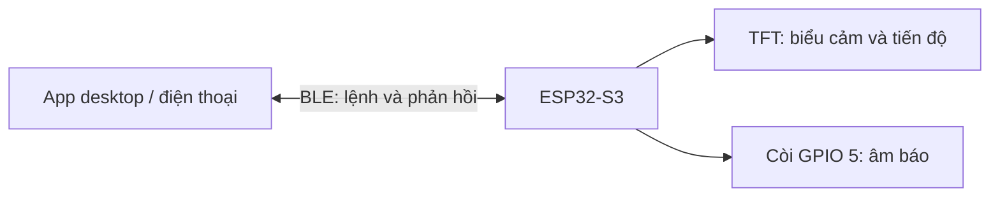

# Trợ lý VietOCR — ESP32-S3

**Hiện tại (03/11/2026): OV5640 autofocus, firmware `3.2.1-resume`.**
Tải JPEG có `Range`/`ETag`, có thể tải tiếp đúng ảnh nếu TCP gián đoạn.
Đã kiểm thử luồng desktop **BLE → UDP preview → ảnh 5 MP → nghỉ 13s → mở lại**
qua COM8 và LAN; xem [báo cáo](docs/validation/production-camera-2026-11-03/result.json).
Thanh ghi xác nhận native **2592×1944, increment 0x11/0x11, scaler tắt**.
Quy trình chụp mới chờ khóa AF và phơi sáng ổn định trước khi trả ảnh 5 MP.
Xem nghiên cứu, giới hạn và số đo thật trong [OCR_CAPTURE.md](docs/OCR_CAPTURE.md).
Camera tự vào standby sau 10 giây không preview/chụp, CPU hạ **160 MHz** khi nghỉ.
Không hạ 80 MHz ở bản này: đã gặp HTTP đứng sau khi chuyển về mức đó.
Khi tải ảnh, CPU giữ 240 MHz và Wi-Fi được ưu tiên; hết lượt tải tự trả về chế độ nghỉ.
Serial `POWER STATUS` đọc nhiệt độ trong chip/trạng thái nguồn. BLE giảm nhịp
khi không có dữ liệu; Wi-Fi giữ modem sleep và tự chọn TX theo RSSI.
Lưu tối đa 5 mạng/mật khẩu trong NVS, desktop đọc được danh sách qua BLE.
Serial `POWER SLEEP`
dừng camera/Wi-Fi/BLE và ngủ sâu đến khi nhấn **EN/RESET**; LED TFT nối 3V3 vẫn được cấp điện.
Chỉ còn profile **`esp32-s3-cam-ov5640`** trong PlatformIO. Preview mặc định
**640×480/QS18**, mục tiêu **15 FPS trở lên**, trần gửi 30 FPS; ảnh chụp **2592×1944/QS8**, không lấy
ảnh preview phóng lớn. Cùng bo N16R8 và dây TFT/còi hiện tại, không đổi GPIO.
Đã nạp qua **COM8** để kiểm tra. Hướng dẫn và số đo thực ở
[OV5640.md](docs/OV5640.md); phần OV3660 dưới đây giữ làm lịch sử.

```powershell
pio run -e esp32-s3-cam-ov5640
pio run -e esp32-s3-cam-ov5640 -t upload --upload-port COM8
pio device monitor --port COM8 --baud 115200
```

Preview **UDP đã đo 18,5–21,8 FPS tại máy nhận**, kể cả khi BLE cùng kết nối;
MJPEG qua TCP vẫn có để tương thích nhưng chậm hơn. Chạy công cụ xem IoT
`tools/camera_check.py --udp --show`. Đây là số đo trước trên hotspot; mạng/ánh sáng khác có thể chậm hơn.
Bản Android tương ứng: **2.0.0+15**, [Mobile](../Mobile/README.md).

Serial: `CAM OPEN`, `CAM CLOSE`, `CAM FOCUS`, `CAM AF STATUS`, `CAM CONFIG`,
`CAM SET preview_width 640`, `CAM SAVE`. Xem luồng HTTP và chụp kiểm tra bằng
`tools/camera_check.py` mà không cần chạy desktop/Android. Các bản build cũ
đã được dọn, mã nguồn và báo cáo cũ giữ lại; chi tiết `docs/ov5640-cleanup.json`.

## Lịch sử firmware trước OV5640

Firmware hiển thị trợ lý hoạt hình trên TFT ILI9341 320×240, giao diện sáng/tối,
thông báo tiếng Việt có dấu và âm báo qua GPIO 14 (profile camera), GPIO 5
(profile cũ). Thư viện VietMusic hỗ trợ
giai điệu trên còi passive; TMB12A05 active hiện có chỉ phát theo nhịp.
Có chớp mắt, thức dậy, nhận ảnh, đọc chữ, mặt vui khi hoàn tất và mặt báo lỗi.
Có thể điều khiển qua Bluetooth BLE bằng app desktop/điện thoại, hoặc Serial qua USB/UART.
ESP32 chụp JPEG gốc **2048×1536** từ OV3660 và gửi qua **Wi-Fi LAN**, OCR chạy offline trên Android/máy tính. BLE điều khiển trợ lý và cấu hình Wi-Fi. Chụp trong app cần HTTP camera hoạt động.

**Mới: OV3660 + N16R8.** Camera dùng profile riêng `esp32-s3-cam-ov3660`.
Firmware camera mới **`2.6.0-config`**; gửi `INFO` trong Serial/BLE để xác nhận.
Desktop: **Xem camera → Cấu hình camera**. Android **1.8.0+13**: biểu tượng
thanh trượt trong trang camera. Chỉnh preview/JPEG/FPS, màu sắc, ánh sáng và
hướng ảnh, rồi **Áp dụng**; tùy chọn nhớ lưu trong NVS `vietocr-camera/profile`
qua ngắt Bluetooth và mất điện. Có preset Mượt/Cân bằng/Chi tiết, Tải lại và
Mặc định. [Hướng dẫn/API](docs/CAMERA.md#cấu-hình-camera-trong-app).
Preview **640×480/QS16**, cùng cửa sổ cảm biến 4:3 với ảnh chụp
**2048×1536/QS4**. Hai framebuffer và bỏ giới hạn gửi 10 FPS; desktop hiển
thị FPS thực. Chọn **Lật ngang / Lật dọc** trong cửa sổ camera để đổi cả
preview lẫn JPEG chụp; hướng ảnh nằm cùng bản ghi NVS cấu hình camera.
Sau chuyển chế độ/hướng, bỏ hai frame đầu và kiểm tra timestamp/kích thước
JPEG để không đưa nhầm preview hoặc frame cũ vào OCR.
**2.6.0 chỉ build firmware và APK Android, chưa nạp/cài theo yêu cầu mới nhất;
chưa đo FPS trên bo hoặc kiểm tra thay đổi cảm biến bằng bản mới.**
15–30 FPS là mục tiêu, không phải kết quả đã đo. Không tắt modem sleep.

Kết quả phần cứng trước đó của 2.4.4 (preview 3 MP):
Đã kiểm tra trực tiếp COM8 và nhận/giải mã JPEG trên máy tính ngày 29/10/2026.
Thử đổi riêng mức nén xác nhận **QS=0/1 không có JPEG hoàn chỉnh; QS=2 vẫn
ngắt; QS=4 chạy được ở nguyên 2048×1536**. Lượt stream QS4 nhận 28 ảnh trong
125 giây, không lỗi giải mã hay khởi tạo lại camera (~0,22 FPS trên LAN hiện
tại). Xem [báo cáo camera](docs/camera-validation.json). `/health` và Serial
lấy mức JPEG từ cấu hình thực, không ghi cố định QS=0 nữa.

Từ 2.4.3:
Sửa quyền sở hữu GDMA: cấp kênh RX qua ESP-IDF, giữ clock trong suốt phiên
camera, nối đúng peripheral CAM và giải phóng sau khi đã gỡ ISR. Không dò
kênh trống bằng thanh ghi nữa. Serial có `CAMERA GDMA owned RX=...`.
Lượt này chỉ build profile camera; app desktop/Android dùng tiếp bản hiện có.
App tự đọc `WIFI STATUS` / `WIFI SAVED` sau BLE và mỗi 5 giây, hiển thị mạng
đã lưu cùng IP. Đọc trạng thái không quét mạng, không kết nối lại và không
ghi flash. `CAMERA INIT OK` chỉ xác nhận khởi tạo; `CAMERA FIRST JPEG` mới
xác nhận có ảnh. Lỗi camera có thêm `CAMERA DVP TIMEOUT` với bộ đếm VSYNC,
EOF, thiếu marker JPEG và tràn bộ đệm, không bị mức log mặc định che mất.
Từ 2.5.0 preview VGA và ảnh chụp 3 MP được chọn riêng; HAL camera cục bộ cấp
hai bộ đệm JPEG **2 MiB** thay vì khoảng 629 KB mặc định. Các bản sao preview
chỉ cấp theo độ dài JPEG thực để vừa PSRAM 8 MiB. `/health` trả kích thước
preview/still, QS từng chế độ, `mirror`, `flip`, `camera_status`, `jpeg_capacity`.
App xem ảnh vừa chụp 3 giây hoặc Bỏ qua, sau đó tự vào hàng đợi và trở lại
preview; cửa sổ camera chỉ đóng khi người dùng đóng. Từ 2.5.0 bỏ giới hạn
gửi 10 FPS; xem số đo thực trên giao diện và log, chưa cam kết FPS trên bo.
Sửa reset lặp đã xác nhận bằng Serial/backtrace của 2.3.1: bật
`WIFI_PS_MIN_MODEM` trước STA, bỏ `setSleep(false)` sau kết nối. Không tắt
modem sleep khi Wi-Fi/BLE chạy cùng Arduino core 2.0.14/IDF 4.4.
Không cần xóa Wi-Fi đã nhớ hay đổi dây. Khi boot có
`WIFI COEX power_save=MIN_MODEM rc=ESP_OK`. Bản 2.4.4 đã được nạp và kiểm tra qua COM8.
Mỗi lần **kết nối BLE**, ESP32 chủ động tìm SSID đã lưu và kết nối ngay,
không chờ người dùng mở Wi-Fi camera hoặc chờ hết thời gian retry. Kết nối
Wi-Fi đang hoạt động được giữ nguyên; lượt connect đang chạy tiếp tục chạy.
Mạng kết nối thành công được nhớ trong NVS `vietocr-wifi/profile`; bật nguồn
sẽ tự kết nối, mất mạng sẽ thử lại sau 3/6/12/24/60 giây, không cần mở app.
Cấu hình SSID/password cũ được đọc lại và tự chuyển sang bản ghi mới.
Wi-Fi/HTTP/NVS chạy task riêng; BLE và TFT không phải chờ connect hay stop HTTP.
`WIFI SAVED` kiểm tra có mạng lưu (không trả mật khẩu), `WIFI FORGET` xóa mạng.

Từ 2.2.1:
Sửa scan Wi-Fi khi mạng cũ không còn: hủy kết nối offline, tắt reconnect
trong lúc scan, đợi driver rồi thử tối đa ba lần. Quá hạn kết nối 25 giây
sẽ thực sự dừng driver connect; không xóa NVS/mật khẩu đã lưu. Trạng thái
OFFLINE bổ sung mã lý do ngắt mạng, Serial ghi từng lần thử scan.
Ở các bản 2.2–2.3 cũ, stream **320×240** chạy trên HTTP **:81/stream**;
ảnh chụp **2048×1536/quality6**, HTTP :80. Bản 2.4.1–2.4.3 thử 3 MP/QS0 nhưng
không xuất được JPEG hoàn chỉnh trên bo này; 2.4.4 dùng 3 MP/QS4. Hai server/task
riêng để stream không chặn chụp hay `/health`.
Serial ghi `WIFI MJPEG listening`, `first_frame_ms`, số khung và thời gian chụp/gửi.
Lỗi app báo `INVALID_COMMAND` khi Quét mạng đã xác nhận do bo chạy firmware
cũ. Đã nạp bản 2.0.1 vào COM8 và quét được mạng qua BLE ngày 27/10/2026;
bản mới chỉ build, chưa nạp theo lựa chọn người dùng.
Mặc định là `esp32-s3-cam-ov3660`, theo bộ dây mới người dùng xác nhận ngày 26/10.
Camera trùng GPIO với dây TFT/còi cũ: **phải chuyển dây trước khi nạp profile
camera**. Xem [bảng dây, cách chụp và giao thức ảnh](docs/CAMERA.md). Pinout đã
được người dùng kiểm tra ngày 26/10: OV3660 PID 0x3660, sáu JPEG giải mã đạt
qua hai biến thể PWDN. Profile chính giữ **PWDN=-1 / RESET=-1 / XCLK 20 MHz**.

TFT luôn hiển thị trợ lý, không hiển thị camera; góc nhìn camera nằm trong app.
SPI màn hình **40 MHz**, không chạy màn màu lúc khởi động. Nếu TFT trắng,
xem `FIRMWARE ...`/`TFT CONFIG ...` trong Serial và [cách kiểm tra TFT](docs/CAMERA.md#tft-trắng-sau-khi-chuyển-dây).
**SDO/MISO nay nối GPIO39**, tránh việc TFT_eSPI 2.5.43 tự ghép MISO vào MOSI
khi cấu hình -1 trên S3. GPIO13 đã dành cho PCLK camera.

## Kết nối Bluetooth BLE

ESP32-S3 hỗ trợ **Bluetooth Low Energy**, không hỗ trợ Bluetooth Classic/SPP
(`BluetoothSerial`), theo [tài liệu Espressif](https://docs.espressif.com/projects/esp-idf/en/stable/esp32s3/api-guides/bt-architecture/overview.html).
Firmware phát tên **VietOCR-Assistant**, dùng Nordic UART Service (NUS).
Kết nối điều khiển bằng cách quét/chọn BLE. Trong **Wi-Fi camera**, quét/chọn
mạng 2.4 GHz và nhập mật khẩu để ESP32 vào mạng. Máy tính/điện thoại cần cùng
LAN; IP/token camera được app lấy qua BLE, không cần nhập IP.



1. **Build và Upload firmware mới** trong thư mục `pbl4` bằng PlatformIO.
   Màn hình hiện `BLE` / `Cho ket noi`; Serial Monitor 115200 in
   `BLE READY name=VietOCR-Assistant service=6e400001-b5a3-f393-e0a9-e50e24dcca9e`.
2. Từ thư mục `VietHandOCR_API_Release`, cập nhật thư viện và chạy app:

   ```powershell
   .\.venv\Scripts\python.exe -m pip install -r requirements.txt
   .\.venv\Scripts\python.exe -X utf8 app.py
   ```

3. Bấm **Kết nối ESP32** → **Bật Bluetooth** → chọn **VietOCR-Assistant** sau khi
   quét → **Kết nối**. Chờ **Đã kết nối BLE** rồi bấm **Thử còi**.
   Nếu Bluetooth đã bật, có thể dùng **Quét Bluetooth** trực tiếp.
   Trên Windows, app yêu cầu quyền khi cần và kiểm tra bộ thu đã bật; nếu Windows
   từ chối hoặc không tìm thấy bộ thu, app mở Cài đặt để bạn kiểm tra/bật thủ công.
   Máy tính cần Bluetooth hỗ trợ BLE; nút bật không hoạt động trên mọi hệ thống.
4. Mở góc nhìn camera trên TFT rồi **Chụp OV3660** trong app; Android còn có
   camera/thư viện điện thoại. Ảnh tự vào hàng đợi OCR tuần tự không giới hạn 10 ảnh.
   Thiết bị sẽ thức dậy, nhận ảnh,
   hiển thị tiến độ, mặt vui khi hoàn tất và ngủ khi đóng/ngắt app.
5. Để thử bằng điện thoại ngay, dùng **nRF Connect for Mobile** theo
   [hướng dẫn điện thoại và giao thức BLE](docs/BLE_PROTOCOL.md).
   App OCR Android offline nằm trong [Mobile](../Mobile/README.md).

App lưu thiết bị đã chọn cùng theme trong `.desktop-preferences.json` và tự kết
nối ở lần mở sau. **Ngắt kết nối** xóa thiết bị đã lưu; đóng app giữ lựa chọn đó.
Các địa chỉ IP từ phiên bản Wi-Fi cũ không dùng để tự kết nối BLE.
Firmware không đọc cấu hình Wi-Fi.

App desktop và Android gửi `THEME DARK` / `THEME LIGHT` khi kết nối hoặc đổi nền.
Nạp lại firmware mới để bật đồng bộ này. Đổi theme giữ nguyên biểu cảm, tiến độ
và âm báo đang chạy; nền TFT mặc định tối khi khởi động. App vẫn kết nối với
firmware cũ nhưng sẽ nhắc cập nhật nếu lệnh THEME bị từ chối.

Một thiết bị điều khiển tại một thời điểm: ngắt desktop trước khi kết nối điện
thoại và ngược lại. App gửi `PING` mỗi 4 giây; ESP32 ngủ khi BLE ngắt hoặc không
nhận lệnh hoàn chỉnh trong **60 giây**, rồi phát quảng bá để kết nối lại.
Khi kết nối lại, app khôi phục trạng thái hiện tại; cập nhật tiến độ được gộp,
các lần đổi trạng thái khi online được gửi theo thứ tự.

BLE truyền lệnh nhỏ như `RECEIVED 3`, `PROCESS`, `DONE` và JPEG qua characteristic
ảnh riêng. Model OCR nằm ở máy nhận. Profile camera đổi dây TFT/còi theo
[bảng cấu hình mới](docs/CAMERA.md#board-và-dây-nối).

Nếu chưa kết nối được:

- Nạp lại firmware BLE mới, cấp nguồn ESP32, đưa thiết bị lại gần máy tính/điện thoại.
- Bật Bluetooth và cấp quyền Bluetooth/Thiết bị ở gần khi hệ điều hành yêu cầu.
- Ngắt nRF Connect hoặc app khác đang giữ kết nối, rồi quét lại. Khi đang kết nối,
  ESP32 ngừng quảng bá nên không xuất hiện trong lượt quét của app khác.
- Kết nối trong app BLE; không dùng app terminal chỉ hỗ trợ Bluetooth Classic.
- Nếu từng nạp firmware BLE khác, xóa kết nối/ghép đôi cũ trong hệ điều hành nếu có,
  khởi động lại ESP32 và quét lại để cập nhật dịch vụ GATT.
- Serial vẫn dùng song song để kiểm tra; tránh gửi lệnh đổi trạng thái bằng Serial
  khi app đang nhận diện.

## Đấu màn hình

Các chân bên dưới dành cho **profile cũ `esp32-s3-devkitc-1`, camera tắt**.
Với OV3660 dùng bảng trong [CAMERA.md](docs/CAMERA.md), không dùng dây cũ:

| Chân TFT | ESP32-S3 |
| --- | --- |
| VCC | 3V3 |
| GND | GND |
| CS | GPIO 10 |
| RESET | GPIO 8 |
| DC | GPIO 9 |
| SDI / MOSI | GPIO 11 |
| SCK | GPIO 12 |
| LED | 3V3 |
| SDO / MISO | GPIO 13, có thể bỏ nếu chỉ xuất hình |

Màn hình mặc định nằm ngang (`kDisplayRotation = 1`). Nếu ngược chiều, đổi thành
`3` trong `include/assistant_config.h`. Nếu màu hiển thị bị đảo, thử thay
`kInvertDisplay`. Firmware dùng driver **ILI9341** theo cấu hình có sẵn;
nếu module thực tế dùng driver khác thì cần đổi driver tương ứng.

## Đấu còi

TMB12A05 là **còi active điện từ**, có bộ dao động bên trong: cấp DC là kêu.
Mặc định firmware bật/tắt GPIO theo nhịp bản nhạc; còi này không đổi đúng cao độ
Đô/Rê/Mi bằng phần mềm. Muốn nghe giai điệu nhiều cao độ, thay bằng **còi passive**
với mạch điều khiển phù hợp rồi đặt `kBuzzerMode = vietmusic::OutputMode::PassiveBuzzer`
trong `include/assistant_config.h`. Chế độ này dùng PWM LEDC, không chặn BLE/màn hình.
Xem [VietMusic: bảng nốt, thêm bài và lệnh MUSIC](lib/VietMusic/README.md).
Còi không đọc được câu nói; muốn phát giọng nói cần mạch âm thanh và loa.

Theo [datasheet TMB12A05 của nhà sản xuất](https://datasheet.lcsc.com/datasheet/pdf/2a16321f74deffcaef3942d9437fae37.pdf?productCode=C96093),
điện áp định mức là 5V, dòng hoạt động tới 30mA. Với còi hai chân bạn đang nối
trực tiếp GPIO 5 và GND, nên chuyển sang mạch transistor sau để GPIO chỉ điều khiển,
còi lấy nguồn 5V riêng. Giữ **GND nguồn 5V và GND ESP32 nối chung**.

```text
5V ---------------------- (+) TMB12A05
                               (-) ------------- C (collector)
                                                 Q1: NPN 2N2222 / BC337
GPIO 5 ---- R1 1kΩ ----+------------------------- B (base)
                      |                          E (emitter)
                    R2 10kΩ                      |
                      |                          |
GND chung ------------+--------------------------+

D1: mắc song song với còi, cathode (đầu có vạch) về 5V,
    anode về collector. Có thể dùng diode 1N4148 / 1N400x.
```

Tra đúng chân B/C/E của transistor bạn mua; vị trí chân phụ thuộc loại/vỏ.
GPIO 5 HIGH bật còi, LOW tắt còi. Không nối 5V vào GPIO.
Nếu dùng module còi có chân điều khiển riêng, kiểm tra mức kích hoạt của module
và chỉnh `kBuzzerActiveHigh` nếu cần.

## Build, nạp và chạy thử

Mở thư mục `pbl4` bằng VS Code + PlatformIO, dùng **Build** rồi **Upload**.
Hoặc chạy từ thư mục gốc repository:

```powershell
pio run -d pbl4
pio run -d pbl4 -t upload --upload-port COM7
pio device monitor -p COM7 -b 115200 --echo --filter send_on_enter --eol LF
```

Đổi `COM7` thành cổng của board. Cấu hình hiện tại giữ nguyên giả định của dự án:
**flash 16MB, PSRAM octal (`qio_opi`)**. Kiểm tra mã module của bạn, ví dụ N16R8;
nếu dùng bản bộ nhớ khác thì sửa các tùy chọn flash/PSRAM trước khi nạp.
Serial mặc định qua UART bridge (`ARDUINO_USB_CDC_ON_BOOT=0`);
dùng cổng USB-UART của board. Với board chỉ có USB native, cần cấu hình lại CDC
cho đúng phần cứng.

Trong Serial Monitor, gửi **`DEMO` rồi xuống dòng** để chạy một vòng:

```text
Thức → Đã nhận 3 ảnh → Đang đọc chữ → Hoàn tất → Chờ → Ngủ
```

Baud **115200**, mỗi lệnh ASCII kết thúc bằng **LF hoặc CRLF**. Nếu công cụ
có lựa chọn line ending, chọn một trong hai. Gửi `STOP` để dừng demo và tắt còi
ngay ở vòng xử lý kế tiếp. Khi khởi động, trợ lý ngủ và còi im lặng.
Muốn tự chạy demo lúc bật nguồn, đặt `kDemoOnBoot = true` trong file cấu hình.
Không cần **Upload Filesystem Image**: hình mặt và chữ đã nhúng trong firmware.
Các tệp video/ảnh thử nghiệm cũ vẫn được giữ trong repository nhưng không được đọc.

## Lệnh điều khiển

Không phân biệt chữ hoa/thường. Lệnh đổi trạng thái sẽ dừng demo đang chạy.

| Lệnh | Hành vi |
| --- | --- |
| `WAKE` | Thức dậy, cue tăng dần; sau 1,6 giây chuyển sang chờ |
| `RECEIVED` / `RECEIVED 3` | Đã nhận ảnh, cue ngắn; số ảnh từ 1 đến 2147483647, mặc định 1 |
| `PROCESS` | Đọc chữ, cue xử lý, thanh chờ chuyển động |
| `PROGRESS 45` | Cập nhật phần trăm 0–100; chỉ chấp nhận khi đang xử lý |
| `DONE` | Mặt vui, cue hoàn tất; sau 3,5 giây chuyển sang chờ ảnh tiếp |
| `ERROR` | Mặt báo lỗi, cue hạ dần; chờ lệnh tiếp theo |
| `SLEEP` | Nhắm mắt, cue ngủ; giữ khả năng nhận lệnh BLE/Serial |
| `DEMO` | Chạy một vòng minh họa, khoảng 14,7 giây |
| `STOP` | Hủy demo, chuyển sang ngủ, ngắt tiếng ngay |
| `MUTE ON` / `MUTE OFF` | Tắt/bật âm báo; tắt âm ngắt cả nhịp đang phát |
| `BEEP` | Phát cue TEST; giữ nguyên lệnh/ACK cho app cũ, tuân theo mute |
| `MUSIC LIST` | Liệt kê các bài có sẵn |
| `MUSIC SCALE` / `MUSIC TWINKLE` | Phát bài mẫu; không đổi trạng thái trợ lý |
| `MUSIC COIN` / `MUSIC JUMP` / `MUSIC POWERUP` / `MUSIC WIN` / `MUSIC HURT` | Hiệu ứng arcade nhặt xu, nhảy, tăng sức mạnh, thắng và trúng đòn |
| `MUSIC WAKE` / `RECEIVED` / `PROCESS` / `DONE` / `ERROR` / `SLEEP` / `TEST` | Thử cue tương ứng, mỗi tên đều cần tiền tố MUSIC |
| `MUSIC STOP` | Dừng nhạc, giữ trạng thái/demo |
| `THEME DARK` / `THEME LIGHT` | Đổi nền TFT; giữ trạng thái, tiến độ, demo và còi |
| `STATUS` | Trả trạng thái, phần trăm, ảnh, mute, demo, theme và thông tin nhạc |
| `PING` | Trả `PONG` |
| `HELP` | In danh sách lệnh |

App desktop và [Flutter mobile](../Mobile/README.md) dùng cùng luồng lệnh:

```text
WAKE
THEME DARK
RECEIVED 3
PROCESS
PROGRESS 40
PROGRESS 80
DONE
SLEEP
```

Gửi `WAKE` khi mở app; `RECEIVED n` sau khi app đã nhận ảnh;
`PROCESS` khi bắt đầu OCR; `DONE` sau khi OCR thành công, hoặc `ERROR` khi thất bại;
`SLEEP` khi đóng app. `PROGRESS` là tùy chọn: nếu model không cung cấp tiến độ,
chỉ gửi `PROCESS` và để thanh chờ chuyển động. **100% không tự kích hoạt `DONE`.**
Số ảnh trong `RECEIVED` là thông tin hiển thị. Firmware camera chụp và giữ một
JPEG để app nhận qua characteristic ảnh; hàng đợi OCR nằm ở máy nhận và không
còn giới hạn 10 ảnh. Chi tiết `CAM ...` và CRC32 nằm trong [CAMERA.md](docs/CAMERA.md).

Mỗi lệnh hợp lệ trả `OK ...` (hoặc kết quả truy vấn), lệnh sai trả `ERR ...`.
Riêng Serial, mỗi lần đổi trạng thái còn phát một dòng `STATE ...` để theo dõi;
client Serial cần đọc cả các dòng thông báo này, không giả định dòng đầu tiên luôn
là `OK`. BLE chỉ trả phản hồi lệnh qua TX Notify, không gửi dòng chào khi kết nối.
Ví dụ kết quả `STATUS`:

```text
STATUS {"state":"processing","progress":45,"images":3,"muted":false,"demo":false,"theme":"dark","audio":"active","music":false,"note_hz":0}
```

Lệnh dài tối đa 79 ký tự; dòng quá dài hoặc chứa byte không hợp lệ bị bỏ cả dòng,
sau đó bộ nhận phục hồi ở dòng kế tiếp. Chỉ DEMO giả lập tiến độ tự động;
ở chế độ thường, nhận ảnh và xử lý giữ nguyên cho tới lệnh từ app.

## Cấu trúc và kiểm tra

- `src/main.cpp`: lệnh BLE/Serial, điều phối trạng thái và GPIO 5.
- `src/assistant_bluetooth.cpp`: BLE GATT/NUS, hàng đợi nhận/gửi, quảng bá lại và ngủ khi ngắt app.
- `docs/BLE_PROTOCOL.md`: UUID, cách thử bằng điện thoại và tích hợp bản mobile.
- `src/assistant_display.cpp`: vẽ mặt hoạt hình, thanh tiến độ, hai bảng màu sáng/tối.
- `include/assistant_config.h`: chân còi, âm báo, xoay màn hình, tên/UUID BLE và timeout.
- `src/assistant_logic.cpp`: logic thuần C++ cho lệnh, bộ đếm thời gian và trạng thái.
- `lib/VietMusic`: nốt Hz, score/BPM, player không chặn và đầu ra GPIO/LEDC.
- `include/assistant_labels.h`: bitmap chữ tiếng Việt, đọc từ flash.
- `tools/generate_labels.py`: sửa câu chữ và tạo lại bitmap bằng Python + Pillow.
- `test/test_assistant_logic.cpp`: kiểm tra logic trên máy tính, không cần ESP32.
- `test/test_music.cpp`, `test/test_music_output.cpp`: kiểm tra nhạc và đầu ra active/passive.

Animation và các nhịp còi dùng `millis()`, không chờ bằng `delay()` dài.
Vùng mặt dùng sprite 16-bit; nếu thiếu RAM thì thử 8-bit, sau đó vẽ trực tiếp.
Đồng hồ vẫn hoạt động đúng khi `millis()` tràn. Trạng thái ngủ chỉ là biểu cảm;
board vẫn chạy, và đèn nền vẫn sáng vì LED màn hình nối cố định 3V3.

Kiểm tra logic, nhạc và đầu ra GPIO/LEDC bằng g++ từ thư mục gốc repository:

```powershell
powershell -ExecutionPolicy Bypass -File pbl4/tools/test_host.ps1
```

Khi sửa câu tiếng Việt, cài Pillow vào môi trường Python của bạn rồi chạy:

```powershell
python pbl4/tools/generate_labels.py
```

Windows dùng Segoe UI có sẵn. Hệ điều hành khác có thể truyền `--regular` và
`--bold` trỏ tới font có tiếng Việt. Build firmware không cần Python/Pillow này.
